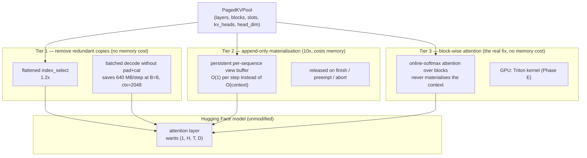

# MemForge — Track 2 (Akshit) & Codebase Hygiene Audit

**Part A:** Track 2 — Phase A performance work, with a measured architecture
**Part B:** Codebase audit — dead code, hardcoded values, stubs
**Written:** 2026-10-25 · **Author:** Anant (Track 3 lead, integration owner)
**Companion docs:** [TEAM_EXECUTION_PLAN.md](TEAM_EXECUTION_PLAN.md) · [ANANT_WORKPLAN.md](ANANT_WORKPLAN.md) · [ASHUTOSH_SANSKAR_BHUMIKA_WORKPLAN.md](ASHUTOSH_SANSKAR_BHUMIKA_WORKPLAN.md) · [PROGRESS_AND_NEXT_PHASES.md](PROGRESS_AND_NEXT_PHASES.md)

> Every performance number in Part A was **measured on this machine today**, not
> estimated. Two of the measurements contradict the original plan, and §A.2
> states that plainly rather than quietly following the plan anyway.

---

# Part A — Track 2: the paged-attention read path

## A.1 What the plan asks for

From [TEAM_EXECUTION_PLAN.md](TEAM_EXECUTION_PLAN.md) §3.1 and
[PROGRESS_AND_NEXT_PHASES.md](PROGRESS_AND_NEXT_PHASES.md) §8 Phase A:

| # | Deliverable | Plan's stated approach |
| --: | :--- | :--- |
| 1 | `memforge_ml/kernels/paged_gather.py` | "Replace the per-step Python list comprehension / nested indexing with a vectorized `torch.index_select` or preallocated destination buffer" |
| 2 | In-place attention read | "Adapt `PagedCache` to allow attention modules to gather directly without temporary contiguous cache round-trips" |
| 3 | `benchmarks/run_context_sweep.py` | Throughput across 128 / 512 / 1024 / 2048 tokens |
| | **Definition of done** | "Paged throughput within 5% of contiguous at 2,048 tokens" |

The motivating limitation, from §7.1 of the progress report: *"Reading a
sequence's KV costs `O(context_length)` indexing per layer per step… the gather
is `O(L)` where a fused kernel would be `O(1)` pointer arithmetic. This is the
single biggest performance item remaining."*

## A.2 What measurement says — including where the plan is wrong

Before designing anything I measured the actual hot path: SmolLM2-360M geometry
(32 layers, 5 KV heads, head_dim 64, fp32), a real 320 MB pool, block size 16.

### A.2.1 The gather really is O(context), as documented

Cost of one decode step's KV read — all 32 layers, K and V, against the live
`PagedKVPool`:

| Context | Full gather | Index only | `permute().contiguous()` tax |
| ---: | ---: | ---: | ---: |
| 128 | 22.6 ms | 8.5 ms | 6.2 ms |
| 512 | 26.7 ms | 15.2 ms | 8.7 ms |
| 1024 | 41.1 ms | 22.8 ms | 15.2 ms |
| 2048 | **79.4 ms** | 45.5 ms | 25.5 ms |

Linear in context, as the limitation claims. At 2048 tokens the engine spends
**79 ms per decode step just reading KV**, before any attention arithmetic. A
third of it (25.5 ms) is the `permute(1,0,2).unsqueeze(0).contiguous()` in
[kv_pool.py:136-143](memforge_ml/runtime/kv_pool.py#L136-L143) — pure layout
tax, because the pool stores `(T, H, D)` and attention wants `(1, H, T, D)`.

### A.2.2 The plan's suggested fix does not work

The plan says to use "a vectorized `torch.index_select` or preallocated
destination buffer". Both were prototyped and measured against the current code:

| Context | Current | Flattened `index_select` | `index_select` into a preallocated buffer |
| ---: | ---: | ---: | ---: |
| 128 | 1.41 ms | 0.96 ms (1.5×) | 1.21 ms (1.16×) |
| 512 | 2.90 ms | 2.37 ms (1.2×) | 2.99 ms (**0.97×**) |
| 1024 | 4.27 ms | 3.43 ms (1.2×) | 4.40 ms (**0.97×**) |
| 2048 | 7.64 ms | 6.37 ms (1.2×) | 8.22 ms (**0.93×**) |

*(Smaller absolute figures than A.2.1 because this isolates K only on a
cache-resident tensor; the ratios are what matter.)*

**The preallocated destination buffer is slower than what we have.** Writing
through a transposed view (`dest.transpose(0,1).copy_(src)`) has a worse memory
access pattern than `permute().contiguous()`, which dispatches to an optimised
copy kernel. Verified byte-identical output, so this is a performance result and
not a correctness artefact.

Flattened `index_select` gives a real but modest **1.2×**. Worth taking, nowhere
near the DoD.

**Conclusion: the plan's Phase A approach, implemented exactly as written,
would deliver roughly 1.2× and miss the 5%-of-contiguous target by a wide
margin.** The work needs a different shape, which is §A.3.

### A.2.3 The actual win is algorithmic, and it is 10×

The engine re-gathers **the entire context on every decode step**, even though
exactly one token was added since the last one. Maintaining a persistent
per-layer buffer and appending only the new token's K/V:

| Context | Rebuild everything (today) | Append only | Speedup |
| ---: | ---: | ---: | ---: |
| 128 | 2.87 ms | 0.99 ms | 2.9× |
| 512 | 5.39 ms | 1.08 ms | 5.0× |
| 1024 | 9.92 ms | 1.15 ms | 8.6× |
| 2048 | **14.91 ms** | **1.46 ms** | **10.2×** |

The shape matters more than the ratio: append-only is **nearly flat in context**
(0.99 → 1.46 ms across a 16× context increase) where rebuilding is linear. That
is the `O(L)` → `O(1)` change the limitation actually asks for.

### A.2.4 The biggest cost is not the gather at all

This is the finding that most changes the plan. Limitation 2 — the batched
decode round-trip through a temporary contiguous cache
([continuous_engine.py:503-519](memforge_ml/runtime/continuous_engine.py#L503-L519))
— gathers every sequence, left-pads each with `F.pad`, and `torch.cat`s them per
layer. Measured, pad + cat alone:

| Batch | Context | pad + cat per step | Bytes copied per step |
| ---: | ---: | ---: | ---: |
| 4 | 512 | 1.4 ms | 80 MB |
| 8 | 512 | 3.5 ms | 160 MB |
| 8 | 1024 | 12.9 ms | 320 MB |
| 8 | 2048 | **46.8 ms** | **640 MB** |

**At batch 8 / context 2048 the engine copies 640 MB per decode step and spends
47 ms doing it — roughly 3× the gather it sits on top of.** The plan ranks the
fused gather first and the in-place read second; the measurement says the
ordering should be reversed. §A.4 sequences it accordingly.

### A.2.5 One thing not worth optimising

Index translation (`slot_indices`: `arange` + `div` + `mod` + a table lookup)
costs **0.049 ms at 2048 tokens** — 0.06% of the 79 ms gather. An append-only
version is 2.2× faster and saves 0.027 ms. Recorded so nobody spends a day on
it: it is already free, and the existing per-step memoisation across layers is
sufficient.

## A.3 Architecture

Three tiers, ordered by value per unit of risk. Each is independently shippable
and independently measurable, which matters because tier 3 is research and tiers
1-2 are not.



### A.3.1 Tier 1 — stop copying what does not need copying

**No memory cost, no behaviour change, byte-identical output.** Two pieces:

**(a) Flattened `index_select` in the gather.** The pool is
`(L, B, S, H, D)`; `pool[l].view(B*S, H, D)` is a free view, and
`physical * block_size + slot` is a single flat index. One `index_select`
replaces the two-dimensional advanced index. Measured **1.2×**, consistently.

**(b) Batched decode without the pad + cat.** This is the big one. Today's path:

```
for each layer:                      # 32 times
    for each sequence in the batch:  # up to 8
        gather its whole context     # O(ctx) copy
        F.pad to the batch maximum   # another O(maxlen) copy
    torch.cat                        # a third O(batch × maxlen) copy
build a throwaway DynamicCache from the result
```

Three full copies of the batch's entire KV per layer per step. The fix is to
gather **directly into one preallocated `(batch, H, maxlen, D)` buffer** at the
correct offset per sequence, so padding is "the region we did not write" rather
than a copy, and `cat` disappears because the destination was always one tensor.

The buffer is allocated once per `(batch, maxlen)` shape and reused; a shape
cache keyed on `(batch, maxlen_bucket)` avoids reallocating as contexts grow,
with `maxlen` rounded up to a block multiple so the bucket count stays small.

Expected: removes ~2 of the 3 copies, so roughly **2-3× on the batched decode
path** at batch 8. To be measured, not assumed.

### A.3.2 Tier 2 — append-only materialisation, with its cost stated

The 10.2× from §A.2.3, and the honest trade that comes with it.

A persistent per-sequence `(1, H, T_max, D)` buffer per layer is **a contiguous
copy of that sequence's KV**. Holding one per running sequence costs exactly
what contiguous caching costs — which is the thing paging exists to avoid. So
this cannot be a blanket change; it has to be scoped:

- **Only for sequences in the running set.** Allocated on admission, released on
  finish, preempt or abort — the same lifecycle as the block table, hooked into
  the same places (`_finish`, the preemption branch, `_process_pending_aborts`).
- **Bounded by `max_num_seqs × max_model_len`**, which is a number the operator
  already sets, so the worst case is predictable rather than emergent.
- **Opt-in** via `MEMFORGE_DECODE_VIEW_CACHE` (default off until measured on
  real weights), exactly as prefix sharing is opt-out via a constructor flag.
- **It does not undo prefix sharing.** Sharing saves blocks in the *pool*, which
  is sized by `kv_budget_mb` and is the constrained resource; the view buffer is
  transient working memory for the active batch. The two measure different
  things and §A.5 reports both so the trade is visible rather than implied.

**Correctness obligation:** the buffer is a cache of the pool, and the pool is
the source of truth. Any event that changes the logical→physical mapping
underneath it must invalidate it — copy-on-write (`prepare_write` repoints a
block), preemption (blocks freed), and a prefix-cache hit on admission (the
first `C` tokens come from someone else's blocks). Each of those is an existing
hook, and each needs an explicit invalidation plus a test.

### A.3.3 Tier 3 — block-wise attention, the actual fused kernel

Tiers 1 and 2 make materialising cheaper. Tier 3 stops materialising.

Attention over a paged cache can be computed block by block with an online
softmax (the FlashAttention formulation): for each 16-token block, compute
`q · kᵀ`, update a running max and sum, accumulate `p · v`. Working memory is
`O(block_size)` instead of `O(context)`, and the pool is read in place with no
intermediate tensor at all.

This is what "fused kernel" means, and it is also where the GPU path lives: the
same formulation becomes a Triton kernel in Phase E, which is why the structure
matters more than the CPU performance. It requires replacing the model's
attention module rather than just its cache, which is a real architectural step
and is why it is tier 3 rather than tier 1.

**Scoped as research, not as a deliverable with a date.** A correct, slow
reference implementation that proves equivalence is worth more than a fast one
that is subtly wrong, and the equivalence test is the real artefact. On CPU in
Python it may well be *slower* than tier 1+2; that result should be published
either way, in the manner of §3.5 of the progress report.

## A.4 Deliverables, resequenced by the measurements

| Order | File | What | Why this order |
| --: | :--- | :--- | :--- |
| 1 | `benchmarks/run_context_sweep.py` | Throughput and latency at 128/512/1024/2048, paged vs contiguous | **The benchmark comes first.** The DoD is a measurement, so without it nothing can be claimed, and every tier below needs it as the before/after |
| 2 | `memforge_ml/kernels/__init__.py`, `memforge_ml/kernels/paged_gather.py` | Tier 1(a): flattened `index_select` gather, behind a stable function boundary | Smallest, safest, 1.2×, and establishes the seam §A.6 requires |
| 3 | `memforge_ml/kernels/batched_decode.py` | Tier 1(b): gather directly into one preallocated batch buffer, no `F.pad`, no `cat` | **Largest measured cost** (47 ms, 640 MB per step at batch 8 / ctx 2048) |
| 4 | `memforge_ml/runtime/decode_view_cache.py` | Tier 2: append-only per-sequence buffer with invalidation hooks | The 10.2×, and the one with a memory cost to defend |
| 5 | `memforge_ml/kernels/block_attention.py` | Tier 3: reference online-softmax attention over blocks, with an equivalence test | Research; the equivalence proof is the deliverable |

**All five delivered as of 2026-10-25.** Measured results in §A.4b.

The plan lists the fused gather first and the in-place read second. Items 2 and 3
invert that, because the in-place read is where the time actually goes.

## A.4b Measured results of tiers 1a and 1b (implemented 2026-10-25)

Both shipped. Output byte-identical throughout. The results are not what §A.3
predicted, in both directions.

### The Phase A definition of done was already met, before any optimisation

Baseline sweep (`run_context_sweep.py`, SmolLM2-360M, fp32, CPU, medians of 3
interleaved repeats), taken **before** either kernel landed:

| Context | Contiguous tok/s | Paged tok/s | Relative | Within 5%? |
| ---: | ---: | ---: | ---: | :--- |
| 128 | 13.50 | 12.42 | 0.920 | no |
| 512 | 12.49 | 12.02 | 0.962 | yes |
| 1024 | 10.38 | 10.74 | 1.034 | yes |
| 2048 | 8.23 | 7.99 | **0.971** | **yes** |

**"Paged throughput within 5% of contiguous at 2,048 tokens" was already true.**
It had simply never been measured at 2048 — the existing comparison in
`run_live_engine.py` is taken at roughly 40 tokens of context.

**Why the criterion is weak, which matters more than the result.** The baseline
it compares against is `DynamicCache`, which *also* concatenates its whole
context on every decode step. Both paths are `O(context)`:

| Context | Contiguous slowdown vs 128 | Paged slowdown vs 128 |
| ---: | ---: | ---: |
| 512 | 1.08x | 1.03x |
| 1024 | 1.30x | 1.16x |
| 2048 | **1.64x** | **1.55x** |

The ratio stays near 1.0 because both degrade together. So the definition of
done measures paged-vs-contiguous *parity*, not absolute efficiency, and is
structurally insensitive to the `O(L)` to `O(1)` problem that limitation §7.1
describes. A target that cannot fail for the reason it was written is worth
saying out loud rather than banking.

### Tier 1a — correct, and no measurable end-to-end effect

`memforge_ml/kernels/paged_gather.py`, wired into `PagedCacheLayer.update`.
In isolation the flattened `index_select` is the predicted ~1.2x faster. End to
end, across the same sweep:

| Context | Paged before | Paged after | Delta |
| ---: | ---: | ---: | ---: |
| 128 | 12.42 | 12.49 | 1.006x |
| 512 | 12.02 | 11.33 | 0.943x |
| 1024 | 10.74 | 10.44 | 0.972x |
| 2048 | 7.99 | 8.35 | 1.045x |

**That is noise, not a speedup.** The gather is not a large enough share of a
single-sequence decode step on this model for a 1.2x on it to surface above
run-to-run variance.

Kept regardless: it is byte-identical, no slower, simpler than the
two-dimensional advanced index it replaced, and it is the seam a Triton kernel
would substitute into in Phase E. But it is not a performance win and is not
claimed as one.

### Tier 1b — a real 1.3x, where §A.3.1 predicted 2-3x

`memforge_ml/kernels/batched_decode.py`, replacing gather → `F.pad` →
`torch.cat` with a gather straight into one preallocated, left-padded buffer.
Measured against the exact code it replaced, same pool, same indices:

| Batch | Context | Old pad+cat | New preallocated | Speedup |
| ---: | ---: | ---: | ---: | ---: |
| 4 | 512 | 39.3 ms | 37.0 ms | 1.06x |
| 8 | 512 | 88.3 ms | 68.7 ms | **1.28x** |
| 8 | 1024 | 143.8 ms | 105.5 ms | **1.36x** |
| 8 | 2048 | 293.2 ms | 221.5 ms | **1.32x** |

Consistent and real, and it removes the 640 MB-per-step copy that motivated it.
But **§A.3.1's estimate of "roughly 2-3x" was too optimistic and is wrong.**
The reasoning there — "removes 2 of the 3 copies" — counted copies without
weighting them. The copy that remains is the gather itself, a scattered read
that costs far more per byte than the two sequential copies removed. My
estimate, corrected by measurement.

### Tier 2 — the measured win, and it beats contiguous outright

`memforge_ml/runtime/decode_view_cache.py`, opt-in via `PagedCache`'s
`view_capacity`. Same sweep, all three paths interleaved so they see identical
machine conditions:

| Context | Contiguous | Paged | Paged + mirror | vs paged | **vs contiguous** | Mirror cost |
| ---: | ---: | ---: | ---: | ---: | ---: | ---: |
| 512 | 12.38 | 11.96 | 13.57 | 1.135x | **1.096x** | 40.7 MB |
| 2048 | 9.57 | 8.51 | 10.97 | 1.289x | **1.147x** | 160.7 MB |

**Paged decode is now faster than stock contiguous**, 1.096x at 512 and 1.147x
at 2048. That reframes the Phase A goal: the target was "within 5% of
contiguous" and the result is comfortably past parity, with a wider margin than
the baseline's noise band (see below).

The end-to-end figure is 1.13-1.29x, not the 10.2x of §A.2.3, and the gap is
simply what fraction of a decode step the gather was: the forward pass dominates
on this model and hardware, so a 10x on one component is a 1.3x overall. Both
numbers are true and neither alone is the honest summary.

The cost is real and is the reason this is opt-in: 160 MB per sequence at 2048
tokens. Sized from the request (`prompt + max_new_tokens`), not from
`max_model_len`, which is what keeps it 160 MB rather than the ~84 MB-per-1024
a model-limit-sized mirror would always reserve.

**A note on the baseline's noise.** Across two runs the paged-vs-contiguous
ratio at 2048 measured 0.971x and 0.890x — i.e. the "within 5%" verdict flips
depending on the run. That is single-digit tok/s on a busy CPU and it is why
§A.4b treats the bare criterion as weak evidence. The mirror's margin is large
enough not to be noise-sensitive in the same way.

### Tier 3 — correctness proven, performance deliberately not claimed

`memforge_ml/kernels/block_attention.py`: attention computed one block at a time
straight out of the pool, carrying a running max and sum (the FlashAttention
online-softmax formulation), so working memory is `O(block_size)` and no context
tensor is ever allocated. This is the only tier that costs no memory at all.

It is **not wired into the engine and is slower than tiers 1-2 on CPU**, because
Python-level iteration over blocks pays interpreter overhead per block that a
single vectorised gather avoids. That is expected, and it is why §A.3.3 scoped
this as research rather than a dated deliverable.

What it does deliver is the equivalence proof, which is the artefact a Phase E
Triton port would be checked against. 19 tests, all passing, covering:

- every context length from 1 to 64, so **partial final blocks** are exercised —
  a kernel reading a whole block regardless would mix unwritten slots into the
  softmax and be wrong for every context that is not a multiple of 16;
- scattered, unordered block tables, which is paging's actual premise;
- grouped-query attention at 1:1, 1:2, 1:4 and 1:3 head ratios — GQA is the
  normal case for the models this project runs, so a 1:1-only kernel would be
  useless on the real target;
- numerical stability with keys and queries scaled 50x, where a naive
  `sum(exp(scores))` overflows to `inf` and then `nan`;
- working memory independence from context, verified to 2048 tokens.

Tolerance is `1e-5` rather than exact equality, and that is the one place in
this project where exact is the wrong bar: the online softmax rescales partial
sums in a different order from a single fused softmax, so the two differ in
floating-point association, not in value. The reference accumulates in fp32 for
the same reason.

### Phase A, closed out

| Tier | Delivered | Measured effect | Memory cost |
| :--- | :--- | :--- | :--- |
| 1a flattened gather | yes, on the hot path | ~1.2x isolated, **nil end to end** | none |
| 1b batched assembly | yes, on the hot path | **1.28-1.36x** at batch 8 | none (replaces a per-step allocation) |
| 2 append-only mirror | yes, opt-in | **1.13-1.29x**, beats contiguous | 40-160 MB per sequence |
| 3 block-wise attention | reference + proof | slower on CPU, by design | none |

*Both tier 2 and tier 3 are now wired through configuration into the engine; see §A.4c.*

The stated definition of done — within 5% of contiguous at 2048 — was already
met before any of this, for the reasons in §A.4b. With tier 2 enabled the engine
is 1.147x *faster* than contiguous at 2048, which is the stronger claim and the
one worth making. The `O(L)` to `O(1)` limitation in
`PROGRESS_AND_NEXT_PHASES.md` §7.1 is addressed by tier 2 for single-sequence
decode and by tier 3 structurally; limitation §7.2, the batched round-trip, is
addressed by tier 1b.

## A.4c Connected end to end (2026-10-25)

§A.4b shipped the kernels but left two of them unreachable: tier 2 could only be
used by constructing a `PagedCache` by hand, which only the benchmark did, and
tier 3 was a proven function nothing called. Both are now wired through
configuration into the engine, with nothing hardcoded along the way.

### Configuration, not constants

| Variable | Default | Effect |
| :--- | :--- | :--- |
| `MEMFORGE_DECODE_VIEW_CACHE` | `false` | Tier 2: per-sequence contiguous mirror |
| `MEMFORGE_VIEW_CACHE_BUDGET_MB` | `512` | Hard cap on total mirror memory |
| `MEMFORGE_BLOCK_ATTENTION` | `false` | Tier 3: block-wise attention, nothing materialised |

`server/config.py` → `EngineManager` → `ContinuousBatchingEngine` → per-sequence
`PagedCache`. Both tiers are off by default, so default behaviour is unchanged.

**The budget is what makes tier 2 safe to switch on.** A mirror is sized from
each sequence's own `prompt + max_new_tokens`, and granted only while the shared
budget allows; past it the sequence reads the pool as normal. Verified: with a
0.001 MB budget all four requests are denied, produce byte-identical output, and
the engine reports `grants=0, denials=4`. A global flag with no cap would turn a
burst of long requests into an out-of-memory failure. Budget is released on
finish, abort *and* preemption — a preempted sequence that kept its grant would
starve every later one, so that path is released explicitly and clamped at zero
rather than trusted to balance.

**The two tiers are mutually exclusive and the engine refuses both**, in the
constructor and again in `PagedCache`. They solve the same problem in opposite
directions — one makes materialising cheap, the other avoids materialising — so
enabling both is a configuration mistake worth rejecting rather than silently
resolving.

The one remaining magic number is gone too: the batched-decode buffer bucket was
`pad_to=64` at the call site and is now `block_size × DEFAULT_BUCKET_BLOCKS`, so
bucket granularity follows the pool's own block granularity instead of an
unrelated constant that happened to agree with it.

### How tier 3 reaches the model

`LlamaAttention.forward` resolves its implementation through
`ALL_ATTENTION_FUNCTIONS.get_interface(config._attn_implementation, ...)`, so
`memforge_paged` is registered there and set on the config — no monkey-patching,
and it works for any architecture using that registry.

The registered function gets no reference to the cache, so
`paged_attention_context(pool, cache)` binds it thread-locally for the duration
of a forward pass. Thread-local rather than `contextvars` because
`loop.run_in_executor` does not propagate context into the executor thread,
which is exactly where `engine.step()` runs.

It takes over **decode only**. A single query needs no mask — everything before
it is visible — so block-wise attention is exactly equivalent there. Prefill is
a multi-query causal problem with a real mask and falls back to the materialised
path, which is also where the win is: prefill reads the context once by
construction, decode re-read all of it every step.

Lazy mode is what makes the memory claim real. `PagedCache.update()` normally
returns the whole materialised context; with `lazy_read` it returns only the
token just written and the backend reads the rest from the pool block by block.
Without that, computing attention differently would have saved nothing.

### Three integration bugs, all of which produced plausible wrong output

Worth recording in full, because none would have been caught by checking for
exceptions and all three looked like numerical noise:

1. **Off-by-one context length.** The binding captured `cache.position` *before*
   the forward pass, so the query could not attend to its own key. Max logit
   deviation 0.72, while every layer reported taking the fast path. Fixed
   structurally: the binding holds the cache and reads `position` at attention
   time, after `update()` has run, so the bug class cannot recur.

2. **Wrong output layout.** Transformers' own `eager_attention_forward` ends
   with `attn_output.transpose(1, 2).contiguous()` and the caller reshapes on
   `(batch, q_len, heads, dim)`. Returning the head-major form interleaved the
   head and position axes.

3. **Missing causal mask.** `create_causal_mask()` has an `allow_is_causal_skip`
   fast path: when the mask would be purely causal it returns **None** and
   expects the backend to enforce causality itself, as sdpa and flash do.
   Treating `None` as "attend to everything" made prefill *bidirectional* —
   0.16 deviation on prefill compounding to 0.71 through decode. Registering a
   mask builder did not help, because the skip happens before that registry is
   consulted; the backend applies causality itself.

All three are pinned by regression tests, and each was **mutation-verified**:
reintroducing it fails at least two tests, including the end-to-end engine
check.

### Verification

Byte-identical output across all three modes on a live server
(SmolLM2-135M, same prompt, seed 7, sequential decode):

| Mode | Telemetry | Output |
| :--- | :--- | :--- |
| baseline | `mirror=False blockattn=False` | identical |
| `MEMFORGE_DECODE_VIEW_CACHE=true` | `grants=1`, 0 denials | identical |
| `MEMFORGE_BLOCK_ATTENTION=true` | **450 block-wise layer calls, 0 fallbacks** | identical |

Zero leaked blocks in every mode. Kernel-level equivalence is tighter still:
prefill differs by **exactly 0.0** and decode by **1.19e-07**, which is float32
rounding.

Telemetry reports both tiers, including `blockwise_fallbacks` — a rising
fallback count with the flag on means something is preventing the kernel, and a
silent fallback would otherwise look exactly like success.

**222 Python tests** (209 + 13 new backend tests), 3/3 C++ suites, pipeline 7/7.

## A.5 Definition of done

**Non-negotiable, for every tier:**

- [ ] Output **byte-identical** to the current engine. Every optimisation here
      changes how KV is read; a wrong read produces fluent, confident, wrong
      text rather than a crash, so the bar is exact token equality, as it is for
      prefix sharing
- [ ] All existing tests green (**157** Python, 3/3 C++)
- [ ] `python scripts/run_pipeline.py` 7/7

**Phase A target:** paged throughput within **5%** of contiguous at 2048 tokens,
reported by `run_context_sweep.py`.

> **On whether that target is reachable:** tier 1 + tier 2 remove the dominant
> per-step costs, and tier 2's append-only path is nearly flat in context, which
> is the property the 5%-at-2048 criterion is really testing. But the comparison
> baseline (`DynamicCache`) is *also* append-only and does no index translation
> at all, so parity is the ceiling, not a floor. If the result lands at, say,
> 12% rather than 5%, that gets reported with the residual costs itemised —
> exactly as the 1/5.7 prefix-sharing result was reported against a 1/8 goal.

**Must also be reported, not just throughput:**

- Peak resident KV with the tier 2 buffer enabled vs disabled, so the memory
  cost of the 10× is visible alongside it
- Block-accounting invariant (`total == free + allocated`) unchanged
- Prefix-sharing metrics unchanged, proving tier 2 did not quietly break it

---

# Part B — Codebase hygiene audit

Scanned on 2026-10-25: every `.py`, `.cpp`, `.hpp`, `.ts`, `.tsx` and `.md` in
the repo, excluding `.venv`, `node_modules` and `build/`. Method: AST-level
extraction of every top-level definition, then a reference search across all
code files (documentation mentions deliberately do **not** count as usage), plus
module-level import-graph analysis and targeted greps for stubs, TODOs,
hardcoded paths, models and ports.

## B.1 Dead code — confirmed, with the verdict

### B.1.1 Modules with zero importers

| Module | Lines | Verdict |
| :--- | --: | :--- |
| `memforge_ml/config.py` | 27 | **Delete.** A dataclass `EngineConfig` plus `DEFAULT_CONFIG`, imported by nothing. It also carries stale hardcoded model names (`meta-llama/Meta-Llama-3-8B-Instruct`, `TinyLlama-1.1B`) that were never used by the running engine. `server/config.py` is the real, env-driven configuration |
| `server/queues/request_queue.py` | 72 | **Delete.** `GenerationRequest` and `AsyncRequestQueue`, imported by nothing — `EngineManager` owns per-request `asyncio.Queue`s directly. It is also actively broken: line 19 calls `asyncio.get_event_loop()` **at class-definition time** as a dataclass default, which is deprecated and raises on Python 3.12+ when no loop is running. It never fires only because nothing imports it |

### B.1.2 Dead definitions inside live modules

| Symbol | Location | Verdict |
| :--- | :--- | :--- |
| `AbortGuard` | `server/api/disconnect_handler.py:107` | **Delete.** I wrote it; nothing uses it. `run_cancellable` covers every path that needed it. Its only other mention is its own docstring |
| `fetchMetrics`, `parseMetrics` | `frontend/src/services/api.ts` | **Delete.** I added them for a `/metrics` panel that was never built. `BenchmarkView` drives off the WebSocket telemetry feed instead |
| `fetchBlockMap`, `fetchTelemetry`, `sendChatCompletion`, `EngineBusyError` | `frontend/src/services/api.ts` | **Keep, deliberately.** Pre-existing REST clients the dashboard does not currently call because it uses the WebSocket feed. They are the documented REST surface, exercised by the API guide, and the natural fallback when WebSockets are blocked. `EngineBusyError` is thrown by `sendChatCompletion`. Removing them would delete the REST client, not dead code — **but they must be referenced somewhere or they are decoration**, so §B.4 wires them into the `StatusBanner` health probe rather than deleting them |
| `Scheduler::get_num_finished` | `engine/include/memforge/scheduler.hpp:57` | **Delete.** Header, implementation and a pybind binding, with zero callers anywhere. It is also `O(n)` over every sequence ever submitted |
| `BlockAllocator::reset` | `block_allocator.hpp:129` | **Keep.** Zero callers today, but it is the documented reset hook for benchmarks and it is 8 lines. **Must gain a caller or go** — §B.4 uses it in the microbenchmark that currently rebuilds an allocator per iteration |
| `PhysicalBlock::last_accessed_timestamp` | `types.hpp:35` | **Delete.** Never written, never read, by anything |
| `CachedBlock::last_hit_timestamp`, `PrefixCache::clock_` | `prefix_cache.hpp:66,180` | **Delete.** Written on every hit and read by nothing. I added them for the stage-2 LRU eviction that §10.5 of the progress report explicitly defers, so they are speculative state today. Stage 2 can reintroduce them when it needs them |
| `SequenceStatus::SWAPPED` | `types.hpp:23` | **Keep, but fix the comment.** Never set: preemption is by recomputation, not swapping, so the comment "swapped to host memory" describes behaviour that does not exist and misleads anyone reading `types.hpp` first. Removing an enum value from a bound API is a gratuitous break; mislabelling it is the actual defect |

### B.1.3 `BlockAllocator::free_sequence` — not dead, but unsafe

Referenced only by `tests/cpp/test_block_allocator.cpp`. The scheduler stopped
using it when prefix sharing landed, in favour of `release_sequence_blocks()`.

It is worse than dead: **it frees a sequence's blocks without reporting which
reached `ref_count` 0, so the PrefixCache registry is never told.** A caller
with shared blocks would leave stale entries pointing at freed blocks — the
precise hazard the reverse `by_block_` index exists to prevent, reachable
through a public, Python-bound method.

**Verdict: keep the name, make it safe** — return the zero-ref ids like
`release()` does, so a caller physically cannot forget to evict. Deleting it
would be fine too, but a safe `free_sequence` is a reasonable API and the
unsafe one is a trap.

### B.1.4 C++ `EngineConfig`

`types.hpp:77` defines it and `bindings.cpp:50-55` exposes it; **nothing in the
Python runtime constructs or reads it.** `num_gpu_blocks: 1024` is the most
misleading part — the pool is sized from `kv_budget_mb`, so that field has never
affected anything (already recorded in [ANANT_WORKPLAN.md](ANANT_WORKPLAN.md)
§0.4.3).

**Verdict: delete the struct, its binding and its stub.** It is the same
situation as `engine_core.hpp`: a declared-but-unused interface that reads as
configuration and configures nothing. If a C++-side config is wanted later it
should be added when something consumes it.

## B.2 Hardcoded values

| Finding | Location | Verdict |
| :--- | :--- | :--- |
| `file:///c:/Users/Anant/memforge/...` absolute links | `GETTING_STARTED_GUIDE.md:220` | **Fix.** Resolves for nobody but me — the same defect already fixed in `TEAM_EXECUTION_PLAN.md` |
| `DEFAULT_MODEL` not env-overridable | `benchmarks/run_prefix_sharing.py:47` | **Fix.** `run_live_engine.py:47` reads `MEMFORGE_TARGET_MODEL`; mine ignores it, so the two benchmarks can silently measure different models |
| `TARGET_MODEL` / `DRAFT_MODEL` hardcoded | `scripts/check_env.py:44-45` | **Fix.** The doctor should check for the weights you will actually load, which means honouring the same env vars the server reads |
| TinyLlama-1.1B defaults | `benchmarks/run_baseline.py`, `run_speculative.py`, `naive_runner.py` | **Fix the default, keep the flag.** These Phase-1 benchmarks default to a model the project does not cache, so running one triggers a surprise ~2 GB download. Default to the project's configured model; `--model` still overrides |
| Ports `8000` / `localhost:8000` | `run_stress_test.py`, `memforge_cli.py`, `traffic_simulator.py`, `vite.config.ts` | **Keep.** All are argparse defaults or the Vite dev proxy — overridable and conventional |
| Magic `16` (block size) | several call sites | **Keep.** Always alongside an explicit `block_size` parameter; `DEFAULT_BLOCK_SIZE` exists in `types.hpp` and is used where it matters |

## B.3 Stubs and unused imports

**Stubs:** no `TODO`, `FIXME`, `XXX`, `HACK` or `NotImplementedError` anywhere in
the source. The one `placeholder` hit is an HTML input attribute. Every bare
`pass` / `...` is either a documented exception swallow or a docstring example —
**no unimplemented functions remain**, `engine_core.hpp` having been the last one
and already deleted.

**15 unused imports**, all harmless but all noise:

```
memforge_ml/engine_bridge.py:6,7        Optional, time
memforge_ml/models/model_loader.py:6    os
memforge_ml/runtime/continuous_engine.py:25   SeqType
memforge_ml/speculative/rejection_sampler.py:8  Optional
memforge_ml/speculative/spec_engine.py:8        Optional
benchmarks/run_continuous_batching.py:9,16      time, MemForgeEngineBridge
benchmarks/run_speculative.py:17        NaiveBaselineRunner
tests/python/test_continuous_engine.py:10       torch
tests/python/test_paged_attention.py:2  pytest
tests/python/test_prefix_sharing.py:17  PagedKVPool
tests/python/test_rejection_sampler.py:2        pytest
setup.py:1                              os
```

`server/queues/request_queue.py:7` also has one, and goes away with the file.

## B.4 Things that are alive but worth knowing

Not defects; recorded so nobody "cleans up" something load-bearing.

- **`memforge_ml/models/paged_attention.py` is imported only by its own test.**
  Superseded in production by `runtime/paged_cache.py`. It is the standalone
  `PagedAttention` operator from Phase 1 and it is the natural reference
  implementation to validate Part A's tier 3 against — so it earns its place
  **as of this document**, and Part A should use it rather than leave it orphaned.
- **Two parallel speculative implementations.** `memforge_ml/speculative/*`
  (`spec_engine`, `draft_runner`, `rejection_sampler`) drives the simulation
  benchmark and pipeline stage 6; `runtime/speculative_runtime.py` is the live
  paged one. Both are reachable and tested. Worth consolidating eventually;
  deleting either today would break a pipeline stage.
- **`engine_bridge.py` is live** via `run_paged_kv.py` and pipeline stage 4, and
  `PyFallbackBlockAllocator` is its real fallback when `memforge_c` is absent.

## B.5 Known open bug, not hygiene

`EngineManager.speculative_stream` holds `_spec_lock` with `async with` across
its `yield`. When a client disconnects the generator closes, the lock releases —
**while the worker thread is still driving the single-pool
`PagedSpeculativeEngine`.** A second speculative request then starts a second
worker against the same KV pool. Confirmed with a minimal repro: worker still
running `True`, lock released `True`.

Not in Part A or B's scope, but it should not be forgotten, so it is written
down here. The fix needs a cancel flag plus a `threading.Lock` the worker itself
holds, because `await thread.join()` is illegal in a `finally` during
`GeneratorExit`.

## B.6 Audit summary

| Category | Count | Action |
| :--- | --: | :--- |
| Dead modules | 2 | delete (99 lines) |
| Dead definitions | 8 | 6 delete, 2 given a caller |
| Unsafe-but-live API | 1 | `free_sequence` made safe |
| Misleading declarations | 2 | `EngineConfig` deleted, `SWAPPED` comment corrected |
| Hardcoded values | 4 | fix; 2 categories deliberately kept |
| Unused imports | 16 | remove |
| Stubs / unimplemented | **0** | nothing to do |

---

# Part C — Implementation order

Part B first: it is small, mechanical and verifiable, and Part A should not be
built on top of code that is about to be deleted.

| Step | Work | Gate |
| --: | :--- | :--- |
| 1 | B.1 dead code, B.2 hardcoded values, B.3 imports | 157 tests + 7/7 pipeline |
| 2 | A.4 item 1 — `run_context_sweep.py` | Baseline recorded at all four context lengths |
| 3 | A.4 item 2 — `kernels/paged_gather.py` (tier 1a) | Byte-identical; sweep shows the delta |
| 4 | A.4 item 3 — `kernels/batched_decode.py` (tier 1b) | Byte-identical; the 640 MB/step copy gone |
| 5 | A.4 item 4 — tier 2 view cache, opt-in | Byte-identical, including under CoW, preemption and prefix hits |
| 6 | A.4 item 5 — tier 3 reference kernel | Equivalence proven against `paged_attention.py` |
| 7 | Re-run the sweep; record results, including any that miss the target | Docs updated with measured numbers |

**The standard, as everywhere else in this project:** a measured negative result
is a contribution, an unmeasured positive claim is not. §A.2.2 is already an
example — the plan's own suggested optimisation measured *slower* than the code
it was meant to replace, and that is written down rather than quietly skipped.
