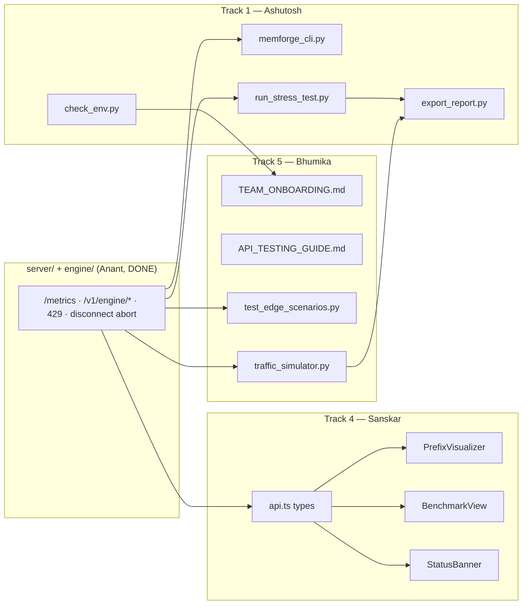

# MemForge — Combined Work Plan: Tooling, Frontend & QA

**Tracks covered:** Track 1 (Ashutosh) · Track 4 (Sanskar) · Track 5 (Bhumika)
**Written:** 2026-10-25 · **Author:** Anant (Track 3 lead, integration owner)
**Companion docs:** [TEAM_EXECUTION_PLAN.md](TEAM_EXECUTION_PLAN.md) · [ANANT_WORKPLAN.md](ANANT_WORKPLAN.md) · [PROGRESS_AND_NEXT_PHASES.md](PROGRESS_AND_NEXT_PHASES.md)

> **Not covered here:** Track 2 (Akshit, paged-gather kernels). His track touches
> `memforge_ml/runtime/paged_cache.py`, which I have now modified, so it needs a
> separate handover — see [§9.2](#92-what-is-still-unresolved).

---

## 1. How to read this document

Three tracks, one document, because all three consume the **same** server
contracts and I would rather write those contracts down once, exactly, than
three times approximately.

| You are | Read | Skip |
| :--- | :--- | :--- |
| **Ashutosh** | §2, §3, §4, §9, §10 | §5, §6 |
| **Sanskar** | §2, §3, §5, §9, §10 | §4, §6 |
| **Bhumika** | §2, §3, §6, §9, §10 | §4, §5 |

**§3 is mandatory for everyone.** It is the single source of truth for what the
server actually returns. Every payload in it was captured from a running engine
on 2026-10-25, not transcribed from the plan — several fields in the plan's
contracts turned out to be wrong or missing, and §3 is what is real.

Two of you are working through Antigravity. §10 has prompts written to be pasted
in directly, with the real schemas inlined so the model is not guessing. Use
them as starting points, then read what comes back — you own the code that lands
on your branch, including the parts an AI wrote.

### 1.1 The one rule that matters most

**Do not edit a file another track owns.** Not even a one-line fix. The whole
reason this project has five parallel tracks and no merge pain is that no two
people touch the same file. If you need a change outside your own files, ask the
owner. Ownership is in [TEAM_EXECUTION_PLAN.md](TEAM_EXECUTION_PLAN.md) §2;
server and C++ files are mine.

---

## 2. What actually exists today (verified 2026-10-25)

Before planning anything, this is the ground truth. Everything in this table was
run, not assumed.

| Thing | State | How it was checked |
| :--- | :--- | :--- |
| Python test suite | **116 passing** | `python -m pytest tests/python/ -q` |
| C++ test suites | **3/3 passing** (allocator, scheduler, prefix cache) | compiled and run under MSVC |
| Native extension | built, `memforge_c.cp312-win_amd64.pyd` | imported by the suite |
| Frontend build | **green**, 163 KB JS / 2 KB CSS in 7.6 s | `cd frontend && npm run build` |
| `frontend/node_modules` | **installed** | present on disk |
| Real model weights | **cached locally** — SmolLM2-360M + 135M | `~/.cache/huggingface/hub` |
| Continuous batching | 3.32x at 8 concurrent | `benchmarks/results/live_engine.json` |
| Prefix sharing (Phase B) | **done** — 5.7x fewer blocks at 8 concurrent | `benchmarks/results/prefix_sharing.json` |
| Server hardening (Phase F) | disconnect abort, 429 backpressure, `/metrics` — **done** | `tests/python/test_server_hardening.py` |

### 2.1 What does *not* exist yet

**Nothing from any of your three tracks has been written.** Twelve files, zero
on disk. The sprint began 2026-10-15 and Milestone 1 (Oct 19) and Milestone 2
(Oct 25) have both passed. That is the honest position this document starts
from, and it is why §8 re-sequences the work rather than pretending the original
Gantt still applies.

There is also no `docs/` directory and no `frontend/src/views/` directory yet.

### 2.2 Dependencies: you need to install nothing

`requirements.txt` already contains everything Tracks 1 and 5 need:

```
rich>=13.7.0        # terminal UI for the CLI and diagnostics
psutil>=5.9.0       # process RSS for the leak harness
httpx>=0.27.0       # async HTTP client for traffic simulation
websockets>=12.0    # WebSocket client
matplotlib>=3.8.0   # charts for the report exporter
tqdm>=4.66.0        # progress bars
pytest>=8.1.0       # tests
```

**Do not add dependencies to `requirements.txt` or `frontend/package.json`
without asking me.** Those are shared config files; a parallel edit to
`package-lock.json` in particular produces a merge conflict nobody enjoys
resolving. If you genuinely need a package, message me and I will add it.

---

## 3. Shared foundations — the contracts, exactly

### 3.1 Getting a server running

```bash
# From the repo root, every time, in every terminal:
source .venv/Scripts/activate          # Git Bash
#  .\.venv\Scripts\Activate.ps1        # PowerShell

# Serve on 127.0.0.1:8000
uvicorn server.app:app --host 127.0.0.1 --port 8000
```

First start downloads nothing — the weights are already cached — but it does
load a 360M model into RAM, which takes **10–30 seconds**. Until it finishes,
`/v1/health` reports `engine_ready: false`. Wait for it rather than treating it
as a failure.

For fast iteration, point the server at the tiny test model instead of real
weights. Full variable list in §3.5.

### 3.2 Every endpoint that exists

Captured from the running app, so this list is complete and current:

| Method | Path | Purpose | Who needs it |
| :--- | :--- | :--- | :--- |
| `GET` | `/v1/health` | liveness, `engine_ready`, `load_error` | all three |
| `GET` | `/v1/models` | model ids | Bhumika |
| `GET` | `/v1/engine/status` | config + full telemetry + `in_flight`, `at_capacity` | Ashutosh, Sanskar |
| `GET` | `/v1/engine/telemetry` | the big telemetry payload (§3.3) | Ashutosh, Sanskar |
| `GET` | `/v1/engine/blocks` | block occupancy + `block_owners` (§3.4) | Sanskar |
| `GET` | `/metrics` | Prometheus text (§3.6) | Ashutosh |
| `POST` | `/v1/completions` | raw-prompt completion | Ashutosh, Bhumika |
| `POST` | `/v1/chat/completions` | OpenAI-shaped, `stream: true` for SSE | all three |
| `WS` | `/ws/stream` | one message per generated token | Ashutosh, Sanskar, Bhumika |
| `WS` | `/ws/telemetry` | engine state pushed every 0.4 s | Sanskar |

Interactive docs while the server runs: **http://127.0.0.1:8000/docs**.

> **`/v1/completions` does not return an OpenAI-shaped response.** It returns the
> engine's raw result dict — `{"type": "done", "seq_id": 2, "prompt_tokens": 1,
> "generated_tokens": 2, "text": "...", "tokens_per_second": ...}`. Only
> `/v1/chat/completions` is OpenAI-compatible. Worth knowing before you write a
> client that assumes `choices[0]`.

### 3.3 `GET /v1/engine/telemetry` — the real payload

Captured live. **This is the authoritative shape** — the plan's "Telemetry WS
Payload Contract" is close but not exact, and this is what you code against:

```json
{
  "shared_blocks": 2,
  "blocks_saved": 4,
  "memory_saved_mb": 0.031,
  "cached_prefix_blocks": 2,
  "prefix_hit_rate": 0.6667,
  "prefix_cache_hits": 4,
  "prefix_cache_misses": 2,
  "prefix_sharing_enabled": true,
  "block_owners": { "0": [1, 2, 3], "1": [1, 2, 3], "2": [1], "3": [2], "4": [3] },

  "uptime_s": 0.02,
  "steps": 4,
  "forward_passes": 6,
  "tokens_generated": 10,
  "prefill_tokens": 59,
  "tokens_per_second": 675.73,
  "lifetime_tokens_per_second": 412.37,
  "tokens_per_forward_pass": 1.667,
  "active_sequences": 3,
  "waiting_sequences": 0,
  "running_sequences": 3,
  "preemptions": 0,
  "cached_prefix_tokens": 64,
  "cow_copies": 0,
  "total_blocks": 64,
  "free_blocks": 59,
  "allocated_blocks": 5,
  "memory_utilization": 0.0781,
  "block_size": 16,
  "kv_pool_mb": 0.5
}
```

Read that `block_owners` carefully, because it is the whole story of prefix
sharing in one field: **blocks 0 and 1 are held by sequences 1, 2 and 3 at the
same time** — three requests sharing one copy of a common prompt — while blocks
2, 3 and 4 are each private to one sequence. Three requests, five blocks, where
without sharing they would need nine.

Guarantees you can rely on:

- **Every key above is always present**, including when prefix sharing is
  switched off. In that case the sharing fields are `0` / `0.0` / `false` rather
  than missing, so you can bind to one stable shape and never write
  `telemetry?.shared_blocks ?? 0`.
- `total_blocks == free_blocks + allocated_blocks`, **always**. If you ever see
  otherwise, that is a block leak and a genuine bug — report it to me.
- `block_owners` keys are **strings** (JSON object keys), values are arrays of
  integer sequence ids, sorted. Free blocks are absent, not present-and-empty.

### 3.4 `GET /v1/engine/blocks`

```json
{
  "block_size": 16,
  "total_blocks": 64,
  "allocated_blocks": 5,
  "occupancy": [1, 1, 1, 2, 3, 0, 0, 0, "... one entry per physical block"],
  "block_owners": { "0": [1, 2, 3], "1": [1, 2, 3], "2": [1] },
  "shared_blocks": 2
}
```

`occupancy[i]` is **one** owner of block `i`, or `0` if free. It cannot express
a shared block — that is exactly why `block_owners` was added beside it rather
than replacing it. The existing `MemoryVisualizer` consumes `occupancy` and
keeps working untouched; the new visualizer uses `block_owners`.

### 3.5 Environment variables

Every one is read at import time by `server/config.py`, so **set them before
starting the server**, not after.

| Variable | Default | Use it to |
| :--- | :--- | :--- |
| `MEMFORGE_HOST` | `127.0.0.1` | bind address |
| `MEMFORGE_PORT` | `8000` | port |
| `MEMFORGE_TARGET_MODEL` | `HuggingFaceTB/SmolLM2-360M-Instruct` | swap the model |
| `MEMFORGE_DRAFT_MODEL` | `HuggingFaceTB/SmolLM2-135M-Instruct` | speculative draft model |
| `MEMFORGE_LOAD_DRAFT` | `true` | `false` saves ~500 MB RAM and start-up time |
| `MEMFORGE_EAGER_LOAD` | `true` | `false` defers loading until the first request |
| `MEMFORGE_BLOCK_SIZE` | `16` | tokens per physical block |
| `MEMFORGE_KV_BUDGET_MB` | `384` | KV pool size — **lower this to force memory pressure** |
| `MEMFORGE_MAX_NUM_SEQS` | `8` | sequences the scheduler runs at once |
| `MEMFORGE_MAX_MODEL_LEN` | `1024` | context limit; prompts over it get a 400 |
| `MEMFORGE_MAX_CONCURRENCY` | `32` | admitted requests before 429 |
| `MEMFORGE_DEFAULT_MAX_TOKENS` | `96` | default generation length |
| `MEMFORGE_BATCHED_DECODE` | `true` | `false` forces the sequential decode path |

Two configurations worth saving as shell aliases:

```bash
# FAST: tiny real model, no draft. Starts in ~3 s. Use for all UI/CLI iteration.
MEMFORGE_TARGET_MODEL=HuggingFaceTB/SmolLM2-135M-Instruct \
MEMFORGE_LOAD_DRAFT=false \
MEMFORGE_KV_BUDGET_MB=128 \
  uvicorn server.app:app --port 8000

# PRESSURE: a deliberately tiny KV pool, so preemption and 429s actually happen.
MEMFORGE_KV_BUDGET_MB=24 \
MEMFORGE_MAX_NUM_SEQS=2 \
MEMFORGE_MAX_CONCURRENCY=4 \
MEMFORGE_LOAD_DRAFT=false \
  uvicorn server.app:app --port 8000
```

The PRESSURE config is how Bhumika's saturation tests and Ashutosh's leak
harness produce interesting results instead of a flat, idle engine.

### 3.6 `GET /metrics` — Prometheus text

Built for Ashutosh's harness so it does not have to track the JSON shape:

```
memforge_engine_ready 1
memforge_requests_in_flight 0
memforge_max_concurrency 32
memforge_blocks_total 204
memforge_blocks_allocated 48
memforge_blocks_free 156
memforge_blocks_shared 16
memforge_blocks_saved 224
memforge_memory_saved_mb 280.0
memforge_prefix_hit_rate 0.991
memforge_prefix_cached_blocks 32
memforge_memory_utilization 0.2353
memforge_sequences_running 4
memforge_sequences_waiting 0
memforge_tokens_per_forward_pass 6.29
memforge_tokens_generated_total 1024
memforge_forward_passes_total 163
memforge_preemptions_total 2
memforge_cow_copies_total 0
memforge_blocks_leaked 0
```

Format: `# HELP` and `# TYPE` comment lines, then `name value`. Parse by
skipping `#` lines and splitting on the first space.

**`memforge_blocks_leaked` must always be `0`.** It is `total - free -
allocated`. A nonzero value is a real leak, and catching one is a genuinely
valuable result — not a reason to tweak the harness until it goes away.

### 3.7 WebSocket message shapes

`/ws/stream` — send `{"prompt": "...", "max_new_tokens": 32, "temperature": 0.7,
"top_p": 0.9, "use_speculative": false}`, then receive:

```json
{"type": "start",  "mode": "continuous_batching", "prompt": "...", "max_new_tokens": 32}
{"type": "token",  "seq_id": 1, "index": 0, "token": "Hello", "token_id": 9906,
                   "source": "target", "is_draft": false, "metrics": { }}
{"type": "done",   "generated_tokens": 32, "finish_reason": "length",
                   "tokens_per_second": 48.6, "time_to_first_token_ms": 45.2, "metrics": { }}
{"type": "error",  "message": "..."}
```

`/ws/telemetry` — no request needed, pushes every 0.4 s:

```json
{"type": "telemetry", "telemetry": { /* §3.3 */ }, "last_step": { }, "occupancy": [ ]}
```

Before the engine finishes loading, `telemetry` is `null` and `ready` /
`load_error` are present instead. **Handle that case** or your first render
crashes on a cold server.

### 3.8 Error codes — including one the plan gets wrong

| Code | When | Body |
| :--- | :--- | :--- |
| `200` | success | result |
| `400` | prompt longer than `max_model_len` | `{"detail": "prompt of 5000 tokens leaves no room under max_model_len=128"}` |
| `422` | malformed request — missing `messages`, `max_tokens <= 0` | Pydantic error array |
| `429` | `max_concurrency` reached | `{"detail": "engine at capacity: ..."}` + `Retry-After: 1` |
| `499` | client disconnected before the response was ready | nothing is actually sent |
| `503` | engine failed to load | `{"detail": "engine unavailable: ..."}` |

> **The plan says to test "empty prompt string validation" expecting a graceful
> 400. That behaviour does not exist.** Measured on 2026-10-25: an empty
> `content` on `/v1/chat/completions` returns **200**, because the chat template
> renders `"user: \nassistant:"` which is not empty; an empty `prompt` on
> `/v1/completions` also returns **200**. See §9.1 — this needs a change in
> `routes.py`, which is my file, and it is on me, not Bhumika.
>
> Also note **422, not 400**, for malformed bodies. That is FastAPI's default
> and is correct behaviour; assert `422` for schema problems and `400` only for
> the length check.

---

## 4. Track 1 — Ashutosh: benchmarking, stress & leak testing, CLI tools

**Branch:** `feat/ashutosh-stress-cli-tools`
**You own:** `benchmarks/run_stress_test.py` · `scripts/memforge_cli.py` ·
`scripts/check_env.py` · `scripts/export_report.py`
**You touch nothing else.** All four files are new, so you cannot conflict with
anyone — provided you stay inside them.

Your track is the one that turns "it works on my machine" into evidence. Two of
your four deliverables are things the rest of us will use daily.

### 4.1 `scripts/check_env.py` — environment diagnostics

**Do this one first.** It is the easiest, and it is the thing that unblocks
everyone else when their setup is broken. Right now a new contributor with no
C++ compiler gets a confusing `ImportError`; this turns that into a sentence
telling them what to install.

Checks to run, each printing OK / WARN / FAIL plus a fix suggestion:

| Check | How | Why it matters |
| :--- | :--- | :--- |
| Python ≥ 3.9 | `sys.version_info` | `pyproject.toml` requires it |
| Virtualenv active | `sys.prefix != sys.base_prefix` | the commonest mistake by far |
| PyTorch importable + version + CUDA | `torch.__version__`, `torch.cuda.is_available()` | CPU-only is expected and fine — say so, do not warn |
| `memforge_c` importable | `import memforge_c` | if missing: `python setup.py build_ext --inplace` |
| C++ compiler present | `shutil.which` for `cl`, `g++`, `clang++` | needed to build the extension |
| RAM | `psutil.virtual_memory().total` | under ~4 GB free, the 360M model will struggle |
| CPU count + AVX2/AVX512 | `os.cpu_count()`, `platform`, `/proc/cpuinfo` or `cpufeature` if present | explains CPU throughput |
| Model weights cached | look for `models--HuggingFaceTB--SmolLM2-360M-Instruct` under `~/.cache/huggingface/hub` | if missing, print the exact `hf download` command |
| Disk space | `shutil.disk_usage` | weights are ~1 GB |
| Key packages | `importlib.metadata.version` for fastapi, transformers, rich, httpx, psutil | catches a half-finished install |

```
$ python scripts/check_env.py

MemForge Environment Doctor
──────────────────────────────────────────────────────────────
  OK    Python 3.12.1
  OK    virtualenv active (.venv)
  OK    PyTorch 2.13.0 (CPU only — expected on this project)
  OK    memforge_c native extension importable
  OK    C++ compiler: cl.exe (MSVC 14.44)
  OK    RAM 15.8 GB total, 7.2 GB available
  OK    16 CPUs, AVX2 supported
  OK    model weights cached: SmolLM2-360M-Instruct, SmolLM2-135M-Instruct
  WARN  draft model not cached: SmolLM2-135M-Instruct
        -> HF_HUB_DISABLE_SYMLINKS=1 hf download HuggingFaceTB/SmolLM2-135M-Instruct
──────────────────────────────────────────────────────────────
  9 OK · 1 warning · 0 failures      exit code 0
```

**Design rules:**
- **Never crash.** Wrap every probe in `try/except` and report FAIL with the
  exception text. A diagnostic tool that throws is worse than none, because the
  person running it is already confused.
- **Exit code 0 on warnings, 1 only on failures**, so CI can use it.
- A missing CUDA device is **not** a warning. This is a CPU project. Saying
  "WARN: no GPU" on every run trains people to ignore your output.

**Done when:** it runs clean on this machine, and still produces sensible output
with the virtualenv deactivated (`deactivate` then run it — it should tell you
that, not traceback).

### 4.2 `scripts/memforge_cli.py` — interactive streaming chat

A terminal chat client, so testing a change does not mean opening a browser or
hand-writing `curl`. Connect to `ws://127.0.0.1:8000/ws/stream` (preferred — it
gives you token provenance) or SSE via `POST /v1/chat/completions` with
`stream: true`.

Per response, print and then summarise:

```
You> explain paged attention in one sentence

MemForge> Paged attention stores a sequence's keys and values in fixed-size
blocks rather than one contiguous buffer, so memory can be allocated on demand.

  TTFT  142 ms  ·  38 tokens  ·  24.1 tok/s  ·  1.72 s total
  blocks 12/204 · shared 0 · saved 0.00 MB
```

- **TTFT** = wall time from send to the first `token` message. Measure it
  yourself with `time.perf_counter()`; do not read it from the `done` event, as
  that is the server's view and excludes network time.
- **tok/s** = token count ÷ (last token time − first token time). Excluding TTFT
  is deliberate: it measures steady-state decode rather than start-up.
- Colour draft-accepted tokens differently using `source` / `is_draft` — that is
  what makes speculative decoding visible. `rich` is already installed.

Slash commands worth having: `/spec` toggle speculative · `/tokens N` set length
· `/stats` dump `/v1/engine/telemetry` · `/blocks` print the occupancy map ·
`/quit`.

**Handle these**, all of which will happen to you:
- server not running → `ConnectionRefusedError`. Print "is the server running on
  port 8000?", not a traceback.
- `engine_ready: false` → poll `/v1/health` and show "loading model…" rather
  than failing.
- `Ctrl-C` mid-stream → close the socket cleanly. This also exercises my
  disconnect-abort path, so if you see blocks stay allocated after you interrupt,
  that is a bug in **my** code — tell me.

**Done when:** you can hold a multi-turn conversation, tokens appear
incrementally rather than in one lump at the end, and the metrics line is right.

### 4.3 `benchmarks/run_stress_test.py` — sustained load & leak detection

This is the deliverable the project's Phase F definition of done depends on:
*"the server survives a sustained multi-client load test with flat memory and no
leaked blocks."* Nobody can claim that until this exists.

What it does: fire 50–100 requests, sequential and concurrent, at a live server,
sampling memory and block accounting throughout.

```bash
python benchmarks/run_stress_test.py --requests 100 --concurrency 8 --tokens 32
```

Follow the conventions in `benchmarks/run_live_engine.py` and
`benchmarks/run_prefix_sharing.py` — `argparse`, a `PROJECT_ROOT` `sys.path`
insert, a printed table, and a JSON file in `benchmarks/results/`. Read
`run_prefix_sharing.py` first; it is the closest model for what you are building
and it is 250 lines.

Write `benchmarks/results/stress_test.json` in the schema the plan fixes
(TEAM_EXECUTION_PLAN.md §4 contract 1), plus the sharing fields:

```json
{
  "total_requests": 100,
  "concurrent_clients": 8,
  "initial_rss_mb": 420.5,
  "peak_rss_mb": 680.2,
  "final_rss_mb": 421.1,
  "rss_growth_mb": 0.6,
  "leaked_blocks": 0,
  "p50_ttft_ms": 45.2,
  "p99_ttft_ms": 112.8,
  "mean_tok_per_sec": 48.6,
  "errors": {"429": 3, "500": 0},
  "duration_s": 94.3
}
```

**The three measurements that matter:**

1. **Block accounting.** Scrape `/metrics` before, during and after. Assert
   `memforge_blocks_leaked == 0` at every sample, and that
   `memforge_blocks_allocated` returns to its starting value once the run
   drains. This is the strongest leak check available and it is exact, not
   statistical.
2. **Process RSS.** The server is a separate process, so `psutil.Process(pid)`
   needs its pid — either take `--server-pid`, or find it by port with
   `psutil.net_connections`, or launch the server yourself with
   `subprocess.Popen` under a `--spawn-server` flag. Simplest reliable option:
   `--spawn-server`, so you own the lifecycle.
3. **Latency percentiles.** Collect every TTFT into a list and use
   `statistics.quantiles`. With fewer than ~100 samples, p99 is one data point —
   report it, but do not read much into it.

**Interpreting RSS honestly:** PyTorch and the allocator both cache, so RSS
growing over the first few requests and then flattening is **normal and not a
leak**. What matters is the shape: compare the final value against a plateau
measured after ~20 warm-up requests, not against the very first sample. If you
report a leak, be sure it is monotonic growth and not warm-up — and cross-check
against `memforge_blocks_leaked`, which has no warm-up behaviour at all.

**Expect 429s** if `--concurrency` exceeds `MEMFORGE_MAX_CONCURRENCY`. That is
backpressure working correctly. Count them, do not treat them as failures, and
honour `Retry-After`.

**Done when:** 50+ requests complete, `leaked_blocks == 0`, block counts return
to baseline, and the JSON is written.

### 4.4 `scripts/export_report.py` — results to Markdown

Read every `benchmarks/results/*.json` and emit Markdown tables ready to paste
into a report or the progress doc.

```bash
python scripts/export_report.py --out benchmarks/results/REPORT.md
python scripts/export_report.py --only prefix_sharing --format csv
```

Three JSON files exist to consume today: `live_engine.json`,
`prefix_sharing.json`, and `stress_test.json` once §4.3 lands. **Read the real
files before writing the parser** — they are nested differently
(`prefix_sharing.json` has a `rows` array of `{off, on}` pairs; `live_engine.json`
is organised by scenario). Do not assume a uniform shape.

Keep it robust: a missing file is "not yet run", not a crash; an unrecognised
schema gets skipped with a note. `matplotlib` is available if you want PNG
charts, but **Markdown tables first** — they are what actually gets pasted into
documents.

**Done when:** it produces a valid Markdown report from whatever results exist,
and does not fall over when one is missing.

---

## 5. Track 4 — Sanskar: frontend dashboard & visualisation

**Branch:** `feat/sanskar-frontend-dashboard`
**You own:** everything under `frontend/`. The whole directory. Nobody else
touches it.
**New files:** `src/components/PrefixVisualizer.tsx` ·
`src/components/BenchmarkView.tsx` · `src/components/StatusBanner.tsx` ·
`src/views/`
**Existing files you will edit:** `src/services/api.ts` (types are stale — §5.2)
· `src/App.tsx` (to mount your components)

### 5.1 The stack you are working in

Read these three files before writing anything — they are short and they define
the house style:

- `src/components/MemoryVisualizer.tsx` — closest model for what you are
  building. A block grid coloured by owning sequence.
- `src/services/api.ts` — typed REST client.
- `src/services/websocket.ts` — `StreamClient` and `TelemetryClient`, the latter
  already auto-reconnecting.

Conventions, all of which already hold throughout the codebase:

| | |
| :--- | :--- |
| React | 18.3.1, function components, `React.FC<Props>` |
| Styling | **inline `style={{}}` objects** plus the `glass-card` class. No CSS modules, no Tailwind |
| Icons | `lucide-react` (`import { Database } from 'lucide-react'`) |
| Colours | **CSS variables only** — see §5.5. Never hardcode a hex |
| State | `useState` in `App.tsx`, passed down as props. No Redux, no context |
| Build | `npm run build` = `tsc && vite build`. **TypeScript errors fail the build** |

**There is no charting library installed**, and I am asking you **not to add
one**. Hand-roll the charts as inline `<svg>`. Two reasons: adding a dependency
changes `package.json` and `package-lock.json`, which are shared files needing
coordination; and `MemoryVisualizer` already shows that hand-rolled visuals work
fine in this codebase. An SVG line chart is about 30 lines — compute an x/y
scale, build a `points` string, render `<polyline>`. Antigravity does this well
(§10.2). If you hit something genuinely impossible without a library, come to me
and we will discuss `recharts` rather than you adding it unilaterally.

### 5.2 First task: the types are out of date

`src/services/api.ts` was written before prefix sharing existed. Its
`LiveMetrics`, `EngineTelemetry` and `BlockMap` interfaces are **missing every
field your new components need**. Fix this first, or you will fight the
typechecker all week.

```ts
// Add to LiveMetrics (served by /v1/chat/completions telemetry and WS events):
shared_blocks: number;
memory_saved_mb: number;
prefix_hit_rate: number;
in_flight: number;
max_concurrency: number;

// Add to EngineTelemetry (served by /v1/engine/telemetry and /ws/telemetry):
blocks_saved: number;
cached_prefix_blocks: number;
prefix_cache_hits: number;
prefix_cache_misses: number;
prefix_sharing_enabled: boolean;
cached_prefix_tokens: number;
cow_copies: number;
block_owners: Record<string, number[]>;

// Add to BlockMap:
block_owners: Record<string, number[]>;
shared_blocks: number;
```

Every one of those is **always present** in the response (§3.3), so they are
required fields, not optional — no `?`. That is deliberate on my side so you do
not need defensive defaults.

Also: `sendChatCompletion` currently throws a generic error on any non-OK
status. A **429** now means "at capacity, retry" and carries `Retry-After`. Give
it its own branch so the UI can say "engine busy" instead of "API error".

### 5.3 `PrefixVisualizer.tsx` — the headline component

Prefix sharing is the project's newest and most impressive result, and right now
there is no way to see it. This component is what makes a 5.7x memory saving
visible in a demo.

Drive it from `block_owners` (§3.3), **not** `occupancy` — a flat array cannot
represent a block held by three sequences, which is the entire point.

What to show:

1. **A block grid** where each cell is a physical block, like `MemoryVisualizer`
   but distinguishing three states: **free** (no entry in `block_owners`),
   **private** (exactly one owner), **shared** (more than one owner). Make
   shared blocks unmistakable — a brighter fill, a border, a small badge with
   the owner count. This is the thing people should notice first.
2. **A savings panel:** `memory_saved_mb`, `blocks_saved`, `shared_blocks`, and
   `prefix_hit_rate` as a percentage. Phrase it as outcome, not jargon — "1.25 MB
   saved · 16 blocks shared · 99.1% hit rate".
3. **A hover tooltip** listing which sequence ids own a block. With
   `block_owners["0"] === [1,2,3]`, hovering block 0 should say "shared by
   sequences 1, 2, 3".

Handle these states, because all three occur in normal use:
- `prefix_sharing_enabled: false` → say "prefix sharing disabled", not a blank
  grid that looks broken.
- All blocks private → "no shared prefixes yet". This is correct and common; a
  single request shares nothing.
- `block_owners` empty / engine idle → show the empty pool, not a spinner.

### 5.4 `BenchmarkView.tsx` and `StatusBanner.tsx`

**`BenchmarkView.tsx`** — latency and throughput over time. The engine does not
store history, so **accumulate it client-side**: push each `/ws/telemetry` tick
into a bounded array (`slice(-120)` gives about 48 seconds at 0.4 s) and chart
that. Worth plotting:

- `tokens_per_forward_pass` — the single best indicator that batching is
  working. 1.0 means no batching; 6.29 was measured at 8 concurrent requests.
- `tokens_per_second` over time.
- TTFT per request, collected from your own stream timings.
- **Inter-token latency** — the gap between consecutive `token` events. Compute
  it in the component; the server does not send it.

Keep the y-axis honest. Starting it at a nonzero value to make a line look
dramatic is the kind of thing that undermines a real result.

**`StatusBanner.tsx`** — connection and engine state, which the dashboard
currently handles only loosely:

- WebSocket state: live / reconnecting / disconnected. `TelemetryClient` already
  retries every 1.5 s; surface that it is doing so.
- Engine state from `/v1/health`: `engine_ready`, `load_error`. A cold server
  takes 10–30 s to load — show "loading model…" rather than looking dead.
- Capacity: `in_flight` / `max_concurrency`, visibly warning as it approaches
  the limit.
- **A dark/light toggle.** The app is currently dark-only via `:root` variables
  in `index.css`. Add a `[data-theme="light"]` block and toggle the attribute on
  `document.documentElement`. Persist the choice in `localStorage` inside a
  `try/catch` — it throws in private-browsing modes.

### 5.5 Design tokens — use these, never hex literals

Defined in `src/index.css`:

```css
--bg-primary: #0a0d14;    --bg-secondary: #101522;   --bg-card: rgba(18,24,38,.75);
--border-color: rgba(255,255,255,.08);               --border-highlight: rgba(0,255,170,.3);
--accent-cyan: #00f2fe;   --accent-emerald: #00ffaa; --accent-purple: #9d4edd;
--accent-red: #ff477e;    --accent-amber: #ffaa00;
--text-primary: #f1f5f9;  --text-secondary: #94a3b8; --text-muted: #64748b;
--font-sans: 'Inter', …;  --font-mono: 'Fira Code', monospace;
```

Existing classes: `.glass-card` · `.block-grid` · `.block-cell` · `.block-free` ·
`.block-allocated` · `.token-draft` · `.token-target`.

Using the variables is what makes the light-mode toggle a five-line change
instead of a rewrite. Every hardcoded hex is a bug you will have to find later.

### 5.6 Working without a backend

You do not need the Python server running to build UI. `vite.config.ts` proxies
`/v1` and `/ws` to port 8000, but while iterating on layout, hardcode a mock
object shaped exactly like §3.3 and render from that. Switch to the live feed
once it looks right.

When you do want real data, use the FAST config in §3.5 — it starts in about
three seconds.

**Done when:** `npm run build` passes with **zero TypeScript errors**, all three
components render correctly against both mock and live telemetry, nothing under
`frontend/` has stale types, and you have not edited a single backend file.

---

## 6. Track 5 — Bhumika: QA, traffic simulation & documentation

**Branch:** `feat/bhumika-qa-and-docs`
**You own:** `scripts/traffic_simulator.py` ·
`tests/python/test_edge_scenarios.py` · `docs/API_TESTING_GUIDE.md` ·
`docs/TEAM_ONBOARDING.md`
`docs/` does not exist yet — create it. All four files are new, so you cannot
conflict with anyone.

Your track is where we find out whether the engine actually holds up. A test
that fails is a **good outcome** — it found something before a demo did. Please
do not adjust a test until it passes; tell me instead.

### 6.1 Start here: `docs/TEAM_ONBOARDING.md`

Write this first, for one specific reason: **you are the newest person on the
project, so you are the only one who can still see what is confusing.** Everyone
else has forgotten. Write down every step you took to get running, including the
things that went wrong.

Cover: cloning · creating and activating the virtualenv (both Git Bash and
PowerShell) · `pip install -r requirements.txt` · `python setup.py build_ext
--inplace` and what to do when it fails for lack of a compiler · downloading
weights with `HF_HUB_DISABLE_SYMLINKS=1` and why that flag exists on Windows
(symlink privileges) · running the tests · starting the server · starting the
frontend · the branch-per-person workflow.

Known rough edges worth documenting, all real:

- **`g++` cannot link on some machines here** (`ld returned 116`, zero-byte
  output). It is environmental, not a project bug.
  `scripts/cpp_test_runner.py` falls back to MSVC.
- **The C++ stage of `scripts/run_pipeline.py` currently fails for me** with
  `PermissionError` when executing a freshly built test binary from a temp
  directory. It reproduces on the pre-existing suites, so it is environmental.
  Check whether it happens to you — a second data point is genuinely useful.
- **`MEMFORGE_*` variables are read at import time.** Setting one after the
  server starts does nothing. This confuses everybody once.
- **First server start takes 10–30 s** to load the model, during which
  `/v1/health` reports `engine_ready: false`.

Verify your own doc by following it top to bottom on a clean shell. Anything you
have to improvise is a gap.

### 6.2 `docs/API_TESTING_GUIDE.md`

Copy-pasteable examples for every endpoint in §3.2 — `curl` and Python `httpx`,
plus `websockets` for the two WS endpoints. **Run every single one before you
commit it.** A testing guide with an example that does not work is worse than no
guide, because it costs the reader trust as well as time.

```bash
curl http://127.0.0.1:8000/v1/health

curl -X POST http://127.0.0.1:8000/v1/chat/completions \
  -H "Content-Type: application/json" \
  -d '{"messages":[{"role":"user","content":"Hello"}],"max_tokens":32}'

# Streaming SSE
curl -N -X POST http://127.0.0.1:8000/v1/chat/completions \
  -H "Content-Type: application/json" \
  -d '{"messages":[{"role":"user","content":"Count to ten"}],"max_tokens":48,"stream":true}'

curl http://127.0.0.1:8000/v1/engine/telemetry
curl http://127.0.0.1:8000/metrics
```

Include the error cases from §3.8 with their **real** status codes, and document
the `/v1/completions` response shape surprise from §3.2 — it returns the raw
engine dict, not an OpenAI envelope.

### 6.3 `tests/python/test_edge_scenarios.py`

Read `tests/python/test_api_stream.py` first and copy its structure. It has the
two fixtures you need: `client` (a `TestClient` running the app lifespan) and
`stub_engine` (patches a tiny in-memory engine into `ENGINE_MANAGER`, so tests
are fast and need no weights). `tests/python/conftest.py` provides `tiny_model`
and `stub_tokenizer`.

Also look at `tests/python/test_server_hardening.py` — I wrote it this week and
it covers adjacent ground. **Do not duplicate what it already tests** (429
behaviour, `/metrics` parsing, disconnect plumbing). Go around it.

Scenarios to cover:

| # | Scenario | Expected | Note |
| --: | :--- | :--- | :--- |
| 1 | Prompt over `max_model_len` | **400** with a readable detail | Verified working |
| 2 | Missing `messages` field | **422** | Pydantic, not 400 |
| 3 | `max_tokens` of 0 or negative | **422** | |
| 4 | Empty prompt string | **currently 200** | See §9.1 — **ask me before writing this one**, the behaviour is about to change |
| 5 | Pool saturation: more concurrent requests than `max_concurrency` | mix of 200 and **429** with `Retry-After`; no 500s | use the PRESSURE config (§3.5) |
| 6 | Client disconnects mid-stream | sequence aborted, **blocks returned to the pool** | assert via `/metrics` |
| 7 | Memory pressure forces preemption | all requests still complete correctly | tiny `MEMFORGE_KV_BUDGET_MB` |
| 8 | WebSocket with empty prompt | `{"type": "error"}`, socket stays open | already handled in `websocket.py` |
| 9 | Malformed WebSocket JSON | server does not crash | |
| 10 | Many sequential requests | **no block leak** — `blocks_leaked == 0` | the cheap version of Ashutosh's harness |
| 11 | Unicode / emoji prompt | round-trips without mangling | byte-level BPE makes this non-trivial |
| 12 | Concurrent identical prompts | correct output **and** `shared_blocks > 0` | exercises prefix sharing from the API |

**The one invariant to assert everywhere:** `total_blocks == free_blocks +
allocated_blocks`, and allocated returns to baseline once requests finish. If
that ever breaks, you have found a real memory leak.

### 6.4 `scripts/traffic_simulator.py`

A load generator with configurable concurrency and realistic behaviour.

```bash
python scripts/traffic_simulator.py --concurrency 10 --requests 30
python scripts/traffic_simulator.py --concurrency 20 --requests 100 --disconnect-rate 0.1
```

Use `asyncio` with `httpx.AsyncClient`, or `websockets` for the WS path. Both
are installed. Per virtual user: pick a random prompt from a list, random length,
random think-time between requests, record TTFT / total time / tokens streamed /
status code.

The flag that makes this more than a load generator: **`--disconnect-rate`**,
dropping some fraction of clients mid-stream. That is precisely the Phase F
hardening path, and nothing else in the project exercises it under load. Pair it
with `/metrics` before and after: if `memforge_blocks_allocated` does not return
to baseline after a run with disconnects, you have found a leak in **my** code,
which is exactly the kind of thing this script exists to catch.

Report at the end: requests sent/succeeded/failed, status-code histogram, TTFT
p50/p95/p99, mean tok/s, disconnects triggered, and block counts before vs after.

**Overlap with Ashutosh:** his `run_stress_test.py` is a *pass/fail leak gate*
with fixed assertions; yours is an *exploratory traffic generator* with random
behaviour and no assertions. Both are worth having, but please talk to each other
so you are not writing one tool twice.

**Done when:** `--concurrency 10 --requests 30` completes against a live server,
all 12 edge tests pass with `pytest tests/python/test_edge_scenarios.py`, and
both docs have been followed end to end by someone other than their author.

---

## 7. How the three tracks fit together



**Nothing in these three tracks blocks anything else in these three tracks**,
with two small exceptions: Sanskar should fix the `api.ts` types before building
components on top of them, and `export_report.py` has more to read once the
stress and traffic results exist (though it can be built against the two JSON
files already present).

All four server dependencies are **already shipped and tested**. Nobody is
waiting on me except for §9.1.

| You need | Status |
| :--- | :--- |
| `/metrics` for the leak harness | ✅ shipped |
| 429 + `Retry-After` for saturation tests | ✅ shipped |
| Disconnect → scheduler abort | ✅ shipped |
| `shared_blocks`, `memory_saved_mb`, `block_owners` for the visualizer | ✅ shipped |
| Empty-prompt validation | ❌ **does not exist** — §9.1 |

---

## 8. Suggested sequencing

The original Gantt assumed a start on Oct 15. It is Oct 25 and these tracks have
not begun, so this is ordered by *unblocking value* rather than by the original
dates. Milestone 4 (final demo, Nov 3) is the only date still worth holding.

| Order | Who | Task | Why this first |
| --: | :--- | :--- | :--- |
| 1 | Ashutosh | `check_env.py` | Smallest task; immediately helps everyone else get set up |
| 1 | Bhumika | `TEAM_ONBOARDING.md` | Must be written while the setup is still fresh to you |
| 1 | Sanskar | `api.ts` types + `StatusBanner` | Types unblock your own next two components |
| 2 | Ashutosh | `memforge_cli.py` | Becomes the team's default way to test by hand |
| 2 | Bhumika | `API_TESTING_GUIDE.md` | Needs only a running server |
| 2 | Sanskar | `PrefixVisualizer` | The headline demo component |
| 3 | Ashutosh | `run_stress_test.py` | Phase F's definition of done depends on it |
| 3 | Bhumika | `test_edge_scenarios.py` | |
| 3 | Sanskar | `BenchmarkView` | Needs client-side history accumulation |
| 4 | Ashutosh | `export_report.py` | Most valuable once stress results exist |
| 4 | Bhumika | `traffic_simulator.py` | |
| 4 | Sanskar | theme toggle, responsive polish | |
| 5 | all | integration, demo rehearsal | |

Items marked **1** are each worth roughly a day and have no dependencies at all.
Start today.

---

## 9. Decisions and open items

### 9.1 Empty-prompt validation — my task, blocking Bhumika's test #4

The plan says to test that an empty prompt produces a graceful 400. Measured on
2026-10-25, it returns **200** on both completion endpoints: the chat template
turns an empty message into `"user: \nassistant:"`, and the raw endpoint
tokenizes `""` into a one-token prompt.

My view is that an empty or whitespace-only prompt **should** be a 400 — it is
unambiguously a client error, and generating from nothing wastes a slot. But
that is a behaviour change in `server/api/routes.py`, which is my file, and it
needs to land before Bhumika writes a test asserting it.

**Bhumika: leave scenario 4 until I confirm.** Writing a test today that asserts
200, and then having to change it, is wasted work in both directions.

### 9.2 What is still unresolved

- **Akshit's handover (Track 2).** I have modified
  `memforge_ml/runtime/paged_cache.py` and `continuous_engine.py`, which his
  paged-gather work also needs. The plan left those files unowned, which is its
  one real conflict. He and I need to agree the boundary in
  [ANANT_WORKPLAN.md](ANANT_WORKPLAN.md) §6.1 before he starts. **Not covered by
  this document.**
- **`run_pipeline.py` C++ stage** fails for me with a `PermissionError`
  executing freshly built binaries from a temp directory. Environmental, not a
  regression — it reproduces on pre-existing suites. Bhumika: please check
  whether it happens on your machine (§6.1).
- **Structured logging** is still outstanding on my side (Phase F). The server
  uses `print()`. Not blocking anyone.
- **No charting library**, by decision (§5.1). Revisit with me if hand-rolled
  SVG genuinely blocks something.

---

## 10. Working with Antigravity effectively

Both Sanskar and Bhumika are using Antigravity. These prompts are written to be
pasted directly. The pattern they follow is worth internalising: **give the model
the real schema and the real file to imitate, then ask for one specific thing.**
A vague prompt produces plausible code that does not compile against this
codebase.

### 10.1 General rules

1. **Always paste the real contract.** Copy the JSON from §3.3 into the prompt.
   Without it the model invents field names, and `telemetry.sharedBlocks` will
   not exist.
2. **Name a file to imitate.** "Match the style of
   `frontend/src/components/MemoryVisualizer.tsx`" is worth a paragraph of
   instructions.
3. **Ask for one component or one function at a time.** "Build the dashboard"
   produces something unreviewable.
4. **Run it immediately.** `npm run build` or `pytest` after every generated
   chunk. Debugging one new file is easy; debugging four is not.
5. **Read what you commit.** If you cannot explain a line in review, do not
   commit it. You own the code on your branch regardless of who typed it.

### 10.2 Sanskar — `PrefixVisualizer.tsx`

```
I am working in a React 18 + TypeScript + Vite dashboard for an LLM inference
engine called MemForge. Create a new component at
frontend/src/components/PrefixVisualizer.tsx.

Match the exact style of frontend/src/components/MemoryVisualizer.tsx:
- function component typed as React.FC<Props>
- inline style={{}} objects, no CSS modules or Tailwind
- the "glass-card" class on the outer container
- icons from lucide-react
- colours ONLY from CSS variables: --accent-cyan, --accent-emerald,
  --accent-purple, --accent-amber, --text-primary, --text-secondary,
  --text-muted, --border-color, --bg-card
- do NOT add any npm dependency

Props:
  blockOwners: Record<string, number[]>   // block id (string) -> owning sequence ids
  totalBlocks: number
  blockSize: number
  sharedBlocks: number
  memorySavedMb: number
  prefixHitRate: number                   // 0..1
  enabled: boolean

Real example of blockOwners from the running server:
  { "0": [1,2,3], "1": [1,2,3], "2": [1], "3": [2], "4": [3] }
Blocks 0 and 1 are SHARED by three sequences (prefix sharing). Blocks 2,3,4 are
private to one sequence each. A block with no entry is free.

Render:
1. A grid of totalBlocks cells. Three visually distinct states: free (no entry),
   private (exactly 1 owner), shared (2+ owners). Shared blocks must stand out
   most — this is the feature being demonstrated.
2. A stats row: memorySavedMb as "X.XX MB saved", sharedBlocks as a count,
   prefixHitRate as a percentage.
3. A hover tooltip on each cell naming its owning sequence ids.

Handle: enabled === false -> show "prefix sharing disabled"; no shared blocks ->
"no shared prefixes yet"; empty blockOwners -> show the empty pool.

Must compile under `tsc` with no errors and no `any`.
```

### 10.3 Bhumika — `test_edge_scenarios.py`

```
I am writing pytest tests for a FastAPI LLM inference server. Create
tests/python/test_edge_scenarios.py.

First read tests/python/test_api_stream.py and reuse its fixture pattern exactly:
a `client` fixture using fastapi.testclient.TestClient(app) as a context manager,
and a `stub_engine` fixture that monkeypatches a small ContinuousBatchingEngine
into server.engine_manager.ENGINE_MANAGER. conftest.py already provides
`tiny_model` and `stub_tokenizer` fixtures.

Do NOT duplicate anything in tests/python/test_server_hardening.py (it already
covers 429 backpressure, /metrics parsing, and disconnect plumbing).

Write one test per scenario, with a docstring saying what it protects against:
1. prompt longer than max_model_len -> 400, detail mentions max_model_len
2. POST /v1/chat/completions with no "messages" field -> 422
3. max_tokens of 0 -> 422; max_tokens of -5 -> 422
4. WebSocket /ws/stream with an empty prompt -> {"type":"error"}, socket stays open
5. malformed JSON over the WebSocket -> server does not crash
6. 30 sequential requests -> no block leak: after they finish,
   total_blocks == free_blocks + allocated_blocks and allocated returns to its
   starting value. Read these from GET /v1/engine/telemetry.
7. a prompt containing unicode and emoji -> round-trips without mangling
8. two concurrent identical prompts -> both succeed AND
   GET /v1/engine/telemetry reports shared_blocks > 0 at some point

Use plain asserts with messages. Tests must be fast and must not download weights.
```

### 10.4 Ashutosh — `check_env.py`

```
Create scripts/check_env.py: an environment diagnostic for a Python + C++ LLM
inference project called MemForge. Use the `rich` library (already installed) for
a clean table. No new dependencies.

Check, in order, printing OK / WARN / FAIL plus a one-line fix suggestion for
anything not OK:
1. Python >= 3.9
2. virtualenv active (sys.prefix != sys.base_prefix)
3. torch importable, its version, and whether CUDA is available
   - CPU-only is EXPECTED for this project. Report it as OK, never as a warning.
4. `import memforge_c` works
   - if not: suggest `python setup.py build_ext --inplace`
5. a C++ compiler on PATH: shutil.which for cl, g++, clang++
6. total and available RAM via psutil
7. CPU count, and AVX2/AVX512 support if detectable
8. HuggingFace weights cached: look for directories named
   models--HuggingFaceTB--SmolLM2-360M-Instruct and
   models--HuggingFaceTB--SmolLM2-135M-Instruct under
   ~/.cache/huggingface/hub
   - if missing: suggest
     HF_HUB_DISABLE_SYMLINKS=1 hf download HuggingFaceTB/SmolLM2-360M-Instruct
9. free disk space on the drive holding the HF cache
10. installed versions of fastapi, transformers, rich, httpx, psutil via
    importlib.metadata

Hard requirements:
- Every individual check wrapped in try/except. The script must NEVER raise.
- Print a summary line: "N OK, N warnings, N failures".
- Exit code 0 if there are no failures (warnings are fine), 1 otherwise.
- Must work on Windows, Linux and macOS.
```

---

## 11. Combined definition of done

**Track 1 — Ashutosh**

- [ ] `python scripts/check_env.py` runs clean, never raises, exits 0 on warnings
- [ ] `python scripts/memforge_cli.py` holds a streaming multi-turn conversation with live TTFT and tok/s
- [ ] `python benchmarks/run_stress_test.py --requests 50` reports **0 leaked blocks** and writes `benchmarks/results/stress_test.json`
- [ ] `python scripts/export_report.py` produces Markdown from every results file present
- [ ] No file outside your four touched

**Track 4 — Sanskar**

- [ ] `npm run build` passes with **zero** TypeScript errors
- [ ] `api.ts` types cover every field in §3.3
- [ ] `PrefixVisualizer` distinguishes free / private / shared blocks and shows real savings
- [ ] `BenchmarkView` charts TTFT, inter-token latency and tokens-per-forward-pass
- [ ] `StatusBanner` shows connection, engine-load and capacity state; theme toggle persists
- [ ] All three components handle loading, empty and disabled states without looking broken
- [ ] **No backend file edited**

**Track 5 — Bhumika**

- [ ] `pytest tests/python/test_edge_scenarios.py` passes, covering §6.3 (scenario 4 pending §9.1)
- [ ] `python scripts/traffic_simulator.py --concurrency 10 --requests 30` completes against a live server
- [ ] `--disconnect-rate 0.1` leaves block counts back at baseline
- [ ] `docs/TEAM_ONBOARDING.md` followed start to finish by someone else, with no improvisation needed
- [ ] `docs/API_TESTING_GUIDE.md` — every example executed before commit

**Shared**

- [ ] All **116** existing Python tests still green
- [ ] `frontend && npm run build` green
- [ ] Each person on their own branch, one PR, one approval
- [ ] No shared config (`requirements.txt`, `package.json`) edited without asking

---

## 12. The standard

`PROGRESS_AND_NEXT_PHASES.md` reports that speculative decoding came out at
**0.58x — slower than not using it** — and explains why rather than hiding it.
Phase B's goal asked for a 1/8 memory reduction; the measured result was 1/5.7,
and the document says so with the arithmetic for the gap.

That is the standard for this project, and it applies to your work too. If the
stress harness finds a leak, report the leak. If the dashboard shows prefix
sharing saving less than the benchmark claims, say so — you may have found a
real bug in my telemetry. If a test fails, bring the failure, not a workaround.

A measured negative result is a contribution. An unmeasured positive claim is
not.
