# MemForge: Current Status & Execution Blueprint

---

## 1. Executive Summary & Current Repository Status

MemForge is a working LLM inference engine. The C++ paged memory allocator and
continuous-batching scheduler, the PyTorch execution layer, the FastAPI server and
the React telemetry dashboard are implemented **and connected**, serving real model
weights end to end. Section 3 records what is measured rather than claimed.

```mermaid
graph TD
    subgraph S1["Completed in Scaffolding (Phase 1 Initial)"]
        C1["C++ Core Data Structs & Engine Headers"]
        C2["C++ BlockAllocator (Paged KV) & Scheduler"]
        C3["ML Baseline Runner & Speculative Sampler"]
        C4["FastAPI Server & WebSocket Streaming Endpoints"]
        C5["React Telemetry Dashboard & Speculative Diff UI"]
        C6["Automated C++ Unit Test Verification (100% Pass)"]
    end

    subgraph S2["Completed in the Live Runtime Phase (2026-10-13)"]
        N1["Native pybind11 Extension Built & Verified"]
        N2["PagedAttention in a Real Forward Pass (bit-exact)"]
        N3["Continuous Batching on Real Weights (3.32x at N=8)"]
        N4["Speculative Decoding Verified Lossless"]
        N5["Server & Frontend on Live Telemetry"]
        N6["2 Scheduler Bugs Fixed (block leak, queue block)"]
    end

    subgraph S3["Completed in the Prefix Sharing Phase (2026-10-24)"]
        B1["Chained Prefix Hashing & Block Registry (C++)"]
        B2["Copy-on-Write Write Guard"]
        B3["Partial Prefill over Cached Prefixes"]
        B4["HTTP Disconnect -> Scheduler Abort"]
        B5["Backpressure (429) & /metrics Endpoint"]
        B6["EngineCore Dead Header Removed"]
    end

    subgraph S4["Next Phases (see PROGRESS_AND_NEXT_PHASES.md)"]
        P1["A: Fused paged-attention kernel"]
        P3["C: Chunked prefill"]
        P4["D: Speculation inside continuous batching"]
        P5["E: GPU execution path"]
        P6["F: Sustained load testing & structured logging"]
    end

    S1 --> S2 --> S3 --> S4
```

---

## 2. Detailed Status by Subsystem

### 2.1 C++ Core Engine (Systems Architect)
- **Completed**:
  - `engine/include/memforge/types.hpp`: Defined `SequenceId`, `TokenId`, `BlockId`, `SequenceStatus`, `PhysicalBlock`, `SequenceStepInfo`, and `SchedulerStepResult`.
  - `engine/include/memforge/sequence.hpp` & `sequence.cpp`: Implemented token sequences with dynamic block table tracking and boundary auto-expansion.
  - `engine/include/memforge/block_allocator.hpp` & `block_allocator.cpp`: Implemented thread-safe physical block pool (16 tokens/block), free-list management, ref-counting, and deallocation.
  - `engine/include/memforge/scheduler.hpp` & `scheduler.cpp`: Implemented iteration-level continuous batching scheduler managing waiting/running queues and prefill promotion.
  - `engine/src/bindings.cpp`: `pybind11` bridge exporting C++ classes (`BlockAllocator`, `Scheduler`, `Sequence`, `SequenceStatus`, `SchedulerStepResult`) to Python.
  - **Testing**: C++ unit tests (`test_block_allocator.cpp` and `test_scheduler.cpp`) compiled with `g++ -std=c++17` and passed all assertions with 0 errors.

### 2.2 ML & Attention Layer (ML Algorithm Lead)
- **Completed**:
  - `memforge_ml/baseline/naive_runner.py`: Phase 1 unoptimized autoregressive generation loop to capture baseline throughput, TTFT, and VRAM footprint.
  - `memforge_ml/models/model_loader.py`: Hugging Face model loader with automatic fallback to lightweight models (TinyLlama / SmolLM) for low-resource environments.
  - `memforge_ml/models/paged_attention.py`: Paged KV-cache operator (`PagedKVCache` and `PagedAttention`) reading non-contiguous physical memory blocks.
  - `memforge_ml/speculative/draft_runner.py`: Candidate token generator proposing $K$ tokens via the draft model.
  - `memforge_ml/speculative/rejection_sampler.py`: Statistical rejection sampling algorithm applying $\min\left(1, \frac{P(x)}{Q(x)}\right)$ and lossless distribution resampling.
  - `memforge_ml/speculative/spec_engine.py`: Target + Draft speculative loop orchestrator.
  - `memforge_ml/engine_bridge.py`: Python bridge connecting C++ scheduler and allocator with PyTorch execution.

### 2.3 API & Middleware (API / Middleware Dev)
- **Completed**:
  - `server/app.py`: FastAPI server with CORS middleware and lifespan management.
  - `server/api/routes.py`: OpenAI-compatible `/v1/chat/completions`, `/v1/models`, and `/v1/health` endpoints.
  - `server/api/websocket.py`: `/ws/stream` WebSocket endpoint for real-time token streaming and live telemetry emission.
  - `server/queues/request_queue.py`: Thread-safe async queue dispatching requests to continuous batching.

### 2.4 Frontend & Telemetry Dashboard (Telemetry & UI Dev)
- **Completed**:
  - `frontend/package.json` & `vite.config.ts`: React + Vite + TypeScript build setup.
  - `frontend/src/index.css`: Glassmorphism styling with dark theme, glowing badges, and smooth animations.
  - `frontend/src/components/TelemetryMetrics.tsx`: Live throughput (Tokens/sec), acceptance rate, and VRAM utilization cards.
  - `frontend/src/components/MemoryVisualizer.tsx`: Physical memory block heatmap displaying active vs free blocks.
  - `frontend/src/components/SpeculativeDiff.tsx`: Token-by-token diff highlighting Draft-accepted vs Target-verified words.
  - `frontend/src/components/ChatStream.tsx` & `App.tsx`: Prompt dispatcher and dashboard layout.

### 2.5 Unified Master Pipeline (Scripts)
- **Completed**:
  - `scripts/run_pipeline.py` & `scripts/run_pipeline.ps1`: Single-command pipeline runner orchestrating all 7 testing and benchmarking stages with rich stylized terminal dashboard reporting.
  - `scripts/cpp_test_runner.py`: Builds the C++ tests with g++, falling back to MSVC when the local linker is broken.
  - **Live Verification Results**:
    - **Stage 1 (C++ Unit Tests)**: PASSED (BlockAllocator & Continuous Batching Scheduler).
    - **Stage 2 (Native pybind11 Bridge)**: PASSED (`memforge_c` binary extension loaded in Python with 4,096 tokens capacity).
    - **Stage 3 (Pytest Suite)**: PASSED (78 tests covering the KV pool, paged-cache equivalence, the continuous engine, the speculative runtime, the C++ bridge and the API).
    - **Stage 4 (Paged KV Cache Microbenchmark)**: PASSED (~14M block allocations/sec, zero external fragmentation). *Allocator microbenchmark, not end-to-end inference.*
    - **Stage 5 (Continuous Batching Simulation)**: PASSED (2.67x step-count reduction vs static batching). *Analytical model; the measured end-to-end figure is 3.32x — see Stage 7 and section 3.2.*
    - **Stage 6 (Rejection Sampling Simulation)**: PASSED (lossless target distribution preserved over synthetic distributions).
    - **Stage 7 (Live Engine End-to-End)**: PASSED (3 concurrent requests on real weights, 2.77 tokens per forward pass, all physical blocks reclaimed).

---

## 3. Live Runtime Phase (completed 2026-10-13)

The subsystems above are now **connected and running on real model weights**. See
[PROGRESS_AND_NEXT_PHASES.md](PROGRESS_AND_NEXT_PHASES.md) for the full report,
measured results, known limitations and the next phases.

### 3.1 What is now real rather than scaffolded

- `memforge_ml/runtime/paged_cache.py` — `PagedCache` implements the
  `transformers.Cache` interface, so an unmodified Hugging Face model's forward
  pass reads and writes its KV cache through C++-allocated 16-token blocks.
  Verified **bit-exact** against the stock contiguous `DynamicCache`.
- `memforge_ml/runtime/continuous_engine.py` — generation driven by the C++
  scheduler one token step at a time, with a batched decode path.
- `memforge_ml/runtime/speculative_runtime.py` — draft proposal, single-pass
  target verification, rejection sampling, and O(1) cache rollback.
- `server/engine_manager.py` — one background task steps the engine; concurrent
  HTTP and WebSocket clients share it, so requests are genuinely interleaved.
- The WebSocket endpoint streams **real tokens with real telemetry**. It
  previously streamed a hardcoded list of words with invented metrics.

### 3.2 Measured results (CPU-only, SmolLM2-360M target / 135M draft)

| Claim | Status |
| :--- | :--- |
| Paged KV output == contiguous KV output | **Verified**, max abs logit difference 0.0 |
| Continuous batching speedup | **3.32x** at 8 concurrent requests (6.29 tokens/forward pass) |
| Paging throughput overhead | **0.98x**, i.e. break-even (median of 5 interleaved runs) |
| Concurrency per byte of KV memory vs contiguous reservation | **8.3x** |
| Speculative decoding is lossless | **Verified** — greedy speculative == greedy target, exactly |
| Speculative decoding 2-3x speedup | **Not demonstrated.** 0.58x on this CPU/model pair; see the report for why |
| Physical block leaks | **None** across every scenario; free + allocated == total |
| Prefix sharing memory win (8 requests, 512-token shared prompt) | **5.7x fewer blocks** (272 → 48; 340 MB → 60 MB KV), output byte-identical. Goal said "roughly 1/8"; measured 1/5.7 — see [§10.4](PROGRESS_AND_NEXT_PHASES.md) |
| Prefix sharing compute win | **7.3x fewer prefill tokens** (4152 → 568), **3.8x faster TTFT** (25.5 s → 6.8 s) at 8 concurrent |

### 3.3 Bugs fixed in the C++ core

- **Memory-pressure preemption leaked blocks and stranded sequences.** A sequence
  that failed `ensure_capacity()` was marked `SWAPPED`, dropped from the running
  queue, never re-queued and never freed. Now preempted by recomputation: blocks
  released, sequence re-queued at the head, output verified identical.
- **An impossible request blocked the queue forever.** A request larger than the
  whole pool is now aborted instead of head-of-line blocking everything behind it.

### 3.4 Test suite

**78 Python tests passing in ~8 seconds** (previously 7), covering the KV pool,
paged cache equivalence, the continuous engine, the speculative runtime, the C++
bridge, and the API. All 7 pipeline stages pass via `python scripts/run_pipeline.py`.

> Note: the g++ linker in this environment is broken (`ld returned 116`, zero-byte
> output) and fails identically on the pre-existing committed sources, so it is not
> a regression. `scripts/cpp_test_runner.py` now falls back to MSVC, under which
> both C++ suites pass.

---

## 4. Definition of Done for this milestone

- [x] C++ core headers and sources implemented
- [x] C++ unit tests compiling and passing (via the MSVC fallback)
- [x] Python dependencies installed in the local virtualenv
- [x] Native `pybind11` extension built and verified
- [x] PagedAttention integrated into a real model forward pass, verified bit-exact
- [x] Continuous batching driven by the C++ scheduler, speedup measured
- [x] Speculative decoding verified lossless against greedy target decoding
- [x] FastAPI server serving real generation; concurrent requests interleaved
- [x] WebSocket streaming real tokens and real telemetry
- [x] Frontend wired to live endpoints; typecheck and production build green
- [x] Baseline and optimization metrics recorded in `benchmarks/results/live_engine.json`
- [ ] Fused paged-attention kernel (Phase A)
- [x] Prefix sharing via copy-on-write (Phase B) — **done 2026-10-24**, see
      [PROGRESS_AND_NEXT_PHASES.md](PROGRESS_AND_NEXT_PHASES.md) §10
- [ ] Chunked prefill (Phase C)
- [ ] Speculative decoding inside continuous batching (Phase D)
- [ ] GPU execution path exercised (Phase E)
- [~] Production hardening (Phase F) — disconnect propagation, backpressure and
      `/metrics` done; sustained load testing and structured logging outstanding

Next phases are specified with definitions of done in
[PROGRESS_AND_NEXT_PHASES.md](PROGRESS_AND_NEXT_PHASES.md#8-next-phases).
