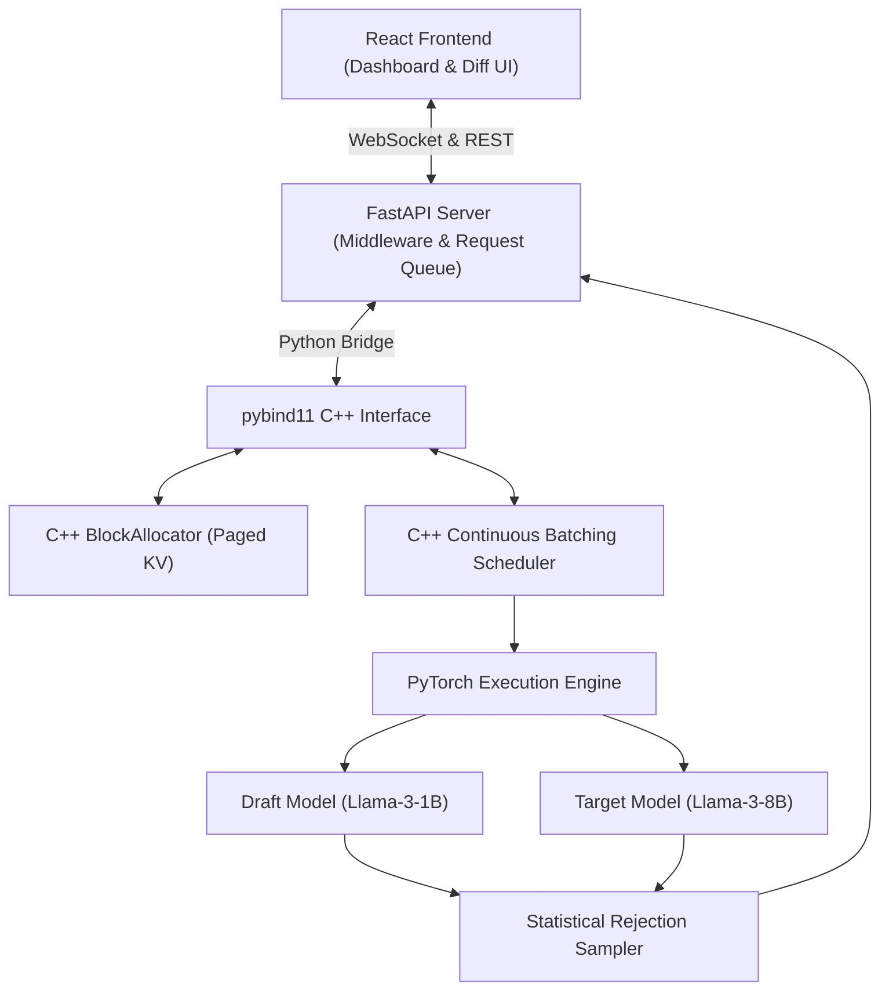

# MemForge: Architecture, Setup, Testing & Roadmap Guide

Welcome to **MemForge**! This guide gives you a complete, intuitive understanding of what we are building, how the system works under the hood, how to set it up, how to run and test every component, and what we are tackling next.

---

## 1. What Are We Doing? (The Big Picture)

When Large Language Models (like Llama-3) generate text, standard inference is heavily bottlenecked by **memory fragmentation** and **compute bandwidth waste**. MemForge builds a custom, high-performance LLM inference engine from scratch to solve these bottlenecks:

```mermaid
flowchart TD
    subgraph Problem1["1. The KV Cache Problem & PagedAttention"]
        P1["Standard Inference"] -->|Demands huge contiguous memory| F1["Memory Fragmentation & Out-of-Memory crashes"]
        S1["MemForge PagedAttention (C++)"] -->|OS-style virtual paging| R1["Fixed 16-token physical blocks & 0% wasted RAM/VRAM"]
    end

    subgraph Problem2["2. The Batching Bottleneck & Continuous Batching"]
        P2["Static Batching"] -->|Waits for the slowest sequence to finish| F2["GPU idle bubbles (massive waste)"]
        S2["MemForge Scheduler (C++)"] -->|Iteration-level scheduling| R2["Requests dynamically join/leave at every token step"]
    end

    subgraph Problem3["3. Autoregressive Latency & Speculative Decoding"]
        P3["Standard Generation"] -->|Target Model (8B) computes 1 token per pass| F3["Memory-bandwidth bound slow generation"]
        S3["MemForge Speculative Engine (PyTorch)"] -->|Draft Model (1B) proposes K tokens + 1 Target verification pass| R3["2x-3x speedup with exact mathematical correctness"]
    end
```

### The C++ / Python Bridge Architecture

- **The Brain (Python / PyTorch)**: Handles the neural network math and loads model weights (e.g., Llama-3-8B target, Llama-3-1B draft) using Hugging Face.
- **The Engine (C++)**: Manages physical memory and request scheduling at lightning speed. It tells Python exactly where to write and read Key/Value tensors in memory blocks.
- **The Bridge (`pybind11`)**: Enables Python to call our compiled C++ engine functions directly with zero serialization overhead.
- **The Middleware (FastAPI & WebSockets)**: Provides OpenAI-compatible `/v1/chat/completions` and live streaming `/ws/stream`.
- **The Frontend (React + Vite)**: Visualizes real-time metrics (Tokens/sec, VRAM block allocation heatmap, and draft-vs-target token highlights).



---

## 2. Repository Layout

```
memforge/
├── engine/                       # [C++ Core Engine - Systems Architect]
│   ├── include/memforge/
│   │   ├── types.hpp             # SequenceId, BlockId, SequenceStatus
│   │   ├── block_allocator.hpp   # Paged KV physical memory manager
│   │   ├── sequence.hpp          # Logical token sequences and block tables
│   │   ├── scheduler.hpp         # Continuous batching step scheduler
│   │   └── engine_core.hpp       # Unified C++ engine orchestrator
│   └── src/
│       ├── block_allocator.cpp   # Block allocation & free-list logic
│       ├── sequence.cpp          # Token append & block table expansion
│       ├── scheduler.cpp         # Step-by-step iteration scheduler
│       └── bindings.cpp          # pybind11 Python export module
│
├── memforge_ml/                  # [Python ML Layer - ML Algorithm Lead]
│   ├── baseline/
│   │   └── naive_runner.py       # Phase 1 baseline standard PyTorch loop
│   ├── models/
│   │   ├── model_loader.py       # Hugging Face target & draft loader
│   │   └── paged_attention.py    # Paged KV-Cache attention operator
│   ├── speculative/
│   │   ├── draft_runner.py       # K-token candidate draft generator
│   │   ├── rejection_sampler.py  # Statistical rejection sampling logic
│   │   └── spec_engine.py        # Combined target + draft verification engine
│   └── engine_bridge.py          # Python/C++ orchestrator bridge
│
├── server/                       # [API & Middleware - Middleware Dev]
│   ├── app.py                    # FastAPI application entrypoint
│   ├── api/routes.py             # OpenAI-compatible REST endpoints
│   ├── api/websocket.py          # Real-time WebSocket token streaming
│   └── queues/request_queue.py   # Async request manager queue
│
├── frontend/                     # [Telemetry & UI - UI Dev]
│   ├── src/App.tsx               # Main dashboard layout
│   ├── src/components/
│   │   ├── TelemetryMetrics.tsx  # Tokens/sec, TTFT, VRAM saturation
│   │   ├── MemoryVisualizer.tsx  # Physical memory block allocation heatmap
│   │   ├── SpeculativeDiff.tsx   # Color-coded draft vs target token diff
│   │   └── ChatStream.tsx        # Real-time prompt dispatcher
│   └── src/index.css             # Glassmorphism dark-mode UI design system
│
├── benchmarks/                   # [Benchmarking Suite]
│   ├── run_baseline.py           # Phase 1 baseline latency benchmark
│   ├── run_paged_kv.py           # Memory fragmentation & allocation speed
│   ├── run_continuous_batching.py# Batching throughput simulation
│   └── run_speculative.py        # Speculative speedup & acceptance rate
│
└── tests/                        # [Automated Test Suite]
    ├── cpp/                      # C++ unit tests (BlockAllocator & Scheduler)
    └── python/                   # Pytest unit tests (RejectionSampler, Attention, API)
```

---

## 3. How to Setup

### 3.1 Python Environment & Dependencies

Activate the pre-configured virtual environment (`.venv`):

```powershell
# Windows PowerShell:
.\.venv\Scripts\Activate.ps1

# Verify Python version (Python 3.12+):
python --version
```

### 3.2 Build the Native C++ Engine (`memforge_c`)

Build and install the high-performance C++ `pybind11` extension:

```powershell
# Build in-place:
python setup.py build_ext --inplace

# Or install in editable mode:
pip install -e .
```

### 3.3 Install Frontend Dependencies

```powershell
cd frontend
npm install
cd ..
```

---

## 4. How to Test & Benchmark Everything

### 4.1 Run C++ Engine Unit Tests

Test the C++ `BlockAllocator` (memory pool & boundary expansion) and `Scheduler` (continuous batching lifecycle):

```powershell
# Compile & run BlockAllocator test:
g++ -std=c++17 -I engine/include tests/cpp/test_block_allocator.cpp engine/src/block_allocator.cpp engine/src/sequence.cpp -o test_block_allocator.exe
.\test_block_allocator.exe

# Compile & run Scheduler test:
g++ -std=c++17 -I engine/include tests/cpp/test_scheduler.cpp engine/src/scheduler.cpp engine/src/block_allocator.cpp engine/src/sequence.cpp -o test_scheduler.exe
.\test_scheduler.exe
```

### 4.2 Run Python Unit Tests

Test statistical rejection sampling math, PagedAttention operators, and FastAPI endpoints:

```powershell
pytest tests/python -v
```

### 4.3 Run Performance Benchmarks

```powershell
# 1. Paged KV-Cache Allocator & Zero-Fragmentation Benchmark:
python benchmarks/run_paged_kv.py

# 2. Continuous Batching vs Static Batching GPU Bubble Simulation:
python benchmarks/run_continuous_batching.py

# 3. Phase 1 Naive Baseline (Unoptimized PyTorch Generation):
python benchmarks/run_baseline.py --tokens 64

# 4. Speculative Decoding Speedup & Acceptance Rate Benchmark:
python benchmarks/run_speculative.py --tokens 64
```

---

## 5. How to Run the Live Engine & Dashboard

### Terminal 1: Launch FastAPI Backend Server

```powershell
.\.venv\Scripts\Activate.ps1
uvicorn server.app:app --host 127.0.0.1 --port 8000 --reload
```
- API Docs: [http://127.0.0.1:8000/docs](http://127.0.0.1:8000/docs)
- Health check: [http://127.0.0.1:8000/v1/health](http://127.0.0.1:8000/v1/health)

### Terminal 2: Launch React Telemetry UI

```powershell
cd frontend
npm run dev
```
- Open [http://localhost:3000](http://localhost:3000) in your browser.
- Type a prompt and observe real-time token streaming, live throughput graphs, memory block heatmaps, and speculative token highlights!

---

## 6. What Are We Doing Next? (Upcoming Sprint)

| Phase | Milestone | Objective | Owner |
| :--- | :--- | :--- | :--- |
| **Phase 2** | **Continuous Batching Integration** | Hook live FastAPI requests from `request_queue.py` into the C++ `Scheduler` so multiple HTTP prompts are interleaved dynamically per token step. | Systems Architect & API Dev |
| **Phase 3** | **PagedAttention Kernel Integration** | Connect the PyTorch model forward pass directly to the C++ block table, replacing all contiguous KV allocations with physical 16-token blocks. | ML Algorithm Lead |
| **Phase 4** | **Speculative Decoding Tuning** | Optimize temperature, top-p, and lookahead $K$ to maximize draft acceptance rate beyond 80% on standard prompts. | ML Algorithm Lead |
| **Phase 5** | **Profiling & Concurrency Stress Testing** | Stress-test concurrent requests with Locust / JMeter, profile memory leak safety with AddressSanitizer, and finalize docs. | Full Team |

---

For full 9-week timeline details and mathematical specifications, refer to [MEMFORGE_PLAN.md](MEMFORGE_PLAN.md) and [CURRENT_STATUS.md](CURRENT_STATUS.md).
