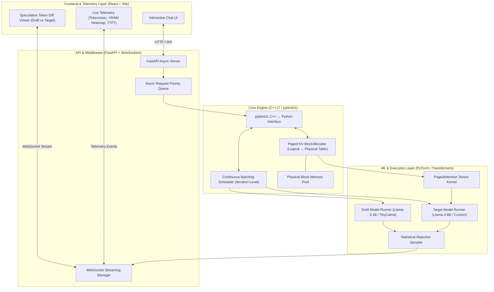
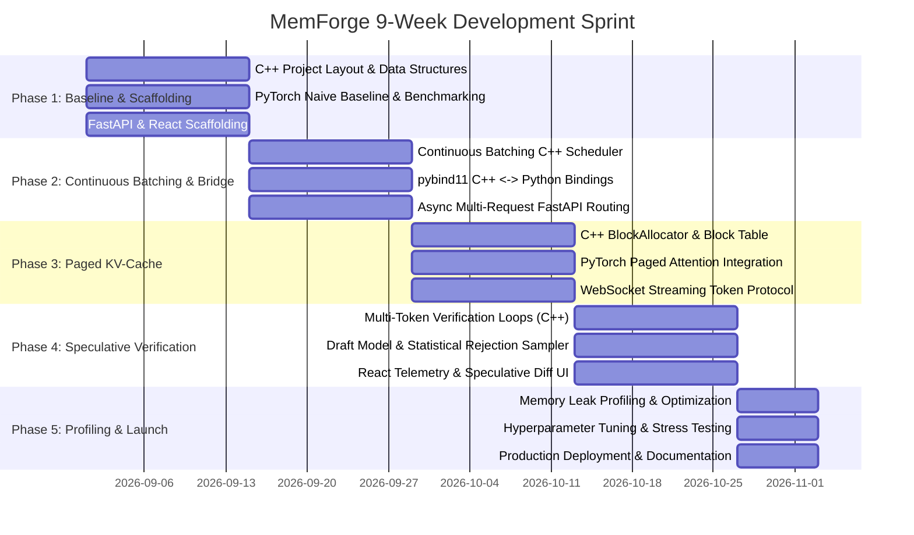

# MemForge: High-Performance Custom LLM Inference Engine
## Master Architectural Specification & Project Initialization Plan

---

## 1. Executive Summary & Core Motivation

**MemForge** is a custom LLM inference engine built from scratch. It bridges low-level C++ systems memory management with modern Python/PyTorch machine learning serving architectures to maximize throughput, minimize latency, and eliminate memory waste during autoregressive text generation.

### The Three Core Problems Solved

```mermaid
flowchart TD
    subgraph Problem1["1. The KV Cache Fragmentation Problem"]
        A1["Standard Inference"] -->|Demands Large Contiguous Allocations| B1["Memory Fragmentation & Out-of-Memory (OOM)"]
        C1["MemForge Solution: PagedAttention"] -->|OS-Style Virtual Paging| D1["Fixed-size Physical Blocks (16 tokens/block) & Zero Waste"]
    end

    subgraph Problem2["2. The Static Batching Bottleneck"]
        A2["Naive Batching"] -->|Waits for Longest Sequence to Finish| B2["GPU Idle Waiting (Bubbles)"]
        C2["MemForge Solution: Continuous Batching"] -->|Step-by-Step Scheduling| D2["Dynamic Ingestion/Eviction of Requests per Token Step"]
    end

    subgraph Problem3["3. Autoregressive Latency Bottleneck"]
        A3["Autoregressive Forward Pass"] -->|Target Model (8B) computes 1 token per pass| B3["Memory Bandwidth Bound Latency"]
        C3["MemForge Solution: Speculative Decoding"] -->|Draft Model (1B) generates K tokens + Single Target Pass| D3["2x-3x Latency Reduction via Statistical Rejection Sampling"]
    end
```

---

## 2. System Architecture & The C++ / Python Bridge



---

## 3. Team Division & Responsibilities (4-Person Architecture)

| Role | Profile | Core Responsibilities |
| :--- | :--- | :--- |
| **1. Systems Architect** *(Lead)* | Advanced C++, OS Internals, High-Performance Concurrency | • Design and implement the C++ `BlockAllocator` (mapping logical sequences to physical VRAM/RAM blocks).<br>• Implement the continuous batching `Scheduler` with iteration-level request preemption and dynamic slot allocation.<br>• Implement concurrency control, thread safety, and memory lifecycle management.<br>• Expose high-performance bindings via `pybind11`. |
| **2. ML Algorithm Lead** | PyTorch, Hugging Face, Attention Mechanics | • Manage Hugging Face PyTorch model loading and weight management for target (8B) and draft (1B) models.<br>• Implement the custom `PagedAttention` layer reading directly from the C++ allocated block table.<br>• Implement the Speculative Decoding tree generation and statistical rejection sampling algorithms.<br>• Benchmark latency, memory throughput, and acceptance rates. |
| **3. API & Middleware Dev** | Python, FastAPI, AsyncIO | • Build the asynchronous FastAPI web service.<br>• Manage the async prompt queue and route HTTP/WebSocket requests into the C++ engine via Python bindings.<br>• Implement token streaming protocols (Server-Sent Events & WebSockets).<br>• Maintain request lifecycle and error handling. |
| **4. Telemetry & UI Dev** | React, TypeScript, Data Visualization | • Build a real-time React telemetry dashboard.<br>• Implement live metrics: Tokens/Second, Time-To-First-Token (TTFT), GPU VRAM / RAM memory block allocation heatmap.<br>• Create an interactive speculative diff view highlighting draft-accepted tokens vs. target-generated tokens in distinct colors. |

---

## 4. Directory & Module Scaffolding

```
memforge/
├── CMakeLists.txt                       # Top-level C++ build configuration
├── pyproject.toml                       # Python package & pybind11 build configuration
├── requirements.txt                     # Python dependencies (PyTorch, Transformers, FastAPI, etc.)
├── .gitignore                           # Standard git ignores (C++, Python, Node, artifacts)
├── README.md                            # High-level overview & quickstart guide
├── MEMFORGE_PLAN.md                     # Master architecture plan and tracking sheet
│
├── engine/                              # [C++ Core Engine - Systems Architect]
│   ├── CMakeLists.txt
│   ├── include/
│   │   └── memforge/
│   │       ├── types.hpp                # BlockID, RequestID, SequenceState, TokenID, BatchStep
│   │       ├── block_allocator.hpp      # BlockAllocator: free-list, ref-counting, block tables
│   │       ├── sequence.hpp             # Sequence: logical token sequence, prompt/output buffers
│   │       ├── scheduler.hpp            # Scheduler: waiting/running/swapped queues, dynamic step
│   │       └── engine_core.hpp          # EngineCore: master C++ orchestrator
│   └── src/
│       ├── block_allocator.cpp          # Block allocation logic and physical block pool management
│       ├── sequence.cpp                 # Sequence append, block table growth
│       ├── scheduler.cpp                # Iteration-level scheduling and batch step construction
│       └── bindings.cpp                 # pybind11 module exporting classes and methods to Python
│
├── memforge_ml/                         # [Python ML Layer - ML Algorithm Lead]
│   ├── __init__.py
│   ├── config.py                        # Model paths, block size (16), max context length, temperature
│   ├── baseline/
│   │   ├── __init__.py
│   │   └── naive_runner.py              # Phase 1 unoptimized standard PyTorch generation loop
│   ├── models/
│   │   ├── __init__.py
│   │   ├── model_loader.py              # Hugging Face AutoModelForCausalLM / tokenizer loader
│   │   └── paged_attention.py           # Custom attention layer reading from C++ block table
│   ├── speculative/
│   │   ├── __init__.py
│   │   ├── draft_runner.py              # Generates K draft candidate tokens with small model
│   │   ├── rejection_sampler.py         # Statistical rejection sampling logic: P(x) vs Q(x)
│   │   └── spec_engine.py               # Combined target + draft verification execution loop
│   └── engine_bridge.py                 # Master Python controller bridging C++ engine with PyTorch
│
├── server/                              # [API & Middleware - Middleware Dev]
│   ├── __init__.py
│   ├── config.py                        # Host, port, default concurrency limits, model paths
│   ├── app.py                           # FastAPI application entrypoint and lifespan management
│   ├── api/
│   │   ├── __init__.py
│   │   ├── routes.py                    # REST API (/v1/models, /v1/chat/completions, /v1/health)
│   │   └── websocket.py                 # WebSocket endpoint for real-time token and metrics streaming
│   └── queues/
│       ├── __init__.py
│       └── request_queue.py             # Thread-safe async queue dispatching requests to C++ engine
│
├── frontend/                            # [Telemetry & UI - UI Dev]
│   ├── package.json                     # React, Vite, Tailwind CSS / Vanilla CSS, Lucide icons
│   ├── vite.config.ts                   # Vite build configuration
│   ├── index.html                       # Entry HTML
│   └── src/
│       ├── main.tsx                     # React root mounting
│       ├── App.tsx                      # Main dashboard layout
│       ├── components/
│       │   ├── ChatStream.tsx           # Real-time token streaming chat interface
│       │   ├── SpeculativeDiff.tsx      # Visual diff (Draft vs Target token color highlights)
│       │   ├── MemoryVisualizer.tsx     # Dynamic block table & physical VRAM allocation grid
│       │   └── TelemetryMetrics.tsx     # Real-time metrics (Tokens/sec, TTFT, Latency gauges)
│       └── services/
│           ├── api.ts                   # REST API client
│           └── websocket.ts             # WebSocket client for streaming data
│
├── benchmarks/                          # [Benchmarking & Profiling Suite]
│   ├── run_baseline.py                  # Phase 1 baseline throughput and memory benchmark
│   ├── run_continuous_batching.py       # Continuous batching throughput vs. static batching
│   ├── run_paged_kv.py                  # Memory fragmentation and max concurrent sequence test
│   └── run_speculative.py               # Speculative decoding acceptance rate & speedup factor
│
└── tests/                               # [Automated Test Suite]
    ├── cpp/
    │   ├── test_block_allocator.cpp     # C++ GoogleTest/Catch2 for block allocation & deallocation
    │   └── test_scheduler.cpp           # C++ tests for continuous batch scheduling & preemption
    └── python/
        ├── test_pybind_bridge.py        # Python tests validating C++ pybind11 module bindings
        ├── test_rejection_sampler.py    # Unit tests for rejection sampling mathematics & edge cases
        └── test_api_stream.py           # Integration tests for FastAPI endpoints & WebSocket stream
```

---

## 5. 9-Week Phased Implementation Roadmap



### Detailed Phase Breakdown

#### Phase 1: The Naive Baseline (Weeks 1-2)
- **Goal**: Establish baseline throughput (Tokens/sec), Time-To-First-Token (TTFT), and VRAM utilization using standard unoptimized PyTorch.
- **Systems Architect**: Setup CMake project, configure compiler flags (`-O3`, `-std=c++17`), define `types.hpp` (`SequenceID`, `TokenID`, `BlockID`, `SequenceStatus`).
- **ML Lead**: Implement unoptimized generation loop in `memforge_ml/baseline/naive_runner.py` for target model (e.g. Llama-3-8B or Llama-3.2-1B / TinyLlama). Record baseline metrics.
- **Middleware & UI**: Build initial FastAPI backend with `/v1/health` and `/v1/chat/completions` endpoints; initialize React + Vite boilerplate with basic chat UI.

#### Phase 2: Continuous Batching & The Engine Shell (Weeks 3-4)
- **Goal**: Eliminate static batch bubbles by scheduling generation step-by-step.
- **Systems Architect**: Build C++ `Scheduler` with `waiting_queue` and `running_queue`. Implement `schedule_step()` which injects incoming sequences the moment a compute slot becomes free.
- **Systems Architect**: Export C++ `Scheduler` and `Sequence` structs to Python via `pybind11`.
- **ML Lead**: Adapt PyTorch generation loop to receive batch execution steps from C++ scheduler rather than static Python lists.
- **Middleware & UI**: Wire FastAPI async request queue to push incoming user requests directly into C++ scheduler queue.

#### Phase 3: Paged KV-Cache (Weeks 5-6)
- **Goal**: Eliminate memory fragmentation and enable dynamic context expansion with zero memory waste.
- **Systems Architect**: Implement C++ `BlockAllocator` dividing memory into fixed blocks (e.g., 16 tokens/block). Build logical-to-physical block table mapping.
- **Systems Architect**: Implement block allocation, ref-counting, block deallocation on sequence completion, and out-of-memory handling.
- **ML Lead**: Implement `paged_attention.py` in PyTorch, modifying the attention computation to gather Key/Value vectors from non-contiguous physical blocks using the C++ block table.
- **Middleware & UI**: Implement WebSocket streaming endpoint in FastAPI for low-latency token streaming to the frontend.

#### Phase 4: Speculative Verification (Weeks 7-8)
- **Goal**: Boost generation speed by 2x-3x using draft generation + single target forward pass verification.
- **ML Lead**: Integrate secondary smaller draft model (e.g., Llama-3.2-1B or TinyLlama).
- **ML Lead**: Implement `rejection_sampler.py` applying the statistical acceptance rule:
  $$\text{Acceptance Probability: } \min\left(1, \frac{P(x)}{Q(x)}\right)$$
  where $P(x)$ is target probability and $Q(x)$ is draft probability. If rejected, resample from $\max(0, P(x) - Q(x))$.
- **Systems Architect**: Optimize C++ batching loops to handle multi-token candidate verification arrays simultaneously.
- **Middleware & UI**: Integrate React telemetry dashboard: visual block table heatmap, tokens/second graph, and color-coded text diff showing draft-accepted vs target-corrected tokens.

#### Phase 5: Profiling, Optimization & Launch (Week 9)
- **Goal**: Zero memory leaks, maximum hardware saturation, and comprehensive documentation.
- **Systems Architect**: Profile with Valgrind / AddressSanitizer; eliminate pointer bottlenecks and memory copies between Python and C++.
- **ML Lead**: Tune draft model temperature, top-p, and lookahead candidate length $K$ (e.g., $K=4$) to maximize acceptance rate.
- **Middleware & UI**: Stress-test FastAPI server under high concurrency (using Locust / JMeter); finalize documentation and packaging.

---

## 6. Mathematical Foundations & Implementation Specifications

### 6.1 PagedAttention Mapping
- **Block Size ($B$)**: 16 tokens.
- **Logical Token Position ($i$)**:
  $$\text{Logical Block Index} = \lfloor i / B \rfloor$$
  $$\text{Block Offset} = i \pmod B$$
- **Physical Memory Lookup**:
  $$\text{Physical Block ID} = \text{BlockTable}[\text{seq\_id}][\text{Logical Block Index}]$$
  $$\text{Physical Address} = \text{PoolBase} + (\text{Physical Block ID} \times B + \text{Block Offset}) \times \text{TokenKVBytes}$$

### 6.2 Speculative Decoding Verification Rule
For a candidate sequence $(x_1, x_2, \dots, x_K)$ generated autoregressively by the draft model $M_{\text{draft}}$ with distribution $Q(x)$:
1. The target model $M_{\text{target}}$ evaluates the entire prefix plus all $K$ tokens in a **single forward pass**, producing distribution $P(x_i \mid x_{<i})$.
2. For each token $i = 1, \dots, K$:
   - Sample $r \sim \text{Uniform}(0, 1)$.
   - If $r \le \min\left(1, \frac{P(x_i \mid x_{<i})}{Q(x_i \mid x_{<i})}\right)$, **Accept** $x_i$.
   - Else, **Reject** $x_i$, resample $x_i \sim \text{normalize}\left(\max(0, P(x_i) - Q(x_i))\right)$, and discard all subsequent draft tokens $x_{i+1}, \dots, x_K$.
3. If all $K$ tokens are accepted, sample one bonus token from $P(x_{K+1} \mid x_{\le K})$.
4. Theoretical guarantee: The output distribution strictly matches the exact distribution of the Target model $P(x)$.

---

## 7. Next Steps for Initializing the Repository

1. **Create initial project configuration files**:
   - `CMakeLists.txt` for C++ engine compilation.
   - `requirements.txt` with PyTorch, transformers, fastapi, uvicorn, pybind11, pytest, etc.
   - `pyproject.toml` / `setup.py` configured with `pybind11` C++ extension module.
   - `.gitignore` for clean version control.
   - `README.md` with setup and execution instructions.
2. **Scaffold core directory structure** (`engine/`, `memforge_ml/`, `server/`, `frontend/`, `benchmarks/`, `tests/`).
3. **Implement Phase 1 baseline & C++ core headers** (`engine/include/memforge/types.hpp`, `engine/include/memforge/block_allocator.hpp`, `memforge_ml/baseline/naive_runner.py`).
