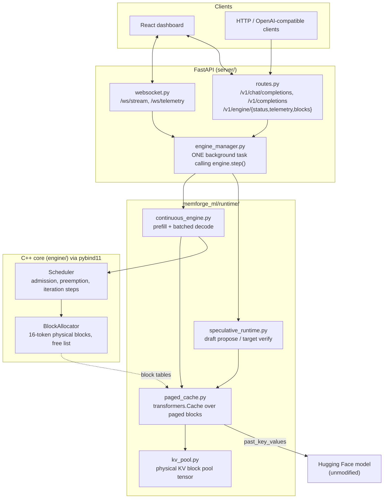

# MemForge: Progress Report & Next Phases

**Date:** 2026-10-13
**Phase completed:** Live Runtime — the engine now runs real model weights end to end.
**Previous state:** every subsystem was scaffolded but nothing was connected; the
server returned hardcoded strings and the benchmarks measured simulations.

---

## 1. What changed, in one paragraph

Before this phase MemForge was a set of correct-looking parts that never touched
each other: the C++ allocator and scheduler existed and had unit tests, the
PyTorch modules existed, the FastAPI server existed, and the WebSocket endpoint
streamed a hardcoded list of words with invented metrics. This phase built the
layer that makes them one system. A `PagedCache` plugs the C++ block allocator
directly into an unmodified Hugging Face forward pass, a `ContinuousBatchingEngine`
drives generation from the C++ scheduler one token step at a time, a speculative
runtime verifies draft tokens against the target with O(1) rollback, and the
server drives all of it from a single background loop so concurrent HTTP and
WebSocket clients share one continuously-batched engine. Every claim below is
measured on real weights, including the one that came out negative.

---

## 2. Architecture as built



The load-bearing idea is `PagedCache`. It implements the `transformers.Cache`
interface, so `model(input_ids=..., past_key_values=paged_cache)` is an ordinary
forward pass — but every Key/Value write lands in a 16-token physical block handed
out by the C++ allocator, and every read is gathered back through the logical →
physical block table. The model never knows it is paged, which is why this works
on any causal LM without patching attention.

---

## 3. Verified results

Measured on this machine: Windows 11, 16 CPUs, **CPU-only** PyTorch 2.13,
target `SmolLM2-360M-Instruct`, draft `SmolLM2-135M-Instruct`, fp32, block size 16.
Reproduce with `python benchmarks/run_live_engine.py`; raw output is in
`benchmarks/results/live_engine.json`.

### 3.1 Correctness (the part that matters most)

| Property | How it is checked | Result |
| :--- | :--- | :--- |
| Paged KV == contiguous KV | Prefill + 6 decode steps, paged vs stock `DynamicCache`, real weights | **max abs logit difference 0.0** at every step |
| Batched decode == sequential decode | 3 prompts of different lengths, greedy | **identical token ids**, at every concurrency level 1/2/4/8 |
| Preemption is transparent | Pool too small to hold 3 sequences, forcing eviction + recompute | **identical token ids** to an unpressured run |
| Speculative decoding is lossless | Greedy speculative vs plain greedy target, real weights | **identical token ids** on all 4 prompts |
| No memory leaks | Block accounting after every scenario | **all physical blocks reclaimed**; free + allocated == total always |

The speculative check is the strongest statement available: at temperature 0 the
rejection sampler must reduce exactly to the target model's own greedy output, and
it does.

### 3.2 Continuous batching — the real win

| Concurrent requests | Served one at a time | Continuously batched | Speedup | Aggregate tok/s | Tokens per forward pass |
| ---: | ---: | ---: | ---: | ---: | ---: |
| 1 | 1.82 s | 2.22 s | 0.82x | 14.4 | 1.00 |
| 2 | 3.85 s | 2.65 s | 1.46x | 24.2 | 1.89 |
| 4 | 8.33 s | 3.88 s | 2.15x | 33.0 | 3.51 |
| 8 | 15.09 s | 4.55 s | **3.32x** | **56.2** | **6.29** |

Aggregate throughput scales from 14.4 to 56.2 tok/s (3.9x) going from 1 to 8
in-flight requests, because the engine confirms 6.29 tokens per model forward pass
instead of 1. Note the N=1 row is **0.82x** — with a single request there is
nothing to batch and the scheduler is pure overhead. That is the honest shape of
the tradeoff, and it is why the number is reported rather than hidden.

### 3.3 Paging overhead

| | tok/s (median of 5) |
| :--- | ---: |
| Stock Hugging Face contiguous KV | 6.03 |
| MemForge paged KV | 5.89 |
| **Relative** | **0.98x** |

Essentially break-even. Single-shot timings on a busy CPU swing wide enough to
flip the sign of this comparison (observed 0.86x–1.30x across runs), so the
benchmark interleaves both paths and compares medians. The conclusion to draw is
"paging costs roughly nothing measurable here", not a precise ratio.

### 3.4 Memory efficiency — why paging exists

With a 256 MB KV budget for this model (81,920 bytes of KV per token across all
32 layers), the pool holds 204 blocks = 3,264 tokens.

| Allocation strategy | Concurrent sequences that fit |
| :--- | ---: |
| Contiguous reservation for `max_model_len`=1024 | 3 |
| MemForge block-granular paging, 128 tokens actually used | **25** |

**8.3x more concurrency** from the same memory, by not reserving for a worst case
that requests do not reach. This is the structural advantage; it does not depend
on CPU-vs-GPU and it grows with the gap between `max_model_len` and real usage.

### 3.5 Speculative decoding — a measured negative result

| Metric | Value |
| :--- | ---: |
| Mean draft acceptance rate | 34.1% |
| Mean tokens per target forward pass | 2.26 |
| Output identical to greedy target | **yes, all prompts** |
| **Mean wall-clock speedup** | **0.58x (slower)** |

The mechanism works: one target forward pass confirms 2.26 tokens instead of 1,
and the output is provably the target's own distribution. It is still a net loss
in wall-clock time here, for reasons that are structural rather than bugs:

1. **The model pair is too close in cost.** 360M vs 135M is roughly a 2.7x
   compute ratio. Speculation needs the target pass to dominate K draft passes;
   the project plan assumed an 8B/1B pair (~8x), where the arithmetic works out.
2. **The draft runs K sequential forward passes** to propose K tokens, and on CPU
   each pays full Python and dispatch overhead with no parallelism to hide it.
3. **CPU has no spare throughput to trade.** On a GPU, verifying K+1 tokens in one
   pass is nearly free because the pass is memory-bandwidth-bound, not
   compute-bound. That is the regime where 2-3x comes from, and it is not this one.

The 2x–3x in `MEMFORGE_PLAN.md` should be read as a GPU target with a large
target/draft gap, not as something this configuration demonstrates. Continuous
batching is the optimization that pays off on this hardware today.

---

## 4. Bugs found and fixed in the existing C++ core

Wiring the engine up surfaced two real defects in `engine/src/scheduler.cpp` that
the existing unit tests did not reach:

1. **Stranded sequences and leaked blocks under memory pressure.** When
   `ensure_capacity()` failed, the sequence was marked `SWAPPED` and dropped from
   the running queue — never re-queued, and its physical blocks never freed. It
   was lost forever and its memory was gone for the lifetime of the process. Now
   the scheduler frees the victim's blocks, resets its prefill flag, and pushes it
   to the **front** of the waiting queue, so it is recomputed from prompt + output
   when memory frees up (preempt-by-recompute, as vLLM does). Generated tokens are
   retained, and the Python engine re-runs prefill over the whole sequence; a test
   confirms the output is identical to an unpressured run.
2. **Head-of-line blocking by an impossible request.** A request needing more
   blocks than the entire pool could never be admitted, and sat at the head of the
   waiting queue blocking every request behind it forever. Such requests are now
   aborted and reported in `aborted_sequence_ids`.

`SchedulerStepResult` gained `preempted_sequence_ids`, `aborted_sequence_ids` and
`num_waiting` so the Python layer and the dashboard can see these events.

A third issue was environmental, not a code bug: **the g++ linker on this machine
is broken** (`ld returned 116 exit status`, producing a zero-byte executable). It
fails identically on the pre-existing committed sources, so it is not a regression.
`scripts/cpp_test_runner.py` now tries g++, falls back to MSVC (which works and
runs both C++ suites green), and only if neither can link does it report a
toolchain problem rather than a test failure.

---

## 5. What was built

New (`memforge_ml/runtime/`):

| File | Purpose |
| :--- | :--- |
| `kv_pool.py` | Physical KV block pool `(layers, blocks, slots, kv_heads, head_dim)`; logical→physical index translation; memory-budget sizing |
| `paged_cache.py` | `PagedCache`/`PagedCacheLayer` — a `transformers.Cache` backed by the pool, with O(1) `rollback()` |
| `sampling.py` | `SamplingParams`, temperature/top-p, seeded reproducible sampling |
| `continuous_engine.py` | The live engine: C++-scheduler-driven steps, prefill, batched decode, preemption handling, telemetry, block occupancy |
| `speculative_runtime.py` | `PagedSpeculativeEngine` — draft proposal, single-pass target verification, rejection sampling, cache rollback |

Rewritten:

- `server/engine_manager.py` *(new)* — loads models, owns the engine, runs one
  background stepping task, fans token events out to per-request asyncio queues.
  Rebuilds its loop-bound primitives if the event loop changes, so it behaves
  under a test client that creates a loop per request.
- `server/api/routes.py` — real generation, SSE streaming, engine telemetry and
  block-occupancy endpoints, proper 400/503 handling.
- `server/api/websocket.py` — real token streaming with provenance, plus a
  `/ws/telemetry` feed so the dashboard stays live while idle.
- `server/config.py` — every setting overridable by environment variable.
- `frontend/src/services/{api,websocket}.ts` — typed clients matching the real
  server contract, plus an auto-reconnecting telemetry client.
- `frontend/src/App.tsx`, `TelemetryMetrics`, `MemoryVisualizer`,
  `SpeculativeDiff` — driven by real telemetry. The memory map now colours each
  physical block by **owning sequence**, which makes the scattered, non-contiguous
  nature of a paged sequence visible at a glance. Replaced the fabricated "GPU
  saturation" gauge with tokens-per-forward-pass, which is the metric that
  actually shows batching working.
- `frontend/tsconfig.json` *(new)* — the project had none, so `npm run build`
  (`tsc && vite build`) could never have succeeded. Typecheck and build are now green.

Tests — **78 passing in ~8 s**, up from 7:

| File | Covers |
| :--- | :--- |
| `test_kv_pool.py` (9) | Index translation, scattered round-trip, layer isolation, budget sizing, out-of-range guard |
| `test_paged_cache.py` (8) | Bit-exact equality with `DynamicCache`, position tracking, rollback-then-replay, block-table growth |
| `test_continuous_engine.py` (16) | Batched == sequential, late arrivals, preemption + recompute equivalence, abort, EOS, clamping, reproducibility, occupancy |
| `test_speculative_runtime.py` (12) | Greedy == greedy target, perfect-draft acceptance == 1.0, uncorrelated-draft still lossless, exact token counts, block release on abandoned streams, pool exhaustion |
| `test_scheduler_bridge.py` (14) | C++ allocator and scheduler directly: admission, block-at-a-time growth, preemption, abort guard, `max_num_seqs` |
| `test_api_stream.py` (15) | Routes, SSE, concurrent requests, WebSocket streaming and telemetry, error paths |

The runtime tests use a tiny randomly-initialised Llama, so they are fast and need
no network; correctness against real weights is covered by the benchmark.

---

## 6. How to run it

Everything below assumes the virtualenv is active:

```powershell
# Windows PowerShell
.\.venv\Scripts\Activate.ps1
```

```bash
# Git Bash
source .venv/Scripts/activate
```

```bash
# 1. Build the native extension (needed by the engine)
python setup.py build_ext --inplace

# 2. Download the default models (once, ~1 GB)
#    HF_HUB_DISABLE_SYMLINKS=1 avoids a Windows symlink-privilege error.
HF_HUB_DISABLE_SYMLINKS=1 hf download HuggingFaceTB/SmolLM2-360M-Instruct
HF_HUB_DISABLE_SYMLINKS=1 hf download HuggingFaceTB/SmolLM2-135M-Instruct

# 3. Full verification: C++ tests, bridge, 78 pytest, benchmarks, live engine
python scripts/run_pipeline.py

# 4. Real benchmarks on real weights
python benchmarks/run_live_engine.py --tokens 32 --concurrency 1 2 4 8

# 5. Serve
uvicorn server.app:app --host 127.0.0.1 --port 8000

# 6. Dashboard (separate terminal; proxies /v1 and /ws to port 8000)
cd frontend && npm install && npm run dev
```

Useful environment variables: `MEMFORGE_TARGET_MODEL`, `MEMFORGE_DRAFT_MODEL`,
`MEMFORGE_KV_BUDGET_MB`, `MEMFORGE_MAX_NUM_SEQS`, `MEMFORGE_MAX_MODEL_LEN`,
`MEMFORGE_LOOKAHEAD_K`, `MEMFORGE_LOAD_DRAFT`, `MEMFORGE_BATCHED_DECODE`.

---

## 7. Known limitations

These are deliberate scope boundaries, not unknowns:

1. **The paged gather is Python-level.** Reading a sequence's KV costs
   `O(context_length)` indexing per layer per step. It is break-even against
   contiguous caching at these context lengths, but it will not stay that way as
   context grows — the gather is `O(L)` where a fused kernel would be `O(1)`
   pointer arithmetic. This is the single biggest performance item remaining.
2. **Batched decode round-trips through a temporary contiguous cache.** The batch
   is gathered out of the pool, left-padded, run, and the new K/V scattered back.
   Correct and genuinely batched, but it copies the whole batch context every step
   instead of letting attention read the blocks in place.
3. **Prefill is one sequence at a time.** Multiple simultaneous arrivals prefill
   sequentially. There is no chunked prefill, so a long prompt occupies a step.
4. **Speculative decoding is single-sequence**, serialized behind a lock, and not
   integrated with the continuous-batching scheduler. The two optimizations cannot
   currently be used together.
5. **No prefix sharing.** `PhysicalBlock` carries a `ref_count` and the allocator
   maintains it, but nothing yet shares blocks between sequences, so a common
   system prompt is stored once per request.
6. **CPU only.** No CUDA device has been exercised; `fp16`/device placement paths
   exist but are untested.
7. **`EngineCore`** is declared in `engine/include/memforge/engine_core.hpp` with
   no implementation. Python orchestrates the allocator and scheduler directly, so
   the header is currently dead weight — implement it or delete it.

---

## 8. Next phases

Ordered by value for effort. Each has a concrete definition of done.

### Phase A — Make the paged gather cheap *(highest value)*

The gather is the one thing standing between this engine and real performance at
long context.

- Replace the per-step Python gather with a fused kernel: Triton for CUDA, or at
  minimum a vectorized `index_select` into a preallocated buffer to stop
  reallocating per step.
- Let attention read blocks **in place** for the batched decode path, removing the
  temporary contiguous cache round-trip (limitation 2).
- **Done when:** paged throughput is within 5% of contiguous at 2,048-token
  context — the current comparison only holds at ~40 tokens — and
  `benchmarks/run_live_engine.py` reports it across a context sweep.

### Phase B — Prefix sharing via copy-on-write

The ref-counting infrastructure already exists and is unused. This is the highest
memory win still on the table.

- Hash prompt prefixes block-by-block; point identical logical blocks at one
  physical block and bump `ref_count`.
- Copy-on-write when a shared block must be written.
- **Done when:** 8 requests sharing a 512-token system prompt allocate roughly
  1/8th the blocks of today, with byte-identical output, and the dashboard shows
  the shared blocks.

### Phase C — Chunked prefill and prefill/decode fusion

- Split long prompts into block-sized chunks across steps so one long prompt
  cannot stall decoding for everyone (fixes limitations 1 and 3 of the scheduler).
- Mix prefill chunks and decode tokens in a single batched pass.
- **Done when:** p99 inter-token latency for an in-flight request is unaffected by
  a 2,000-token prompt arriving, with a benchmark demonstrating it.

### Phase D — Speculative decoding inside continuous batching

- Teach the C++ scheduler to allocate for `K+1` candidate tokens per step.
- Verify multiple sequences' candidate trees in one batched target pass.
- Re-benchmark on a pair with a real cost gap (e.g. Llama-3-8B + Llama-3.2-1B) to
  test whether the predicted 2-3x materializes where the arithmetic supports it.
- **Done when:** speculation and batching compose, and a GPU run either confirms
  or refutes the 2-3x claim with numbers in this document.

### Phase E — GPU execution

- Exercise CUDA: `fp16`/`bf16`, pool allocated in VRAM, real `max_memory_allocated`
  telemetry instead of the current zero on CPU.
- Re-run the whole benchmark suite on GPU and record it alongside the CPU numbers.
- **Done when:** `benchmarks/results/` holds a GPU report and the README states
  both sets of numbers.

### Phase F — Production hardening

- Request cancellation on client disconnect all the way into the scheduler (the
  WebSocket path aborts; HTTP disconnects are not yet detected).
- Structured logging and a `/metrics` endpoint.
- Load testing for concurrency limits and backpressure when the queue saturates.
- Memory-leak profiling under sustained load (AddressSanitizer on the C++ side).
- Decide `EngineCore`'s fate: implement it as the C++ orchestrator the plan
  describes, or delete the header.
- **Done when:** the server survives a sustained multi-client load test with flat
  memory and no leaked blocks.

---

## 9. Honest status against the original 9-week plan

| Plan phase | Claimed | Actual |
| :--- | :--- | :--- |
| 1 — Baseline & scaffolding | Done | **Done.** Baseline measured on real weights |
| 2 — Continuous batching | Done | **Done and measured: 3.32x at 8 concurrent requests** |
| 3 — Paged KV cache | Done | **Done.** Bit-exact vs contiguous; 8.3x concurrency per byte |
| 4 — Speculative verification | Done | **Mechanism done and proven lossless; the 2-3x speedup claim is unproven and is a net loss on this CPU/model pair** |
| 5 — Profiling & launch | Not started | Not started (Phases A–F above) |

Phases 2–4 were previously marked complete on the strength of scaffolding and
simulated benchmarks. They are now complete on the strength of real weights and
differential tests — with the speculative speedup claim explicitly downgraded to
"mechanism verified, speedup not demonstrated at this scale".
