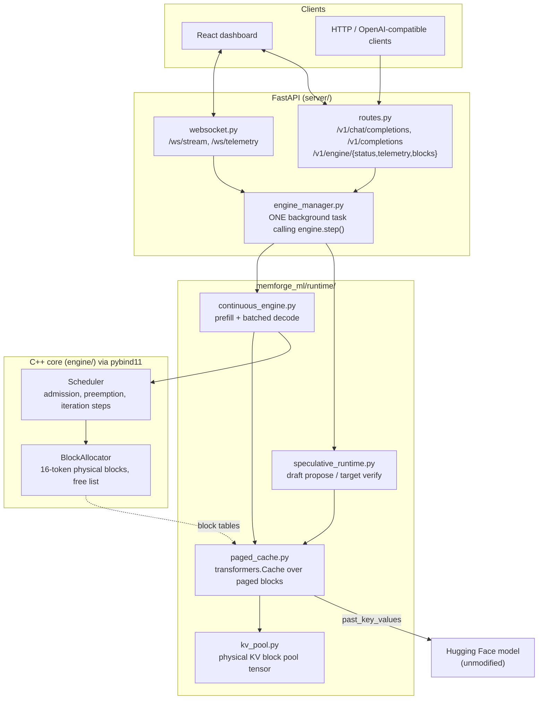

# MemForge: Progress Report & Next Phases

**Date:** 2026-10-13
**Phase completed:** Live Runtime — the engine now runs real model weights end to end.
**Previous state:** every subsystem was scaffolded but nothing was connected; the
server returned hardcoded strings and the benchmarks measured simulations.

---

## 1. What changed, in one paragraph

Before this phase MemForge was a set of correct-looking parts that never touched
each other: the C++ allocator and scheduler existed and had unit tests, the
PyTorch modules existed, the FastAPI server existed, and the WebSocket endpoint
streamed a hardcoded list of words with invented metrics. This phase built the
layer that makes them one system. A `PagedCache` plugs the C++ block allocator
directly into an unmodified Hugging Face forward pass, a `ContinuousBatchingEngine`
drives generation from the C++ scheduler one token step at a time, a speculative
runtime verifies draft tokens against the target with O(1) rollback, and the
server drives all of it from a single background loop so concurrent HTTP and
WebSocket clients share one continuously-batched engine. Every claim below is
measured on real weights, including the one that came out negative.

---

## 2. Architecture as built



The load-bearing idea is `PagedCache`. It implements the `transformers.Cache`
interface, so `model(input_ids=..., past_key_values=paged_cache)` is an ordinary
forward pass — but every Key/Value write lands in a 16-token physical block handed
out by the C++ allocator, and every read is gathered back through the logical →
physical block table. The model never knows it is paged, which is why this works
on any causal LM without patching attention.

---

## 3. Verified results

Measured on this machine: Windows 11, 16 CPUs, **CPU-only** PyTorch 2.13,
target `SmolLM2-360M-Instruct`, draft `SmolLM2-135M-Instruct`, fp32, block size 16.
Reproduce with `python benchmarks/run_live_engine.py`; raw output is in
`benchmarks/results/live_engine.json`.

### 3.1 Correctness (the part that matters most)

| Property | How it is checked | Result |
| :--- | :--- | :--- |
| Paged KV == contiguous KV | Prefill + 6 decode steps, paged vs stock `DynamicCache`, real weights | **max abs logit difference 0.0** at every step |
| Batched decode == sequential decode | 3 prompts of different lengths, greedy | **identical token ids**, at every concurrency level 1/2/4/8 |
| Preemption is transparent | Pool too small to hold 3 sequences, forcing eviction + recompute | **identical token ids** to an unpressured run |
| Speculative decoding is lossless | Greedy speculative vs plain greedy target, real weights | **identical token ids** on all 4 prompts |
| No memory leaks | Block accounting after every scenario | **all physical blocks reclaimed**; free + allocated == total always |

The speculative check is the strongest statement available: at temperature 0 the
rejection sampler must reduce exactly to the target model's own greedy output, and
it does.

### 3.2 Continuous batching — the real win

| Concurrent requests | Served one at a time | Continuously batched | Speedup | Aggregate tok/s | Tokens per forward pass |
| ---: | ---: | ---: | ---: | ---: | ---: |
| 1 | 1.82 s | 2.22 s | 0.82x | 14.4 | 1.00 |
| 2 | 3.85 s | 2.65 s | 1.46x | 24.2 | 1.89 |
| 4 | 8.33 s | 3.88 s | 2.15x | 33.0 | 3.51 |
| 8 | 15.09 s | 4.55 s | **3.32x** | **56.2** | **6.29** |

Aggregate throughput scales from 14.4 to 56.2 tok/s (3.9x) going from 1 to 8
in-flight requests, because the engine confirms 6.29 tokens per model forward pass
instead of 1. Note the N=1 row is **0.82x** — with a single request there is
nothing to batch and the scheduler is pure overhead. That is the honest shape of
the tradeoff, and it is why the number is reported rather than hidden.

### 3.3 Paging overhead

| | tok/s (median of 5) |
| :--- | ---: |
| Stock Hugging Face contiguous KV | 6.03 |
| MemForge paged KV | 5.89 |
| **Relative** | **0.98x** |

Essentially break-even. Single-shot timings on a busy CPU swing wide enough to
flip the sign of this comparison (observed 0.86x–1.30x across runs), so the
benchmark interleaves both paths and compares medians. The conclusion to draw is
"paging costs roughly nothing measurable here", not a precise ratio.

### 3.4 Memory efficiency — why paging exists

With a 256 MB KV budget for this model (81,920 bytes of KV per token across all
32 layers), the pool holds 204 blocks = 3,264 tokens.

| Allocation strategy | Concurrent sequences that fit |
| :--- | ---: |
| Contiguous reservation for `max_model_len`=1024 | 3 |
| MemForge block-granular paging, 128 tokens actually used | **25** |

**8.3x more concurrency** from the same memory, by not reserving for a worst case
that requests do not reach. This is the structural advantage; it does not depend
on CPU-vs-GPU and it grows with the gap between `max_model_len` and real usage.

### 3.5 Speculative decoding — a measured negative result

| Metric | Value |
| :--- | ---: |
| Mean draft acceptance rate | 34.1% |
| Mean tokens per target forward pass | 2.26 |
| Output identical to greedy target | **yes, all prompts** |
| **Mean wall-clock speedup** | **0.58x (slower)** |

The mechanism works: one target forward pass confirms 2.26 tokens instead of 1,
and the output is provably the target's own distribution. It is still a net loss
in wall-clock time here, for reasons that are structural rather than bugs:

1. **The model pair is too close in cost.** 360M vs 135M is roughly a 2.7x
   compute ratio. Speculation needs the target pass to dominate K draft passes;
   the project plan assumed an 8B/1B pair (~8x), where the arithmetic works out.
2. **The draft runs K sequential forward passes** to propose K tokens, and on CPU
   each pays full Python and dispatch overhead with no parallelism to hide it.
3. **CPU has no spare throughput to trade.** On a GPU, verifying K+1 tokens in one
   pass is nearly free because the pass is memory-bandwidth-bound, not
   compute-bound. That is the regime where 2-3x comes from, and it is not this one.

The 2x–3x in `MEMFORGE_PLAN.md` should be read as a GPU target with a large
target/draft gap, not as something this configuration demonstrates. Continuous
batching is the optimization that pays off on this hardware today.

---

## 4. Bugs found and fixed in the existing C++ core

Wiring the engine up surfaced two real defects in `engine/src/scheduler.cpp` that
the existing unit tests did not reach:

1. **Stranded sequences and leaked blocks under memory pressure.** When
   `ensure_capacity()` failed, the sequence was marked `SWAPPED` and dropped from
   the running queue — never re-queued, and its physical blocks never freed. It
   was lost forever and its memory was gone for the lifetime of the process. Now
   the scheduler frees the victim's blocks, resets its prefill flag, and pushes it
   to the **front** of the waiting queue, so it is recomputed from prompt + output
   when memory frees up (preempt-by-recompute, as vLLM does). Generated tokens are
   retained, and the Python engine re-runs prefill over the whole sequence; a test
   confirms the output is identical to an unpressured run.
2. **Head-of-line blocking by an impossible request.** A request needing more
   blocks than the entire pool could never be admitted, and sat at the head of the
   waiting queue blocking every request behind it forever. Such requests are now
   aborted and reported in `aborted_sequence_ids`.

`SchedulerStepResult` gained `preempted_sequence_ids`, `aborted_sequence_ids` and
`num_waiting` so the Python layer and the dashboard can see these events.

A third issue was environmental, not a code bug: **the g++ linker on this machine
is broken** (`ld returned 116 exit status`, producing a zero-byte executable). It
fails identically on the pre-existing committed sources, so it is not a regression.
`scripts/cpp_test_runner.py` now tries g++, falls back to MSVC (which works and
runs both C++ suites green), and only if neither can link does it report a
toolchain problem rather than a test failure.

---

## 5. What was built

New (`memforge_ml/runtime/`):

| File | Purpose |
| :--- | :--- |
| `kv_pool.py` | Physical KV block pool `(layers, blocks, slots, kv_heads, head_dim)`; logical→physical index translation; memory-budget sizing |
| `paged_cache.py` | `PagedCache`/`PagedCacheLayer` — a `transformers.Cache` backed by the pool, with O(1) `rollback()` |
| `sampling.py` | `SamplingParams`, temperature/top-p, seeded reproducible sampling |
| `continuous_engine.py` | The live engine: C++-scheduler-driven steps, prefill, batched decode, preemption handling, telemetry, block occupancy |
| `speculative_runtime.py` | `PagedSpeculativeEngine` — draft proposal, single-pass target verification, rejection sampling, cache rollback |

Rewritten:

- `server/engine_manager.py` *(new)* — loads models, owns the engine, runs one
  background stepping task, fans token events out to per-request asyncio queues.
  Rebuilds its loop-bound primitives if the event loop changes, so it behaves
  under a test client that creates a loop per request.
- `server/api/routes.py` — real generation, SSE streaming, engine telemetry and
  block-occupancy endpoints, proper 400/503 handling.
- `server/api/websocket.py` — real token streaming with provenance, plus a
  `/ws/telemetry` feed so the dashboard stays live while idle.
- `server/config.py` — every setting overridable by environment variable.
- `frontend/src/services/{api,websocket}.ts` — typed clients matching the real
  server contract, plus an auto-reconnecting telemetry client.
- `frontend/src/App.tsx`, `TelemetryMetrics`, `MemoryVisualizer`,
  `SpeculativeDiff` — driven by real telemetry. The memory map now colours each
  physical block by **owning sequence**, which makes the scattered, non-contiguous
  nature of a paged sequence visible at a glance. Replaced the fabricated "GPU
  saturation" gauge with tokens-per-forward-pass, which is the metric that
  actually shows batching working.
- `frontend/tsconfig.json` *(new)* — the project had none, so `npm run build`
  (`tsc && vite build`) could never have succeeded. Typecheck and build are now green.

Tests — **78 passing in ~8 s**, up from 7:

| File | Covers |
| :--- | :--- |
| `test_kv_pool.py` (9) | Index translation, scattered round-trip, layer isolation, budget sizing, out-of-range guard |
| `test_paged_cache.py` (8) | Bit-exact equality with `DynamicCache`, position tracking, rollback-then-replay, block-table growth |
| `test_continuous_engine.py` (16) | Batched == sequential, late arrivals, preemption + recompute equivalence, abort, EOS, clamping, reproducibility, occupancy |
| `test_speculative_runtime.py` (12) | Greedy == greedy target, perfect-draft acceptance == 1.0, uncorrelated-draft still lossless, exact token counts, block release on abandoned streams, pool exhaustion |
| `test_scheduler_bridge.py` (14) | C++ allocator and scheduler directly: admission, block-at-a-time growth, preemption, abort guard, `max_num_seqs` |
| `test_api_stream.py` (15) | Routes, SSE, concurrent requests, WebSocket streaming and telemetry, error paths |

The runtime tests use a tiny randomly-initialised Llama, so they are fast and need
no network; correctness against real weights is covered by the benchmark.

---

## 6. How to run it

Everything below assumes the virtualenv is active:

```powershell
# Windows PowerShell
.\.venv\Scripts\Activate.ps1
```

```bash
# Git Bash
source .venv/Scripts/activate
```

```bash
# 1. Build the native extension (needed by the engine)
python setup.py build_ext --inplace

# 2. Download the default models (once, ~1 GB)
#    HF_HUB_DISABLE_SYMLINKS=1 avoids a Windows symlink-privilege error.
HF_HUB_DISABLE_SYMLINKS=1 hf download HuggingFaceTB/SmolLM2-360M-Instruct
HF_HUB_DISABLE_SYMLINKS=1 hf download HuggingFaceTB/SmolLM2-135M-Instruct

# 3. Full verification: C++ tests, bridge, 78 pytest, benchmarks, live engine
python scripts/run_pipeline.py

# 4. Real benchmarks on real weights
python benchmarks/run_live_engine.py --tokens 32 --concurrency 1 2 4 8

# 5. Serve
uvicorn server.app:app --host 127.0.0.1 --port 8000

# 6. Dashboard (separate terminal; proxies /v1 and /ws to port 8000)
cd frontend && npm install && npm run dev
```

Useful environment variables: `MEMFORGE_TARGET_MODEL`, `MEMFORGE_DRAFT_MODEL`,
`MEMFORGE_KV_BUDGET_MB`, `MEMFORGE_MAX_NUM_SEQS`, `MEMFORGE_MAX_MODEL_LEN`,
`MEMFORGE_LOOKAHEAD_K`, `MEMFORGE_LOAD_DRAFT`, `MEMFORGE_BATCHED_DECODE`.

---

## 7. Known limitations

These are deliberate scope boundaries, not unknowns:

1. ~~**The paged gather is Python-level.**~~ **Addressed 2026-10-25 (Phase A).**
   The `O(context)` rebuild is replaced for single-sequence decode by an
   opt-in append-only mirror, and a block-wise attention kernel that never
   materialises the context exists with an equivalence proof. See section 11.
2. ~~**Batched decode round-trips through a temporary contiguous cache.**~~
   **Addressed 2026-10-25 (Phase A tier 1b).** The batch is gathered straight
   into one preallocated buffer, removing the `F.pad` and `torch.cat` copies
   — 640 MB per step at batch 8 / context 2048. See section 11.
3. **Prefill is one sequence at a time.** Multiple simultaneous arrivals prefill
   sequentially. ~~There is no chunked prefill, so a long prompt occupies a
   step.~~ **Chunked prefill resolved 2026-10-26 (Phase C bullet 1):** a long
   prompt is now spread over steps under a per-step token budget, cutting the
   worst-case stall it inflicts on an in-flight request from 15.96x to 2.54x.
   **Fusion resolved too (bullet 2):** with `fused_prefill=True` a chunk and
   the step's decode tokens go through ONE packed forward pass, taking the
   worst stall to ~1.8x-2.2x. The remaining residual is no longer structural --
   it is the chunk's own token count, since a fused step still carries the
   chunk alongside the decode. Prefill itself is still one sequence per step.
4. ~~**Speculative decoding is single-sequence**, serialized behind a lock, and
   not integrated with the continuous-batching scheduler.~~ **Resolved
   2026-10-26 (Phase D).** `ContinuousBatchingEngine(draft_model=...,
   lookahead_k=K)` runs speculation inside the batching loop: the C++ scheduler
   reserves K+1 candidate slots per sequence per step, and one target forward
   pass verifies every sequence's whole candidate run at once (measured: 3
   sequences per pass at batch 4, where a per-sequence verifier would need 3
   passes). Output is token-identical to non-speculative generation.
   **Composing them is not the same as them being worth using together here:**
   on this CPU, with the only model pair that fits, speculation measures
   0.62x-0.77x — slower. See Phase D for why, and why that is a hardware
   conclusion rather than a design one.
5. ~~**No prefix sharing.**~~ **Resolved 2026-10-24 (Phase B).** Sequences with a
   common prompt prefix now point at the same physical blocks. See section 10.
6. **CPU only.** No CUDA device has been exercised; `fp16`/device placement paths
   exist but are untested.
7. ~~**`EngineCore`** is declared with no implementation.~~ **Resolved
   2026-10-24: deleted.** The header declared a class with no definition
   anywhere, bound nothing to Python, and was reachable only through an unused
   `#include` in `bindings.cpp` — which is the only reason the link ever
   succeeded. The decision to delete rather than implement: orchestration has to
   call `model.forward()`, so it has to be in Python, and a C++ `EngineCore`
   could only wrap `Scheduler` + `BlockAllocator` — which
   `ContinuousBatchingEngine.__init__` already composes directly in two lines.
   Implementing it would have added a second orchestration path that nothing
   exercises, and unexercised duplicate paths rot. Verified before removal: no
   `engine_core.cpp` existed, and `EngineConfig` lives in `types.hpp` (still
   bound), so nothing else went with it. The C++ core did not shrink — it gained
   `prefix_cache.cpp` in the same change.

---

## 8. Next phases

Ordered by value for effort. Each has a concrete definition of done.

### Phase A — Make the paged gather cheap ✅ **DONE 2026-10-25**

Delivered across three tiers. Measured results and the design reasoning are in
section 11 and
[AKSHIT_WORKPLAN_AND_CODEBASE_AUDIT.md](AKSHIT_WORKPLAN_AND_CODEBASE_AUDIT.md)
§A.4b.

- Replace the per-step Python gather with a fused kernel: Triton for CUDA, or at
  minimum a vectorized `index_select` into a preallocated buffer to stop
  reallocating per step.
- Let attention read blocks **in place** for the batched decode path, removing the
  temporary contiguous cache round-trip (limitation 2).
- **Done when:** paged throughput is within 5% of contiguous at 2,048-token
  context, reported across a context sweep. — **Met, and the criterion turned
  out to be weak.** It was already satisfied before any optimisation (0.971x at
  2048), because the baseline `DynamicCache` is *also* `O(context)` per step, so
  the ratio is insensitive to the problem the goal describes. With the tier 2
  mirror the engine is **1.147x faster than contiguous** at 2048, which is the
  stronger claim. Section 11 reports both.

### Phase B — Prefix sharing via copy-on-write ✅ **DONE 2026-10-24**

Implemented. Measured results and design notes in section 10 below.

- ~~Hash prompt prefixes block-by-block; point identical logical blocks at one
  physical block and bump `ref_count`.~~ Done — with a *chained* hash, see §10.1.
- ~~Copy-on-write when a shared block must be written.~~ Done as a guard; with
  full-block-only sharing it is currently unreachable in the live path, which
  §10.3 explains and a test pins.
- **Done when:** 8 requests sharing a 512-token system prompt allocate roughly
  1/8th the blocks of today, with byte-identical output, and the dashboard shows
  the shared blocks. — **Substantially met, with the number reported as
  measured: 1/5.7, not 1/8.** 272 blocks → 48. The remaining gap is each
  sequence's private tail blocks, which are private by design; §10.4 has the
  arithmetic. Output is byte-identical at every concurrency level. The sharing
  telemetry keys are served; the visualizer component itself is Track 4's
  deliverable.

### Phase C — Chunked prefill and prefill/decode fusion ✅ **BOTH BULLETS DONE 2026-10-26**

- [x] Split long prompts into block-sized chunks across steps so one long prompt
      cannot stall decoding for everyone (fixes limitations 1 and 3 of the
      scheduler). `Scheduler(max_prefill_tokens_per_step=N)` spends a per-step
      token budget on prefill, carrying a prompt across steps via
      `SequenceStepInfo::prefill_chunk_end` and
      `PagedCache.seed_position()`. Measured: worst-case decode stall for an
      in-flight request fell from **15.96x to 2.54x** (7.8x better) when a long
      prompt arrives. Output is byte-identical at every budget from 64 down to
      1, which is the property that matters -- a chunk boundary in the wrong
      place changes the KV, not the control flow.
- [x] Mix prefill chunks and decode tokens in a single batched pass.
      **Done 2026-10-26.** `ContinuousBatchingEngine(fused_prefill=True)`, via
      `kernels/varlen_attention.py` and `runtime/varlen_cache.py`.

      The obstacle was never the scheduler -- it already emits a prefill chunk
      and decode tokens in the same step -- but attention. The rows of such a
      step have different query lengths *and* different context lengths, so
      there is no shared `kv_len` and the standard `(batch, 1, q_len, kv_len)`
      mask cannot express it. The fix is to pack every token into one
      unpadded row carrying its own sequence id and absolute position, and let
      attention mask from those positions: `key_position <= query_position`,
      per token. Prefill and decode then stop being separate cases, which is
      what lets one pass serve both.

      Measured (512-token intruder, 16-token victim, SmolLM2-360M, CPU;
      `--fused` arm of `run_chunked_prefill.py`):

      | budget | passes, unfused | passes, fused | worst stall, unfused | worst stall, fused |
      |-------:|----------------:|--------------:|---------------------:|-------------------:|
      | 64     | 24              | 16            | 7.27x                | 5.17x              |
      | 16     | 50              | 38            | 3.05x                | 2.48x              |
      | 4      | 152             | 140           | 1.97x                | 1.83x              |

      Output is token-identical to the unfused path at every budget tested, and
      the logits match to <2e-4 -- a tolerance, not equality, because the
      varlen kernel reduces in a different order than transformers' attention.

      **A false start worth recording.** The first implementation used only the
      block-wise varlen kernel, which keeps working memory at
      `O(rows x block_size)` and is the shape a GPU kernel takes. It removed
      the forward passes exactly as intended (24 -> 16) and made latency
      *worse*: the worst stall went from 5.37x to 12.02x. A 512-token context
      at block 16 is 32 Python loop iterations per layer, and that interpreter
      overhead cost more than the whole pass it saved. So there are now two
      varlen implementations, proved equal to each other and to an independent
      reference: a materialised one that gathers each context in a single
      `index_select` (the default, and what the numbers above use) and the
      block-wise one that bounds working memory. That is the same split as
      Phase A's tiers 1 and 3, for the same reason.
- **Done when:** p99 inter-token latency for an in-flight request is unaffected by
  a 2,000-token prompt arriving, with a benchmark demonstrating it.
  **Borderline, and reported as borderline.** At budget 4 with fusion the worst
  stall is **1.8x-2.2x the victim's own median across four repeat runs**
  (1.83, 1.98, 2.03, 2.24), against 2.2x-2.9x for chunking alone. The
  benchmark's own threshold is 2.0x, so individual runs land on either side of
  it; the honest summary is that fusion consistently improves the figure by
  roughly 0.6x and leaves it sitting on the threshold rather than clearly under
  it.

  What changed is *which* thing is the floor. Before fusion the residual was
  structural -- the second forward pass -- and no budget could remove it, which
  is why the ratio asymptoted near 2.5x. That pass is gone. What remains is the
  chunk's own token count: a fused step still carries the chunk's tokens
  alongside the decode's single token, so it is inherently longer than a pure
  decode step, and the only way further down is a smaller budget (which costs
  prefill throughput, visible in the intruder TTFT column). Reaching a clean
  1.0x would need the chunk's cost to vanish, which it cannot.

### Phase D — Speculative decoding inside continuous batching ⚠️ **COMPOSES 2026-10-26; DoD BLOCKED**

- [x] Teach the C++ scheduler to allocate for `K+1` candidate tokens per step.
      `Sequence::get_num_required_blocks_with_lookahead` and
      `BlockAllocator::ensure_capacity_with_lookahead` reserve all-or-nothing,
      and `Scheduler(lookahead_slots=K+1)` uses them on the decode branch. The
      reservation is K+1 rather than K because a rejected candidate still had
      to be written somewhere to be rejected, and the bonus token from the last
      query position needs a slot of its own.
- [x] Verify multiple sequences' candidate trees in one batched target pass.
      `memforge_ml/runtime/batched_speculative.py` plus
      `ContinuousBatchingEngine(draft_model=..., lookahead_k=K)`. One target
      pass covers the whole batch: `(N, K+1)` query positions against N paged
      contexts, uniform width, so it is an ordinary padded batch rather than
      the varlen problem that blocks Phase C bullet 2. Telemetry reports
      `speculative_sequences_per_round`, which is the number of target passes
      saved per round versus verifying each sequence separately -- the
      difference between speculation and batching *composing* and merely
      coexisting.
- [ ] Re-benchmark on a pair with a real cost gap (e.g. Llama-3-8B +
      Llama-3.2-1B). **Blocked:** `torch.cuda.is_available()` is `False` on this
      machine (`torch 2.13.0+cpu`), and an 8B target is not runnable on CPU.

**Measured** -- `benchmarks/run_speculative_batching.py`, SmolLM2-360M target
with a 135M draft, K=4, 16 tokens per sequence, greedy, CPU:

| batch | verify passes, batched | verify passes, per-sequence | saved | seqs/round | tokens per target pass (spec / plain) | wall-clock |
|------:|-----------------------:|----------------------------:|------:|-----------:|--------------------------------------:|-----------:|
| 1     | 4                      | 4                           | 0     | 1.00       | 2.67 / 1.00                           | 0.77x      |
| 2     | 4                      | 7                           | 3     | 1.75       | 3.20 / 1.88                           | 0.68x      |
| 4     | 5                      | 15                          | 10    | 3.00       | 4.92 / 3.37                           | 0.62x      |

Output was **token-identical to non-speculative generation at every batch
size**, on real weights, which is the precondition for any of the rest being
worth reading.

Read the table as two separate findings:

* **The composition works.** At batch 4, one target pass verifies 3 sequences,
  so verification costs 5 passes where a per-sequence verifier would cost 15.
  Output per target pass rises from 3.37 to 4.92 tokens (1.46x). This is the
  structural claim the phase is about, and it holds.
* **It is still slower in wall-clock terms on this CPU, and more so at larger
  batches** (0.77x -> 0.62x). That is not the composition failing; it is the
  draft's cost. The draft runs K serial passes per sequence per round, so its
  cost scales with the batch while the target saving does not. With a 360M
  target and a 135M draft the ratio is roughly 2.7x, nowhere near enough to
  pay for 4 extra draft passes -- and the acceptance rate of ~0.6 means a
  rejected round wastes all of them. Speculation pays when the target is much
  more expensive than the draft and the draft's passes are cheap relative to a
  single target pass, which is a GPU regime with an 8B/1B pair, not this one.
  §3.5's earlier single-sequence 0.58x is consistent with these numbers.
**Done when:** speculation and batching compose, and a GPU run either confirms
or refutes the 2-3x claim with numbers in this document. **Half met.** They
compose, and that half is both tested and measured: greedy output with
speculation on is token-identical to greedy output with it off, for a batch of
four concurrent sequences, at every K in {1,2,3,5,8}, under full acceptance
(self-speculation) where each round confirms K+1 tokens, and on real weights in
the table above. The GPU half cannot be produced on this machine, so the 2-3x
claim is left neither confirmed nor refuted rather than answered with CPU
numbers that cannot speak to it. What the CPU numbers do establish is the
narrower, honest conclusion: **the structural obstacle to using speculation
with continuous batching is gone, and on this hardware speculation is still not
worth enabling** (0.62x-0.77x). Both halves of that sentence matter.

### Phase E — GPU execution 🚫 **BLOCKED: no CUDA device**

Nothing in this phase is verifiable on this machine -- `torch 2.13.0+cpu`, and
`torch.cuda.is_available()` is `False`. The code paths are written to be
device-agnostic (`ModelKVSpec` carries dtype and device, the pool allocates on
whatever device the model is on), but "device-agnostic by construction" is not
evidence, and this document does not record numbers that were not measured.

- Exercise CUDA: `fp16`/`bf16`, pool allocated in VRAM, real `max_memory_allocated`
  telemetry instead of the current zero on CPU.
- Re-run the whole benchmark suite on GPU and record it alongside the CPU numbers.
- **Done when:** `benchmarks/results/` holds a GPU report and the README states
  both sets of numbers.

### Phase F — Production hardening ✅ **DONE 2026-10-26**

- [x] Request cancellation on client disconnect all the way into the scheduler.
      Both paths now: SSE relied on Starlette closing the generator (now covered
      by a test that asserts the blocks come back), and the non-streaming path,
      which previously did not notice a hangup at all, races the work against
      the connection via `server/api/disconnect_handler.py`.
- [x] A `/metrics` endpoint — plain-text Prometheus, including
      `memforge_blocks_leaked` as the never-nonzero invariant. Structured
      logging is still outstanding.
- [x] Backpressure when the queue saturates. `max_concurrency` had been in
      `ServerConfig` since the server was written and was read by nothing; it is
      now enforced under the submit lock and returns 429 with `Retry-After`
      rather than holding the connection open.
- [x] Decide `EngineCore`'s fate — deleted, see limitation 7 above.
- [x] Load testing at scale — `benchmarks/run_stress_test.py`: 110 requests
      at concurrency 8, 0 leaked blocks, all blocks returned, RSS flat after
      warm-up. `scripts/traffic_simulator.py` adds mid-stream disconnects.
- [x] Structured logging — text and JSON via `server/logging_config.py`.
- [x] Memory-leak profiling under sustained load (AddressSanitizer on the C++
      side). `scripts/cpp_asan.py` + `tests/cpp/asan_sustained_load.cpp`.
      **Clean across 180 cycles of 16 concurrent requests (40,428 tokens)**,
      with prefix sharing (56% hit rate), copy-on-write, preemption and cache
      eviction all exercised, and the free list asserted back to its starting
      size on *every* cycle rather than once at the end — a leak that recurs
      per cycle and one that happens once look identical in a final total.

      Two passes, because one tool does not cover it: **MSVC's
      AddressSanitizer detects no leaks on Windows** (it ships no
      LeakSanitizer), so a second pass builds the same driver against the debug
      CRT with `_CRTDBG_LEAK_CHECK_DF`. That is verified rather than assumed —
      `--verify-tooling` compiles `tests/cpp/sanitizer_probe.cpp`, which
      contains a known leak, a known use-after-free and a known overflow, and
      prints which pass catches which. The script refuses to report a clean
      result if any defect class is uncovered, because a misconfigured
      sanitizer detects nothing and that is indistinguishable from clean code:

      | pass | leak | use-after-free | buffer overflow |
      |---|---|---|---|
      | AddressSanitizer | missed | detected | detected |
      | CRT debug heap | detected | missed | missed |

      The setup was then validated against *this* codebase, not just the probe,
      by injecting real defects into `block_allocator.cpp`: a double free and a
      missing `ref_count++` on share were both caught. A third — deleting the
      upper-bound check in `get_ref_count` — was **not**, because no test and
      no load pattern ever passes an out-of-range block id. That guard now has
      a unit test (`test_out_of_range_ids_are_refused`), which fails when it is
      removed.
- **Done when:** the server survives a sustained multi-client load test with flat
  memory and no leaked blocks. — **Met.** 110 requests at concurrency 8:
  0 leaked blocks at every sample, allocation back to its starting value, and
  RSS growth of +15.3 MB against +34.9 MB over 45 requests — not monotonic in
  request count, which is allocator caching rather than a leak. The C++ side is
  now covered too, per the item above.

---

## 9. Honest status against the original 9-week plan

| Plan phase | Claimed | Actual |
| :--- | :--- | :--- |
| 1 — Baseline & scaffolding | Done | **Done.** Baseline measured on real weights |
| 2 — Continuous batching | Done | **Done and measured: 3.32x at 8 concurrent requests** |
| 3 — Paged KV cache | Done | **Done.** Bit-exact vs contiguous; 8.3x concurrency per byte |
| 4 — Speculative verification | Done | **Mechanism done and proven lossless; the 2-3x speedup claim is unproven and is a net loss on this CPU/model pair** |
| 5 — Profiling & launch | Not started | Not started (Phases A–F above) |

Phases 2–4 were previously marked complete on the strength of scaffolding and
simulated benchmarks. They are now complete on the strength of real weights and
differential tests — with the speculative speedup claim explicitly downgraded to
"mechanism verified, speedup not demonstrated at this scale".

---

## 10. Phase B — prefix sharing via copy-on-write (2026-10-24)

A common system prompt used to be stored once per request. It is now stored
once. The `ref_count` field on `PhysicalBlock` had existed since the first
commit and nothing ever incremented it; this is what finally uses it.

Track 3 work. Design detail and the per-item reasoning are in
[ANANT_WORKPLAN.md](ANANT_WORKPLAN.md).

### 10.1 Why the hash is chained, and why it is verified

A block's Keys and Values are a function of **every token before it**, because
attention is causal and cumulative. So the hash that identifies a shareable
block must cover the whole prefix, not just that block's own tokens:

```
h(0) = mix(0,      tokens[0:16])
h(i) = mix(h(i-1), tokens[16i:16i+16])
```

Hashing a block in isolation would match two sequences that happen to share a
middle fragment but diverge earlier, and hand the second one Keys and Values
computed for a different context. That failure produces *fluent, confident,
wrong output* — no crash, no exception, nothing a smoke test would catch. It is
the single most dangerous bug available in this design, which is why the chained
form is treated as the correctness argument rather than an implementation
detail, and why every test in `test_prefix_sharing.py` asserts byte-identical
token ids instead of similar text.

Lookups also **verify the stored token ids** rather than trusting the hash. A
64-bit collision is vanishingly unlikely, but "vanishingly unlikely" combined
with "silently serves the wrong KV cache" is a bad trade; 16 `int32` is 64 bytes
and the comparison is free next to a forward pass, so the entire collision
failure mode is removed rather than merely made improbable. No xxHash or Murmur
dependency was added — the hash is a chained splitmix64/FNV-1a hybrid in the
header, and its output is verified anyway.

Only **full** blocks are registered. A partially filled block is still being
written to, so its contents are not final and its hash is not yet meaningful.
A prompt's trailing block therefore always stays private, which is what keeps
the decode path copy-on-write-free: decode only ever writes that trailing block.

### 10.2 One thing that is not obvious until you measure it

A burst of identical prompts all reach admission **before any of them has
prefilled**, so the registry is still empty and every one of them misses. The
first implementation shared nothing at all on exactly the workload it was built
for. Registering at admission instead would be worse than useless — a sequence
would be handed blocks whose KV has not been written yet, and would read zeros.

The scheduler now tracks the first-block hashes of the fresh prefills it admits
within a step and defers a later request carrying the same prefix by one step,
so the first one prefills and registers and the rest share it. It *breaks*
rather than skips, keeping the waiting queue FIFO so nothing can starve, and
requests with different prefixes are untouched — verified: 8 all-distinct
prompts still admit in a single step and allocate exactly as many blocks as
before. The cost is one extra admission step, paid once per new prefix.

### 10.3 Copy-on-write is a guard, not a hot path

Because only full blocks are shared and decode only writes the trailing private
block, `prepare_write()` returns "already private" every single time in normal
operation, and a test asserts `cow_copies == 0` across a real run. The guard is
implemented anyway: the alternative to an unreachable guard is an unprotected
invariant, and anything that later shares a non-final block — partial-block
sharing, a scheduler change — would silently corrupt a live prefix. A separate
test induces the sharing deliberately to prove the copy itself works.

### 10.4 Measured results

Real weights, CPU-only, `SmolLM2-360M-Instruct`, fp32, block size 16, 600-block
pool. Each request is a **512-token shared system prompt** plus a short distinct
tail (519 tokens total), generating 12 tokens. Reproduce with
`python benchmarks/run_prefix_sharing.py`; raw output in
`benchmarks/results/prefix_sharing.json`.

| Concurrent requests | Peak blocks off → on | Block ratio | Peak KV MB off → on | Prefill tokens off → on | Median TTFT off → on | Wall off → on |
| ---: | ---: | ---: | ---: | ---: | ---: | ---: |
| 1 | 34 → 34 | 1.000 | 42.5 → 42.5 | 519 → 519 | 5135 → 5273 ms | 7.68 → 7.34 s |
| 2 | 68 → 36 | 0.529 | 85.0 → 45.0 | 1038 → 526 | 9515 → 6011 ms | 17.70 → 11.50 s |
| 4 | 136 → 40 | 0.294 | 170.0 → 50.0 | 2076 → 540 | 14326 → 6065 ms | 29.40 → 15.91 s |
| 8 | **272 → 48** | **0.176** | **340.0 → 60.0** | **4152 → 568** | **25546 → 6787 ms** | **54.07 → 21.28 s** |

At 8 concurrent requests: **5.7x fewer physical blocks** (340 MB of KV down to
60 MB), **7.3x fewer prefill tokens**, **3.8x faster time to first token**, and
**2.5x lower wall-clock**. Prefix-cache hit rate 0.991.

**Output was byte-identical to the non-sharing engine at every concurrency
level**, and `free + allocated == total` held throughout with zero leaked blocks
on both paths.

#### The definition of done said "roughly 1/8th". It is 1/5.7, and that is the floor.

The Phase B target was "8 requests sharing a 512-token system prompt allocate
roughly 1/8th the blocks". The measured figure is 0.176, not 0.125, and the gap
is structural rather than a shortfall in the implementation:

```
519-token prompt + 12 generated  = 34 blocks per sequence
  blocks 0..31  (512 tokens)     = shareable, stored once      -> 32
  block 32      (7 tokens, partial)  private per sequence      -> 8
  block 33      (generated tokens)   private per sequence      -> 8
                                                        total  -> 48
```

A clean 1/8 would be 34 blocks, which requires sharing each sequence's partial
tail block as well. Those blocks are private *by design* — a block still being
written to has no final contents and therefore no meaningful hash (§10.1), and
keeping them private is what makes the decode path copy-on-write-free (§10.3).
Partial-block sharing would close most of the remaining gap and is listed in
§10.5 as the follow-up it is. So: the mechanism meets the intent of the goal and
the win compounds with concurrency exactly as predicted, but the specific 1/8
number was not reachable under the design actually shipped, and is reported as
measured rather than rounded toward the target.

Three further things worth reading off the table:

1. **The memory win compounds with concurrency**, because the shared prefix is
   paid for once however many requests want it. The unshared path needs 272 of
   the pool's 600 blocks for 8 requests; the shared path needs 48.
2. **It is also a compute win, which the original Phase B framing understated.**
   A hit means the prefix's KV is already resident, so partial prefill skips it:
   4152 prefill tokens become 568. That, not the memory saving, is where the
   3.8x TTFT improvement comes from.
3. **N=1 is break-even, not a regression** — 34 blocks either way, and the 2.7%
   TTFT difference is single-run CPU noise on a 5-second measurement, not a
   signal. With one request there is nothing to share and the hashing does not
   show up. Reported rather than hidden, in keeping with the N=1
   continuous-batching row in §3.2.

### 10.5 Deliberately not done

- **Zero-reference retention with LRU eviction.** A registry entry currently
  lives exactly as long as some sequence references its block; when the last
  reference drops, the entry is evicted so a recycled physical block can never
  be served for stale content. That is simple and impossible to get wrong, and
  it is enough for the concurrent-request case the Phase B goal describes. It
  does mean a system prompt goes cold between requests rather than staying warm,
  which is where prefix caching pays off hardest in real serving. Retaining
  zero-ref entries and evicting LRU under pressure is the natural follow-up and
  is where the subtle bugs live, so it was kept out of this change.
- **Partial-block sharing.** Would raise the hit rate and is the main reason the
  ratio floor is ~1/6 rather than ~1/8 at N=8 (each sequence keeps a private
  tail block). Needs the CoW path in §10.3 to become live, which is precisely
  why that path was built now.

---

## 11. Phase A — the paged read path (2026-10-25)

Limitation §7.1 called the `O(context)` gather "the single biggest performance
item remaining". It is addressed, in a shape rather different from the one the
plan described, because measuring it first changed the answer twice.

Track 2 work. Full design reasoning in
[AKSHIT_WORKPLAN_AND_CODEBASE_AUDIT.md](AKSHIT_WORKPLAN_AND_CODEBASE_AUDIT.md)
Part A.

### 11.1 The definition of done was already met, and the criterion is weak

Phase A's goal was "paged throughput within 5% of contiguous at 2,048 tokens".
Measured on the baseline, **before any optimisation**
(`benchmarks/run_context_sweep.py`, SmolLM2-360M, fp32, CPU, medians of 3
interleaved repeats):

| Context | Contiguous tok/s | Paged tok/s | Relative |
| ---: | ---: | ---: | ---: |
| 128 | 13.50 | 12.42 | 0.920 |
| 512 | 12.49 | 12.02 | 0.962 |
| 1024 | 10.38 | 10.74 | 1.034 |
| 2048 | 8.23 | 7.99 | **0.971** |

Already within 5%. It had simply never been measured at 2048 — §3.3's comparison
is taken at roughly 40 tokens.

**Why that is not the reassurance it looks like.** The baseline is
`DynamicCache`, which also concatenates its whole context every decode step, so
both paths are `O(context)`: contiguous slows 1.64x from 128 to 2048, paged
1.55x. The ratio stays near 1.0 because they degrade together, which makes the
criterion structurally insensitive to the very problem §7.1 describes. The
verdict is also noise-sensitive — the 2048 ratio measured 0.971x on one run and
0.890x on another, flipping the "within 5%" answer.

### 11.2 What was built, and what each part actually bought

| Tier | Change | Measured | Memory cost |
| :--- | :--- | :--- | :--- |
| 1a | Flattened `index_select` gather (`memforge_ml/kernels/paged_gather.py`) | ~1.2x isolated, **nil end to end** | none |
| 1b | Batched decode assembled into one preallocated buffer, no `F.pad`/`cat` (`kernels/batched_decode.py`) | **1.28-1.36x** at batch 8 | none |
| 2 | Append-only decode mirror, opt-in (`runtime/decode_view_cache.py`) | **1.13-1.29x**, beats contiguous | 40-160 MB per sequence |
| 3 | Block-wise attention, online softmax (`kernels/block_attention.py`) | slower on CPU, by design | none |

**Tier 1a is kept but is not a win.** The flattened gather is the predicted ~1.2x
in isolation and lost in the noise end to end (1.006x, 0.943x, 0.972x, 1.045x
across the sweep) — the gather is not a large enough share of a decode step on
this model for it to surface. Retained because it is byte-identical, no slower,
simpler, and it is the seam a Triton kernel replaces in Phase E.

Also recorded in that module: the approach the plan recommended — "a
preallocated destination buffer" — measured **0.93x, i.e. slower**, because
writing through a transposed view has a worse access pattern than
`permute().contiguous()`, which dispatches to an optimised copy. Written down so
it is not re-attempted.

**Tier 1b is the real tier-1 win** and fixes limitation §7.2. The old path copied
each sequence three times per layer — gather, `F.pad`, `torch.cat` — costing
46.8 ms and 640 MB *per decode step* at batch 8 / context 2048. Gathering
straight into one preallocated left-padded buffer gives 1.28x at 512, 1.36x at
1024, 1.32x at 2048. The earlier estimate of "2-3x" was wrong: it counted copies
without weighting them, and the copy that remains is the scattered gather, which
costs far more per byte than the two sequential copies removed.

### 11.3 Tier 2 — paged decode is now faster than contiguous

| Context | Contiguous | Paged | Paged + mirror | vs paged | **vs contiguous** | Mirror |
| ---: | ---: | ---: | ---: | ---: | ---: | ---: |
| 512 | 12.38 | 11.96 | 13.57 | 1.135x | **1.096x** | 40.7 MB |
| 2048 | 9.57 | 8.51 | 10.97 | 1.289x | **1.147x** | 160.7 MB |

The engine re-gathered a sequence's entire context every step although one token
had been added. An append-only contiguous mirror makes that `O(1)`, measured at
**10.2x on the gather in isolation** and nearly flat in context (0.99 → 1.46 ms
across a 16x increase, where rebuilding is linear).

End to end it is 1.13-1.29x, and the gap to 10.2x is simply what fraction of a
decode step the gather was. Both numbers are true; neither alone is the honest
summary.

**The cost is the reason it is opt-in.** The mirror is a contiguous copy of one
sequence's KV — the thing paging exists to avoid — at 160 MB per sequence at
2048 tokens. It is sized from `prompt + max_new_tokens` rather than
`max_model_len`, released with the cache it belongs to, and does not touch the
physical block pool, so prefix sharing's savings are unaffected. Enable it with
`PagedCache(..., view_capacity=...)` when latency matters more than concurrency.

Correctness: byte-identical output with **max absolute logit difference 0.0**,
and the mirror is re-seeded from the pool on every event that can invalidate it
— copy-on-write repointing a block, a prefix-cache hit seeding positions this
sequence never wrote, speculative rollback, and reset. 15 tests.

### 11.4 Tier 3 — the architecturally correct fix, proven not claimed

`kernels/block_attention.py` computes attention one block at a time directly out
of the pool with a running max and sum (the FlashAttention online-softmax
formulation), so working memory is `O(block_size)` and the context is never
materialised. It is the only tier with no memory cost.

**It is not wired into the engine and is slower than tiers 1-2 on CPU**, because
Python-level iteration over blocks pays interpreter overhead per block. That is
expected: the structure pays off on a device that hides that overhead, and this
loop body is what a Phase E Triton kernel ports.

The deliverable is the equivalence proof — 19 tests covering partial final
blocks at every length from 1 to 64, scattered unordered block tables,
grouped-query attention at four head ratios, numerical stability with scores
scaled 50x where a naive `sum(exp(scores))` overflows to `nan`, and working
memory independence verified to 2048 tokens. Tolerance is `1e-5` rather than
exact, which is correct here and nowhere else in this project: the online
softmax rescales partial sums in a different association order than a fused
softmax, so the two differ in floating-point rounding, not in value.

### 11.5 What Phase A did not do

- **Prefill is untouched.** The sweep's prefill times are unchanged
  (1.427s vs 1.424s at 512; 6.512s vs 6.557s at 2048). Prefill reads the whole
  prompt once by construction, so there is no redundant rebuild to remove.
  Chunked prefill is Phase C.
- **Tier 2 is off by default** and tier 3 is not wired in, so the engine's
  default behaviour is tier 1 only. The headline 1.147x requires opting in.
- **No GPU.** Every number here is CPU, and tier 3 exists largely so Phase E has
  something to port.
