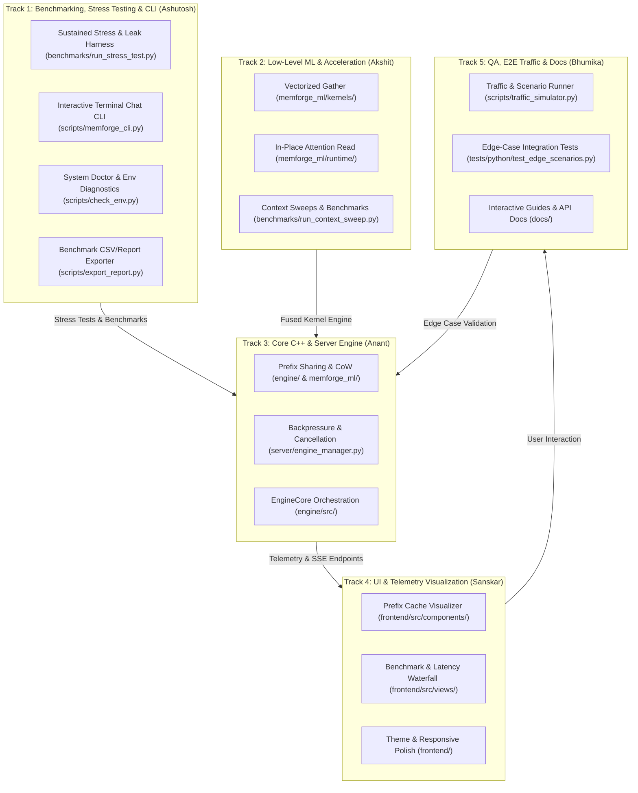
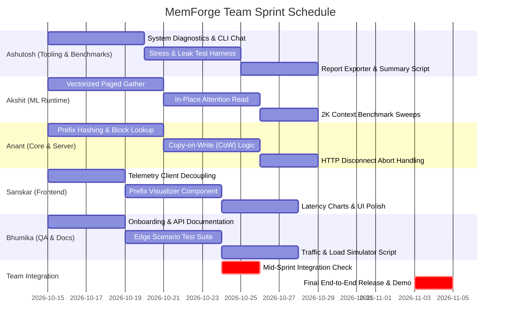

# MemForge: Team Work Allocation, Modular Architecture & Sprint Roadmap

**Project:** MemForge — Paged KV-Cache & Continuous Batching Inference Engine  
**Alignment:** Aligned with [PROGRESS_AND_NEXT_PHASES.md](PROGRESS_AND_NEXT_PHASES.md) and [CURRENT_STATUS.md](CURRENT_STATUS.md)
**Per-track detail:** [ANANT_WORKPLAN.md](ANANT_WORKPLAN.md) (Track 3) · [ASHUTOSH_SANSKAR_BHUMIKA_WORKPLAN.md](ASHUTOSH_SANSKAR_BHUMIKA_WORKPLAN.md) (Tracks 1, 4 and 5)  
**Document Owner:** Engineering Lead  
**Last Updated:** October 2026  

---

## 1. Executive Strategy & Zero-Conflict Architecture

MemForge is a high-performance local PyTorch & C++ paged KV-cache inference engine. To maximize velocity without unnecessary DevOps overhead (no Docker containers or complex cloud CI/CD), our development model relies on **Strict Modular Isolation** and **Contract-First Development**.

### Core Rules for Zero Git Conflicts
1. **Directory-Level Ownership**: Each teammate works within an isolated subsystem. No two developers will edit the same file in their feature branches.
2. **Contracts & Interfaces First**: All inter-module communication is governed by documented types, mock contracts, and data structures.
3. **No Direct Commits to `main`**: All work happens on dedicated feature branches `feat/<name>-<module>`.
4. **Local Verification Before PR**: Pull Requests must pass the local test suite (`pytest tests/python/` and `scripts/cpp_test_runner.py`) before review.
5. **Additive Changes Only on Shared Configs**: If shared configuration files (e.g. `requirements.txt`, `routes.py`) need additions, they must be coordinated directly through Anant or the module leads.



---

## 2. Team Profile & Ownership Matrix

| Teammate | Skill Profile & Tools | Assigned Track & Role | Primary File & Directory Ownership | Primary Deliverables (Aligned with Next Phases) |
| :--- | :--- | :--- | :--- | :--- |
| **Akshit** | Advanced ML/AI, multiple completed projects | **Track 2: Performance Kernels & Speculative Batching** (Lead) | `memforge_ml/kernels/`<br>`memforge_ml/runtime/paged_gather.py`<br>`benchmarks/run_context_sweep.py` | **Phase A (Paged Gather Optimization)**:<br>• Fused/vectorized `index_select` paged gather.<br>• In-place attention block reading.<br>• 2,048-token context sweep benchmark. |
| **Anant** | Intermediate full-stack / systems, versatile | **Track 3: Core Systems, Prefix Sharing & Server Hardening** (Lead) | `engine/include/memforge/prefix_cache.hpp`<br>`engine/src/prefix_cache.cpp`<br>`memforge_ml/runtime/prefix_sharing.py`<br>`server/api/disconnect_handler.py` | **Phase B & Phase F (Prefix Sharing & Reliability)**:<br>• Block-by-block prompt prefix hashing & CoW.<br>• Connect HTTP client disconnect to scheduler abort.<br>• Clean up `EngineCore` orchestration. |
| **Ashutosh** | Beginner with basic knowledge, dabbled in scripting & projects | **Track 1: Benchmarking Harness, Stress/Leak Testing & CLI Tools** | `benchmarks/run_stress_test.py`<br>`scripts/memforge_cli.py`<br>`scripts/check_env.py`<br>`scripts/export_report.py` | **Phase F (Stress Profiling & Practical Tooling)**:<br>• Sustained stress runner (100+ requests, memory leak check).<br>• Interactive terminal chat CLI with live token/sec & TTFT.<br>• System environment diagnostics script.<br>• Benchmark data-to-markdown/CSV reporter. |
| **Sanskar** | Beginner, vibe-coding using Antigravity | **Track 4: Frontend Dashboard & Real-Time Visualizations** | `frontend/src/components/PrefixVisualizer.tsx`<br>`frontend/src/components/BenchmarkView.tsx`<br>`frontend/src/components/StatusBanner.tsx`<br>`frontend/src/views/` | **Frontend Expansion (Visualizing Next Phases)**:<br>• Prefix-sharing block reuse visualization.<br>• Interactive TTFT & inter-token latency charts.<br>• Dark/light mode theme & responsive layout polish. |
| **Bhumika** | Complete beginner, guided by Antigravity | **Track 5: E2E Traffic Simulation, Edge Testing & Docs** | `scripts/traffic_simulator.py`<br>`tests/python/test_edge_scenarios.py`<br>`docs/API_TESTING_GUIDE.md`<br>`docs/TEAM_ONBOARDING.md` | **Quality Assurance & Verification**:<br>• Multi-client concurrent traffic generation script.<br>• Automated edge-case test suites (rapid disconnects, huge prompts).<br>• Postman/cURL guide & team onboarding docs. |

---

## 3. Detailed Work Breakdown by Teammate

### 3.1. Akshit — High-Performance ML Runtime & Kernels (Phase A & D)
* **Goal**: Eliminate the Python-level paged gather overhead (Limitations 1 & 2 in `PROGRESS_AND_NEXT_PHASES.md`).
* **Branch**: `feat/akshit-paged-gather-kernel`
* **Isolated Scope**:
  1. **Vectorized Paged Gather (`memforge_ml/kernels/paged_gather.py`)**:
     - Replace the per-step Python list comprehension/nested indexing with a vectorized `torch.index_select` or preallocated destination buffer.
     - Eliminate per-step memory reallocation during decoding.
  2. **In-Place Attention Read**:
     - Adapt `PagedCache` to allow attention modules to gather directly without temporary contiguous cache round-trips.
  3. **Context Length Benchmarks (`benchmarks/run_context_sweep.py`)**:
     - Benchmark throughput across context lengths: 128, 512, 1024, 2048 tokens.
     - Validate that paged throughput is within 5% of contiguous at 2048 tokens.
* **Definition of Done**:
  - `python benchmarks/run_context_sweep.py` passes with verifiable tabular output.
  - All 78 existing PyTorch and runtime unit tests remain green.

---

### 3.2. Anant — Prefix Sharing & Server Hardening (Phase B & F)
* **Goal**: Implement block-level prefix caching via Copy-on-Write and harden the FastAPI runtime.
* **Branch**: `feat/anant-prefix-caching`
* **Isolated Scope**:
  1. **Prefix Hashing (`engine/src/prefix_cache.cpp` & `memforge_ml/runtime/prefix_sharing.py`)**:
     - Hash prompt prefixes at 16-token block granularity using a fast 64-bit hash (e.g. xxHash or Murmur).
     - Point identical logical blocks of concurrent requests to the same physical block in the allocator.
     - Bump `PhysicalBlock::ref_count` when shared, decrement upon sequence termination.
  2. **Copy-on-Write (CoW) Allocation**:
     - When a sequence writes to a shared block during generation, allocate a private block and copy existing data.
  3. **Scheduler Disconnect Propagation**:
     - Detect HTTP client disconnects (via FastAPI request state) and invoke sequence abortion in the engine scheduler.
  4. **EngineCore Cleanup** — *resolved 2026-10-24: the header was deleted.*
     It declared a class with no implementation anywhere, bound nothing to
     Python, and was reachable only through an unused `#include`. Python owns
     orchestration because orchestration has to call `model.forward()`; a C++
     `EngineCore` could only wrap `Scheduler` + `BlockAllocator`, which
     `ContinuousBatchingEngine` already composes directly, so it would have been
     a second orchestration path that nothing exercises. Rationale recorded in
     [PROGRESS_AND_NEXT_PHASES.md](PROGRESS_AND_NEXT_PHASES.md).
     Original scope, for the record:
     - Implement clean C++ orchestration or deprecate the placeholder header safely.
* **Definition of Done**:
  - 8 concurrent requests sharing a 512-token prompt consume ~1/8th the physical blocks of today.
  - Client disconnect frees physical blocks immediately without leaks.
  - New test file `tests/python/test_prefix_sharing.py` passes 100%.

---

### 3.3. Ashutosh — Benchmarking Suite, Stress/Leak Testing & Interactive CLI (Phase F)
* **Goal**: Build automated stress & memory-leak profiling harnesses, developer diagnostics, and an interactive terminal CLI for live streaming inference.
* **Branch**: `feat/ashutosh-stress-cli-tools`
* **Isolated Scope**:
  1. **Sustained Stress & Memory-Leak Harness (`benchmarks/run_stress_test.py`)**:
     - Sends 50–100 sequential and concurrent requests to the live server.
     - Tracks process RSS memory and validates Phase F criteria: memory remains flat, zero block leaks, and free blocks + allocated blocks == total blocks.
     - Saves detailed test logs to `benchmarks/results/stress_test.json`.
  2. **Interactive Terminal Chat CLI (`scripts/memforge_cli.py`)**:
     - Standalone terminal chat interface connecting to `http://127.0.0.1:8000/v1/chat/completions` or `/ws/stream`.
     - Streams tokens live in color, prints Time-to-First-Token (TTFT), tokens-per-second, and total generation time at the end of each answer.
     - Allows instant manual testing without opening a browser or writing custom curl commands.
  3. **System & Environment Diagnostics Doctor (`scripts/check_env.py`)**:
     - Verifies compiler availability (MSVC / GCC / Clang), PyTorch installation, CPU features (AVX2/AVX512), RAM capacity, and confirms model weight directories exist.
     - Prints clear suggestions if dependencies or model files are missing.
  4. **Benchmark Summary & Report Exporter (`scripts/export_report.py`)**:
     - Reads json files from `benchmarks/results/` and generates clean Markdown tables and summary charts ready to paste into reports or presentations.
* **Definition of Done**:
  - `python benchmarks/run_stress_test.py` runs 50 requests and confirms 0 leaked blocks.
  - `python scripts/memforge_cli.py` allows interactive chatting with streaming output.
  - `python scripts/check_env.py` runs diagnostics cleanly across platforms.

---

### 3.4. Sanskar — Frontend Expansion & Interactive Visualizations
* **Goal**: Build visual dashboards for prefix caching and real-time inference latency using Antigravity vibe-coding.
* **Branch**: `feat/sanskar-frontend-dashboard`
* **Isolated Scope**:
  1. **Prefix Sharing Visualizer (`frontend/src/components/PrefixVisualizer.tsx`)**:
     - Visual grid showing blocks that are shared (multi-reference) vs unique (single-reference).
     - Live counter displaying "Memory Saved via Prefix Sharing" (e.g. MB saved, % compression).
  2. **Latency Waterfall & Benchmark View (`frontend/src/components/BenchmarkView.tsx`)**:
     - Real-time chart displaying:
       - Time to First Token (TTFT) across active requests.
       - Inter-Token Latency (ITL).
       - Aggregate Tokens/sec vs Concurrency gauge.
  3. **UI Polish & Controls (`frontend/src/components/StatusBanner.tsx`)**:
     - Connection status indicator (WebSocket live, reconnecting, disconnected).
     - Dark mode / High-contrast toggle for presentations and demos.
* **Definition of Done**:
  - `npm run build` typechecks cleanly with zero warnings or errors.
  - Visualizer components render mock and live telemetry accurately.
  - No edits to backend files.

---

### 3.5. Bhumika — Quality Assurance, E2E Traffic & Docs (Antigravity-Assisted)
* **Goal**: Build automated traffic simulation, comprehensive edge-case test suites, and team onboarding documentation using Antigravity prompts.
* **Branch**: `feat/bhumika-qa-and-docs`
* **Isolated Scope**:
  1. **Traffic & Scenario Simulator (`scripts/traffic_simulator.py`)**:
     - Standalone Python CLI script using `httpx` and `websockets`.
     - Spawns $N$ concurrent mock users with random prompt lengths and configurable delays.
     - Logs TTFT, total generation time, tokens streamed, and disconnect events.
  2. **Edge-Case Integration Tests (`tests/python/test_edge_scenarios.py`)**:
     - Test scenarios:
       - Empty prompt string validation.
       - Prompt length exceeding `max_model_len` (ensures graceful 400 error).
       - Rapid client disconnect right after prompt prefill.
       - Pool saturation stress (sending 50 simultaneous requests when pool capacity is 25).
  3. **Developer Documentation (`docs/`)**:
     - `docs/API_TESTING_GUIDE.md`: Ready-to-copy `curl`, HTTP, and WebSocket code samples for testing endpoints.
     - `docs/TEAM_ONBOARDING.md`: Step-by-step setup guide for new contributors, including troubleshooting common environment issues (e.g., C++ compilers, HuggingFace symlinks).
* **Definition of Done**:
  - `python scripts/traffic_simulator.py --concurrency 10 --requests 30` runs successfully against a live server.
  - All new tests pass with `pytest tests/python/test_edge_scenarios.py`.
  - Documentation is clean, formatted with GitHub Markdown, and verified.

---

## 4. Architectural Interfaces & Contract-First Decoupling

To prevent teammates from waiting on each other, modules will communicate via fixed interfaces and schemas:

```
+-----------------------------------------------------------------------------------+
| SHARED DATA CONTRACTS                                                             |
+-----------------------------------------------------------------------------------+
| 1. Stress Test Benchmark Log Schema (for Ashutosh & Anant):                       |
|    {                                                                              |
|      "total_requests": 50,                                                        |
|      "concurrent_clients": 8,                                                     |
|      "initial_rss_mb": 420.5,                                                     |
|      "peak_rss_mb": 680.2,                                                        |
|      "final_rss_mb": 421.1,                                                       |
|      "leaked_blocks": 0,                                                          |
|      "p50_ttft_ms": 45.2,                                                         |
|      "p99_ttft_ms": 112.8,                                                        |
|      "mean_tok_per_sec": 48.6                                                     |
|    }                                                                              |
|                                                                                   |
| 2. Telemetry WS Payload Contract (for Sanskar):                                   |
|    {                                                                              |
|      "timestamp": 1728900000,                                                     |
|      "total_blocks": 204,                                                         |
|      "allocated_blocks": 48,                                                      |
|      "shared_blocks": 16,                                                         |
|      "memory_saved_mb": 1.25,                                                     |
|      "active_requests": 4,                                                        |
|      "tokens_per_forward_pass": 3.51,                                             |
|      "block_owners": { "0": [1, 2], "1": [1], "2": [3] }                          |
|    }                                                                              |
|                                                                                   |
| 3. Prefix Cache Engine Contract (for Anant & Akshit):                             |
|    AS SHIPPED 2026-10-24. The hash takes a PARENT HASH as well as the tokens:     |
|    a block's KV depends on every token before it, so a per-block hash would       |
|    match sequences that share a fragment but diverge earlier and hand back the    |
|    wrong KV. Chaining is the correctness argument, not an optimisation.           |
|    - hash_block(parent_hash: int, tokens: List[int]) -> int   # never 0           |
|    - PrefixCache.acquire_shared_prefix(tokens) -> List[BlockId]                   |
|    - PrefixCache.release_acquired(block_ids) -> None   # admission-failure path   |
|    - PrefixCache.register_full_blocks(tokens, block_table) -> int                 |
|    - PrefixCache.evict(released: List[BlockId]) -> None                           |
|    - BlockAllocator.add_ref(block_id) -> bool                                     |
|    - BlockAllocator.release(block_ids) -> List[BlockId]  # only those hitting 0   |
|    - BlockAllocator.prepare_write(seq, logical_index) -> (old, new) | None        |
|    - SequenceStepInfo.num_cached_tokens: int   # prefill offset for the ML layer  |
+-----------------------------------------------------------------------------------+
```

---

## 5. Master Sprint Schedule & Milestones

The project will be executed across a **3-Week Sprint**:



### Milestone Deadlines

| Phase & Milestone | Target Date | Criteria for Sign-off |
| :--- | :--- | :--- |
| **Milestone 1: Scaffold & Tools Ready** | Day 5 (Oct 19) | • CLI chat client connects and streams.<br>• System diagnostics script operational.<br>• Mock telemetry available for frontend.<br>• Team onboarding guide published. |
| **Milestone 2: Modular Feature Complete** | Day 11 (Oct 25) | • Vectorized gather passes unit tests.<br>• Prefix sharing reduces block count in differential tests.<br>• Stress harness executes 50 requests successfully.<br>• Prefix visualizer rendered in UI. |
| **Milestone 3: Integration & Stress Verification** | Day 16 (Oct 30) | • Simulator runs 20 concurrent requests without leaks.<br>• Frontend connected to live engine with real prefix sharing.<br>• Stress harness reports zero block leaks and flat memory. |
| **Milestone 4: Final Benchmarks & Release** | Day 20 (Nov 03) | • 2,048-token context sweep benchmark recorded.<br>• Full verification pipeline passes (`scripts/run_pipeline.py`).<br>• Final benchmark report exported to Markdown. |

---

## 6. Git Workflow & Conflict Prevention Guide

### Step-by-Step Command Guide for Feature Branches

#### Step 1: Start from the latest main
```bash
git checkout main
git pull origin main
```

#### Step 2: Create your dedicated feature branch
```bash
# Ashutosh:
git checkout -b feat/ashutosh-stress-cli-tools

# Akshit:
git checkout -b feat/akshit-paged-gather-kernel

# Anant:
git checkout -b feat/anant-prefix-caching

# Sanskar:
git checkout -b feat/sanskar-frontend-dashboard

# Bhumika:
git checkout -b feat/bhumika-qa-and-docs
```

#### Step 3: Verify tests before committing
```bash
# Run unit tests locally
pytest tests/python/

# Frontend tests & build (for Sanskar)
cd frontend && npm run build
```

#### Step 4: Commit and push your branch
```bash
git add <your-changed-files>
git commit -m "feat(module): describe concise change"
git push -u origin <your-branch-name>
```

#### Step 5: Pull Request & Rebase Protocol
- Never merge `main` into your feature branch using `git merge`. Always use `rebase`:
  ```bash
  git fetch origin
  git rebase origin/main
  ```
- PRs require **1 review approval** (Anant or Akshit for backend/ML, Sanskar for UI, Ashutosh for tooling/benchmarks).
- Merge method: **Squash and Merge** or **Rebase and Merge** to keep git history clean and linear.

---

## 7. Escalation & Review Protocols

- **ML & Kernel Logic**: Reviewed by **Akshit**.
- **C++ Engine & Server Core**: Reviewed by **Anant**.
- **Benchmarking & CLI Tools**: Reviewed by **Ashutosh**.
- **Frontend & UX**: Reviewed by **Sanskar**.
- **Tests & Documentation Accuracy**: Reviewed by **Bhumika** & **Anant**.

> [!TIP]
> **Using Antigravity Effectively**:
> - **Sanskar**: Use Antigravity to generate TypeScript React components, Tailwind/CSS styles, and SVG chart animations. Feed the telemetry schema directly into the prompt.
> - **Bhumika**: Use Antigravity to write automated scenario scripts and Markdown guides. Provide existing test files as reference patterns.
> - **Ashutosh**: Use Antigravity to build rich CLI terminal interfaces (using libraries like `rich` or `argparse`) and generate memory-tracking benchmark scripts.
